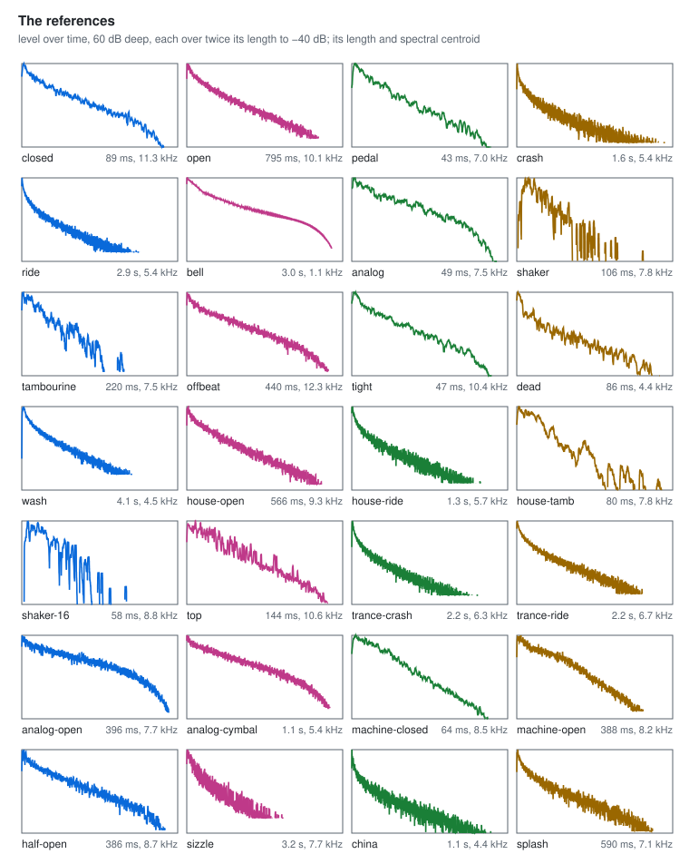

# Brightwork

A synthesizer of hi-hats, cymbals and the tops beside them, shakers and
tambourines, that renders a short text patch to a sampler-ready WAV, the same
way every time.



Brightwork synthesizes one voice from up to four noise sources and two tones:
plates of seeded modes or continuous noise in a band, square or sine
partials, highs that decay faster and bloom later, plates that slap,
collisions that rattle, and a hand or a foot that chokes them. It computes
them at 32 times the sample rate, through a tanh drive, and band-limits them
once with a frozen filter. Every render says whether it lies where its
aliasing is demonstrated below −100 dB, and every file carries the patch that
made it.

Listen to the references: the hats [closed](docs/audio/closed.wav) ·
[open](docs/audio/open.wav) · [pedal](docs/audio/pedal.wav) ·
[analog](docs/audio/analog.wav); the cymbals [crash](docs/audio/crash.wav) ·
[ride](docs/audio/ride.wav) · [bell](docs/audio/bell.wav); the tops
[shaker](docs/audio/shaker.wav) · [tambourine](docs/audio/tambourine.wav);
for house [house-open](docs/audio/house-open.wav) ·
[house-ride](docs/audio/house-ride.wav) · [house-tamb](docs/audio/house-tamb.wav);
for tech house [tight](docs/audio/tight.wav) · [top](docs/audio/top.wav) ·
[shaker-16](docs/audio/shaker-16.wav); for trance
[offbeat](docs/audio/offbeat.wav) · [trance-ride](docs/audio/trance-ride.wav) ·
[trance-crash](docs/audio/trance-crash.wav); from the machine
[analog-open](docs/audio/analog-open.wav) ·
[analog-cymbal](docs/audio/analog-cymbal.wav) ·
[machine-closed](docs/audio/machine-closed.wav) ·
[machine-open](docs/audio/machine-open.wav); and from the band
[half-open](docs/audio/half-open.wav) · [sizzle](docs/audio/sizzle.wav) ·
[china](docs/audio/china.wav) · [splash](docs/audio/splash.wav) ·
[dead](docs/audio/dead.wav) · [wash](docs/audio/wash.wav). They are matched
in loudness, and the [gallery](docs/references.md) shows each one's level,
spectrum and drive headroom.

## Features

- **The same cymbal, struck again.** The seed is the cymbal: where its modes
  lie, one in each cell of its spacing. The take is the strike: how it
  excites them. Round robins, stereo pairs and velocity layers are takes and
  softer strikes of one cymbal, never different cymbals.
- **Modes, not just noise.** A noise source is continuous noise or modes at a
  mean spacing, 14 Hz for a hi-hat, 18 Hz for a crash, so a cymbal's tail
  hums as a chord of modes. `pitch` resizes it exactly, every mode keeping its
  place and its excitation.
- **Highs that behave like metal.** Damping makes high frequencies decay
  faster, bloom makes them rise later after a hard strike, each on its own
  time map, exact on every sample; chatter gates plates that slap.
- **Rattles.** Any source can sound at a stream of collisions instead, one to
  each cell of time, thinning out as the shake dies: shakers, tambourines,
  maracas and cabasas, as loud at the peak as the source they gate.
- **A drum machine's memory.** `[storage]` stores the sound as the
  machines of the eighties stored their cymbals, a few bits deep at a few
  tens of kilohertz, then plays it back through a held DAC and a low-pass,
  the damper as its decay: exactly, on purpose, and only when asked.
- **Chokes and kits.** A damper closes every source at once, as a hand on a
  crash or a foot on the hats. `brightwork pack` writes kits of keys with
  velocity layers on a square law, round robins and choke groups, mapped by
  SFZ and checked in sfizz and liquidsfz.
- **Honest about aliasing.** Every report says whether the render lies inside
  the validated domain, why, and how much more drive it takes before it
  would leave it. `brightwork verify` checks any patch against a reference
  rendered at 128 times the base rate.
- **Levels you can trust.** A gain, a sample peak or a true peak, measured
  exactly between the samples; loudness as BS.1770's largest momentary
  value. Overs are reported, never clipped.
- **Reproducible.** A patch renders bit for bit the same on one platform with
  the same NumPy and SciPy, and every file records its patch, its take and its
  provenance; `brightwork extract` gives the patch back.
- **Live audition.** Play patches in a pattern over your groove, re-rendered
  on every save, or alternate them with the sample they should replace,
  matched in loudness, in a blind order.

## Install

Brightwork needs Python 3.12 or later.

```
uv tool install "brightwork-synth[audition]"
```

or `pipx install "brightwork-synth[audition]"`. The `audition` extra adds live
playback through sounddevice and PortAudio; without it every other command
works. From a checkout, `uv tool install ".[audition]"`.

## Quick start

```
brightwork init closed > closed.toml                           # start from a reference
brightwork audition closed.toml --watch --bpm 120 --every 1/8  # hear every save, in time
brightwork render closed.toml --out closed.wav --takes 8       # eight round robins
brightwork softer closed.toml 8 > closed-8.toml                # a softer layer
brightwork init open > open.toml
brightwork pack 42=closed.toml,closed-8.toml 46=open.toml --choke 46:42 --takes 8 --out hats/
```

The last command writes a kit: closed and open hats on their General MIDI
keys, two velocity layers of the closed hat, eight takes each, the open hat
choked by the closed one, and `hats/hats.sfz` to play it.

## Specifications

| Parameter | Value |
|---|---|
| Output | mono WAV, or stereo from two takes: float32, or 24- or 16-bit PCM with seeded TPDF dither |
| Sample rates | 44.1, 48, 88.2 and 96 kHz; the 2× rates are the base rate's files with samples filled in |
| Internal rate | 32 × the base rate: 1411.2 or 1536 kHz |
| Decimators | frozen minimum-phase, flat to 0.00004 dB up to 20 kHz and at least 115.1 dB down from half the base rate |
| Aliasing | every render reports whether it lies inside the validated domain, where the error against the reference is below −100 dB; the references take 11–47 dB of drive and stay inside |
| Sources | up to four noise sources and two tones; modes 1–200 Hz apart; 1–16 partials a tone; rattles of up to 4,000 collisions a second |
| Levels | a gain, or a sample or true peak target; nothing is ever clipped |
| True peak | read on the file's own reconstruction at 32 times the base rate, within 0.0001 dB of a 19 kHz sine's amplitude |
| Loudness | the largest momentary loudness, BS.1770's 400 ms window slid sample by sample, at every rate |
| Length | every shape ends by 8 s |
| Render time | about 0.1 s for a closed hat, under a second for a 5 s crash and 4–7 s for a kit of 96 files, on a 12-core laptop |

## Documentation

- [The references](docs/references.md): every reference, with its sound,
  level, spectrum and drive headroom.
- [User guide](docs/GUIDE.md): the workflow, every control, recipes, kits and
  chokes, audition, and reading the report.
- [Design](docs/DESIGN.md): every stage of the sound, from the code, and what
  makes a render validated and reproducible.
- [The design plan](docs/PLAN.md): the plan the code was built from, with the
  measurements behind each choice and the decisions still open.
- [Validation](docs/VALIDATION.md): the evidence, from the numerical criteria
  to the adversarial grid and the performance budget.
- [The sample-replacement benchmark](docs/BENCHMARK.md): a protocol to run
  by hand, with your own samples.
- [Changelog](CHANGELOG.md).

This is an independent codebase. It carries over the designs and findings of
the Kick Synth and the Snare/Clap Synth, which live on their own branches,
not their code.

## Contributing

Contributions are welcome. [CONTRIBUTING.md](CONTRIBUTING.md) explains how to
set up, test and propose a change.

## License

Brightwork is free software, under the [GNU General Public License](LICENSE),
version 3 or later.

The sounds you make with it are yours. An additional permission in
[NOTICE](NOTICE) lets you use the sounds Brightwork renders, the patches and
SFZ maps it writes, and its reference patches under any terms you choose, in a
track or in a sample pack you sell.
