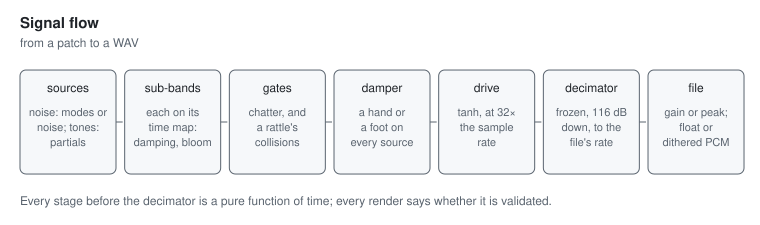
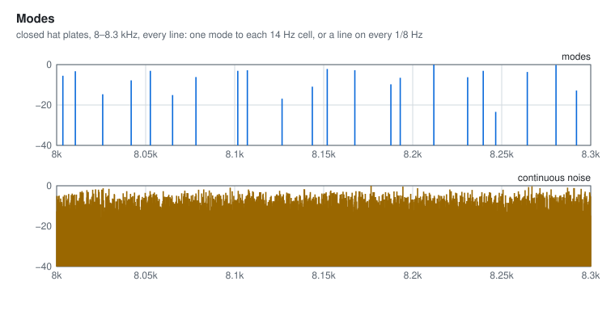
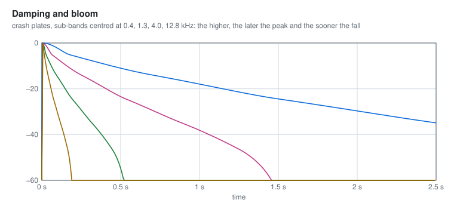
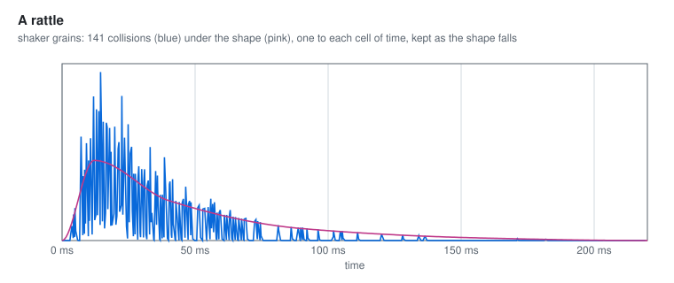
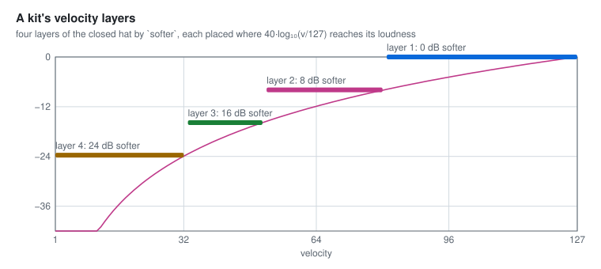

# Design

Brightwork computes one hit as a pure function of time, at 32 times the base
sample rate, through one saturator, and band-limits it once.

$$x(t)=\sum_{j}g_j\,D(t)\,G_j(t)\sum_{b}e_j\big(\tau_{jb}(t)\big)\,c_{jb}(t),\qquad y=S_\alpha(x),\qquad \mathrm{out}[m]=p\,g_{\mathrm{out}}\sum_{k}h[k]\,y\!\left(\tfrac{mK-k}{F}\right)$$

j counts the sources, noise and tones alike, each with its gain g_j. c_jb is
sub-band b of a source's carrier, a fixed spectrum of lines, and e_j∘τ_jb its
shape on that sub-band's time map, which carries damping and bloom. G_j is the
source's gate, its chatter and, if it rattles, its collisions; with storage
on, their sum is stored and played back before the damper; D is the damper; S_α the drive; h the frozen decimator of the rate's family, F the
internal rate, K the decimation factor, g_out the output gain and p the
polarity.

This page says how each stage works today. [PLAN.md](PLAN.md) keeps the plan
the code was built from, with the measurements that chose each design, what
was carried over from the kick and the snare, and the decisions still open;
[VALIDATION.md](VALIDATION.md) holds the evidence.

- [Lines on one grid](#lines-on-one-grid)
- [Noise and modes](#noise-and-modes)
- [Tones](#tones)
- [Shapes](#shapes)
- [Damping and bloom](#damping-and-bloom)
- [Chatter](#chatter)
- [Rattles](#rattles)
- [Storage](#storage)
- [The damper](#the-damper)
- [The drive](#the-drive)
- [Rates, carriers and the decimator](#rates-carriers-and-the-decimator)
- [The validated domain](#the-validated-domain)
- [Levels, sets and dynamics](#levels-sets-and-dynamics)
- [Files](#files)
- [Kits](#kits)
- [Audition](#audition)
- [Reproducibility](#reproducibility)
- [Code map](#code-map)

## Lines on one grid

Every source is a set of lines on one grid, f_k = k/8 Hz for k = 1 … 160,000,
up to 20 kHz. Every carrier is therefore periodic with a period of 8 s, and
every shape ends by 8 s, so no part of a sound ever repeats within it:
listeners hear a frozen noise repeat with ease at periods up to a second, and
trained listeners have followed repetitions ten seconds apart. A partial
sounds at the nearest 1/8 Hz, within 1.1 cents at 100 Hz; the report states
the realized frequencies.

A table holds one sub-band of a source's carrier at the table rate, twice the
base rate, from one inverse real FFT: 768,000 points for the 48 kHz family.
A table depends only on the seed, the take, the source's spectrum and band
and its sub-band layout, never on its shape, level, gates, the damper, the
drive or the output, so the commonest edits re-render without new tables.
Tables are cached.

## Noise and modes

$$c_j(t)=\gamma_j\sum_{l}\lvert H_j(f_l)\rvert\,\rho_l\cos(2\pi f_lt+\theta_l),\qquad \gamma_j^2\sum_{l}\lvert H_j(f_l)\rvert^2=\tfrac12$$

A noise source's lines depend on its `spacing_hz`:

- **0, continuous noise:** every bin is a line, with a Rayleigh amplitude and
  a uniform phase drawn from the seed and the take.
- **1–200 Hz, modes:** the grid is cut into cells of the spacing, and each
  cell holds one mode at a uniform place in it, drawn from the seed alone.
  The take draws each mode's amplitude and phase.

The band weights the lines with second-order Butterworth skirts, half power at
its edges, and γ scales them so that the mean square over takes is ½, that of
a unit sine, whatever the band: a band shapes a source and never attenuates
it. A take's own level varies with its excitation and is never renormalized.

**The cymbal and the strike.** A thin plate has a finite modal density, about
one mode every 13–35 Hz for cymbals of 10 to 20 inches, independent of
frequency. In the low and middle range an auditory band holds a handful of
them, so a cymbal's tail hums as a chord of modes; above a few kilohertz they
blur into noise, which is their limit. The seed is the cymbal: where its modes
lie. The take is the strike: how it excites them. Takes keep every mode's
frequency and draw its amplitude and phase again, as a cymbal struck twice
never rings the same way.

**Coherence.** Sources with the same spacing share their modes and their
excitation, and noise sources share one noise. Identical bands give
bit-identical carriers, editing a band reweights the same lines instead of
drawing new ones, and `pitch` scales every cell, each mode keeping its place
in it: the same cymbal, resized.

## Tones

$$c_j(t)=\gamma_j\sum_{i}a_i\sum_{n}\frac{\lvert H_j(nf_i)\rvert}{n}\,\sin\!\big(n\,(2\pi f_it+\varphi_i)\big)$$

A tone has 1–16 partials at fixed frequencies, their loudest at exactly 0 dB.
A sine partial is its fundamental alone; a square partial sums its odd
harmonics up to 20 kHz, the Fourier series of a square wave, band-limited by
construction, where a naive oscillator at 32 times the rate would alias at
−56 dB. Six squares through a band are the drum machine's metal, as in the
`analog` reference. `strike` starts every partial at zero, as struck modes
do; `free` draws its phases per take, as free-running oscillators are caught
at a trigger.

## Shapes

Every curve is a cubic Hermite curve through its knots with monotone (PCHIP)
slopes, so it never overshoots. An amplitude shape starts and ends at 0 with
zero slopes and peaks at exactly 1; its knots are at least 10 µs apart. A
peak has zero slope, so a sharp tick needs a shoulder knot within about
0.1 ms after it, and knots every 10 dB keep a decay within 0.15 dB of an
exponential. Every knot is a kink of the signal, which the validated domain
counts.

## Damping and bloom

High modes decay faster, and after a hard strike energy climbs from the struck
modes to higher ones. With f_ref the higher of a source's lower band edge and
its lowest partial, content at f plays the shape's decay (f/f_ref)^`damping`
times faster and its rise (f/f_ref)^`bloom` times slower.

This is exact. A source is split into sub-bands, centred every
1/(2·max(damping, bloom)) octaves from f_ref, whose cos² windows in log
frequency sum to exactly 1. Each sub-band plays the shape on its own time map,
its rise stretched and its decay compressed, which is again a Hermite curve
peaking at exactly 1. The closed hat's plates have 3 sub-bands and the
crash's 12; with damping and bloom at 0 a source is one table, exactly the
unsplit source.

## Chatter

$$G_j(t)=1-d\,e_j(t)\,\frac{1-\cos 2\pi f_c t}{2}$$

Half-open plates slap at their own rate, and every slap re-excites the wash.
The gate follows the source's own shape, since plates that have stopped
moving no longer touch, and stays within [1 − d, 1].

## Rattles

A source with `grains_hz` above 0 sounds only at a stream of collisions,
R(t) = a Σ β(t − t_i), as a shaker's beads or a tambourine's jingles; what
rings at each collision is the source itself.

- **One collision**, β, rises to 1 in 0.1 ms and falls through a knot every
  10 dB to −60 dB at `grain_ms`.
- **When.** Time from the trigger is cut into cells of 1/`grains_hz`, each
  holding one candidate at a uniform place in it, drawn from the seed and the
  take; the shape keeps each with its own value at that time. Collisions crowd
  at the peak of a shake and thin out as it dies away. One to a cell, never a
  Poisson stream: a Poisson stream clumps, and since overlapping collisions
  add up, one shake of a dense shaker came out 3–5 dB louder than the next.
  Sources with the same rate share their collisions, as a tambourine's jingles
  and head are struck by the same hand.
- **How strong.** Every collision is equally strong, as in Cook's PhISEM,
  where the noise each one excites carries the randomness. a gives R a mean
  square of exactly 1 at the shape's peak, computed from the statistics of
  one collision to a cell, so a rattle is as loud there as its plain source,
  and tends to it as the rate grows. Below the peak fewer collisions are
  kept, so the energy falls faster than the shape.
- **Exactly, and fast.** R is piecewise cubic. On the sample grid it is summed
  run by run: every collision segment that covers a run of 256 samples whole
  adds its cubic, re-expanded about the run's start, and the run is evaluated
  once. That is within 10⁻¹³ of summing the collisions one by one, and no
  sample depends on how the work is split.

At most 64 collisions ring at once; past that a rattle sounds as the plain
source. Every collision's knots are kinks that the validated domain counts.

## Storage

`[storage]` models the sample memory of the drum machines of the eighties,
which kept recordings of acoustic cymbals in a few bits at a few tens of
kilohertz, read them out through a DAC that holds each value, filtered them
and shaped them with a VCA. It is off at `bits = 0`, and on any patch:

- **Stored.** The sum of the gated sources, before the damper, is taken at
  every D-th internal sample, D = round(F / `rate_hz`): the storage rate is
  F / D, which the report names. Nothing filters it first, so what lies above
  half that rate folds down.
- **Quantized.** Each value is rounded to `bits` bits against the stored
  sound's own peak, without dither. The noise left sits a fixed distance
  under the peak, about 6 dB per bit, so a decaying cymbal turns grainy as it
  fades.
- **Played back.** Each value is held for one storage period and smoothed by
  a Gaussian low-pass, −3 dB at `filter_hz`, delayed by 8σ so that it never
  answers before its input. Hold and Gaussian are a closed form through erf,
  smooth and nil far above the filter's frequency, so the playback adds no
  kinks and nothing for the internal rate to alias; the sound lasts one
  period and the filter's delay longer than its sources.
- **Damped.** The damper multiplies the playback, as the machine's VCA did:
  stretching it is the decay knob.

The stored values are part of the model: `verify` plays back the very values
the render stored, since a value a hair from a rounding threshold could
round the other way at another rate. Storage then leaves the validated
domain only the damper's kinks and the drive to judge.

## The damper

The damper multiplies every source after its sub-bands, so a hand on a crash
or the foot closing the hats damps every mode at the same moment. It is 1
until its first knot and 0 after its last, where the file ends. `choke`
writes one: 1 at its time, then a knot every 10 dB down to −60 dB over the
release.

## The drive

$$S_\alpha(x)=\frac{\tanh\alpha x}{\tanh\alpha},\qquad \frac{\alpha}{\tanh\alpha}=10^{\,\mathrm{drive}/20}$$

`drive.db` is the saturator's small-signal gain, and 0 dB is exact bypass.
S is odd, and S(1) = 1 exactly. On bright content what matters is the source
level plus the drive; how much a render takes is in its report.

## Rates, carriers and the decimator

The internal rate is 32 times the base rate, 1411.2 or 1536 kHz. A table is
interpolated to it by a frozen, linear-phase windowed-sinc interpolator,
accurate to 10⁻¹³ of the carrier's RMS; the shapes apply after it, so it
never smears a transient. One frozen minimum-phase decimator per family then
filters and decimates, free of pre-ringing:

| Family | Taps | Length | Passband deviation to 20 kHz | Stopband |
|---|---|---|---|---|
| 44.1 kHz | 5,183 | 3.67 ms | 3.7·10⁻⁵ dB | 115.6 dB |
| 48 kHz | 2,891 | 1.88 ms | 1.8·10⁻⁵ dB | 115.1 dB |

Both ship as data checked by SHA-256. The 88.2 and 96 kHz files reuse their
family's internal rate with half the factor, and 176.4 and 192 kHz with a
quarter, so a 96 or 192 kHz file is exactly the 48 kHz file with the samples
between filled in.

Synthesis runs in blocks of 2¹⁸ samples aligned to the start, and the
interpolation and the decimation are matrix products in fixed blocks, each on
one thread; parallelism is across blocks. Every sample is therefore computed
the same way at any length and any split of the work. Nothing trims, fades,
high-passes or removes DC: every file starts at exactly zero and ends in the
filter's decayed tail.

## The validated domain

Every render reports whether it lies inside the validated domain, where its
error against a reference render is demonstrated below −100 dB:

$$C\,e^{-\pi^2/q_{\mathrm{knee}}}\,P+B_{\mathrm{kink}}\;\le\;10^{-5}\,P$$

P is the output peak, q_knee the largest step of the driven signal near the
saturator's knee, and C = 0.76 the constant refit on the adversarial grid.
B_kink bounds the aliasing of every knot from first principles, from the
jumps in the second and third derivatives at each knot of every sub-band,
gate, collision and the damper, carried through the saturator. The report
names the knot that contributes most, and gives the drive headroom: how much
more drive the render takes before its status changes, found from the one
render at every drive and never optimistic on the grid.

`brightwork verify` renders the reference itself, at 128 times the base rate,
checked against one at 256, and compares. The grid of 1,188 patches built from
combined corners of the valid domain, the references and their
neighbourhoods are in [VALIDATION.md](VALIDATION.md).

## Levels, sets and dynamics

`output.mode` applies `output.db` as a gain, or brings the sample peak or the
true peak to it. The true peak is read on the file's own reconstruction: the
decimator's output at every internal sample, with a parabola through each
crest. A gain-mode render over full scale is reported and refused, never
clipped; `--allow-over` writes it as float. PCM keeps its peaks 2 LSB below
full scale so that its seeded TPDF dither never clips, and leaves exact
zeros alone.

**Sets.** The takes of a render, and every file of a kit, share one gain, so
their natural balance survives; in a peak mode the loudest file sets it.
`--level-match` scales each file to its layer's first instead, and the report
flags any set spread over 1 dB. A stereo file is two takes, left and right:
the same cymbal struck twice, wide where the strikes differ and centred
where they agree.

**Dynamics.** A patch is one hit at its hardest. `softer` derives the same
cymbal struck softer: every source level falls by the decibels asked for,
before the drive, and by Hertz's contact law every rise lengthens by
v^(−1/5) and every upper band edge falls by v^(1/5), with v the softer hit's
amplitude ratio.

## Files

A WAV from Brightwork's own RIFF writer, mono or stereo, float32 or PCM. A
tone's patch carries its root note in a `smpl` chunk. A private `cymb` chunk
holds the patch text and the file's provenance: the seed and takes, the set
and file gains, the renderer, the filters' checksums and the library
versions. `brightwork extract` gives back the exact patch.

## Kits

`brightwork pack` renders keys of velocity layers, each with its takes. Within
a key, each layer's loudness relative to the loudest places it on the square
law, 40·log₁₀(v/127) dB, and its group in the SFZ map carries a curve point at
every velocity it covers, so the level follows the law across layers. Takes
play in sequence; `--choke` puts keys in a group that turns another off,
fading over the release as a closing hat damps the ring. The map has been
played in sfizz and liquidsfz, which the tests drive.

## Audition

Audition plays the exact float buffer that `render` would write, at the
patch's own rate, never resampled. Each edit starts a render tagged with a
generation; a new buffer takes over at the next hit, stale renders are
dropped, and an invalid edit leaves the last valid buffer playing. Hits fall
on a tempo grid of note values in patterns, with chokes, over a bed that
restarts on the grid, or alternate with a sample matched in loudness, in a
blind order revealed at the end.

## Reproducibility

The same patch, renderer and frozen filters give the same file bit for bit on
one platform with the same NumPy and SciPy, and the same sound elsewhere, to
within a millionth of full scale. Every random value is a pure function of the
patch, from SHAKE-256 over a key that never changes:

| Stream | Key | Gives |
|---|---|---|
| modes | `cymbal/modes/v1`, seed | where each cell's mode lies |
| strike | `cymbal/strike/v1`, seed, take | each mode's amplitude and phase |
| noise | `cymbal/noise/v1`, seed, take | each bin's amplitude and phase |
| phase | `cymbal/phase/v1`, seed, take | free partials' phases |
| grains | `cymbal/grains/v1`, seed, take | each cell's collision and whether the shape keeps it |
| dither | `cymbal/dither/v1`, seed, take | PCM dither |

The keys keep the name the instrument was designed under, `cymbal`, as do
the patch's `instrument` and the WAV chunk, so that the recorded evidence
stays the evidence for this code.

## Code map

| Module | What it holds |
|---|---|
| `spectrum.py` | the grid, the seeded streams, every source's lines and its sub-band layout |
| `carrier.py` | tables, the frozen interpolators, and carriers at any instant |
| `curve.py` | Hermite curves and their time maps |
| `rattle.py` | collisions: their draw, their strength and their exact evaluation |
| `storage.py` | storage: the stored values, their rounding, and their smooth playback |
| `voice.py` | the internal signal, the saturator, and what the validated domain needs: the knee slew and every kink |
| `render.py` | the decimators, synthesis, the validated domain and drive headroom, sets, the true peak and the report |
| `reference.py` | the reference method of `verify` and the grid |
| `loudness.py` | K-weighting and momentary loudness at every rate |
| `patch.py` | the patch: parsing, validation, the canonical form and the editing commands |
| `wav.py` | the RIFF writer and reader |
| `pack.py` | kits and their SFZ maps |
| `audition.py` | live playback |
| `cli.py` | the command line |
