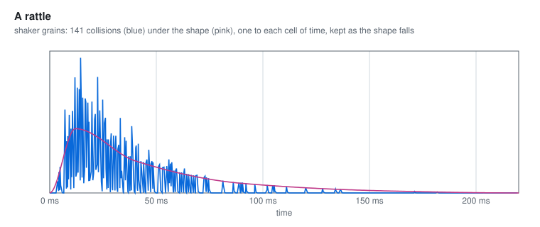
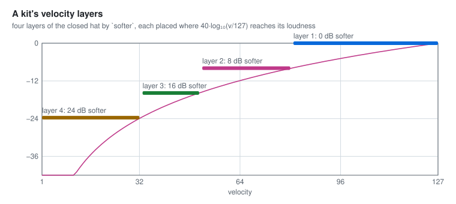

# User guide

This guide is for producers and sound designers who program hi-hats, cymbals
and tops such as shakers and tambourines. It covers the workflow, every control, recipes for common edits, kits
with chokes, and how to read what a render reports. The design and its
evidence are in [DESIGN.md](DESIGN.md) and [VALIDATION.md](VALIDATION.md).

## The workflow

1. **Start from the nearest reference.** `brightwork init closed > closed.toml`.
   There are twenty-eight, from `closed` to `splash` (below).
2. **Voice it in a pattern, over your loop.**
   `brightwork audition closed.toml open.toml --watch --bpm 120 --every 1/8 --pattern 1,1,2,1 --choke 2:1 --with groove.wav`
   plays three closed hits and an open one per half bar, the open hat choked
   by the next closed hit, over your groove, and re-renders whenever you save
   a file. Edits take over at the next hit.
3. **Match it against the sample it should replace.**
   `brightwork audition closed.toml --watch --against favourite.wav --blind --takes 8`
   alternates your render with the sample, matched in loudness, in a random
   order that audition reveals when you stop it.
4. **Derive articulations and layers.** `brightwork choke open.toml 250 > half.toml`
   closes the open hat on a beat; `brightwork stretch closed.toml all 0.7` tightens
   it; `brightwork softer closed.toml 8 > closed-8.toml` gives a softer layer.
5. **Pack the kit for the sampler.**
   `brightwork pack 42=closed.toml,closed-8.toml 44=pedal.toml 46=open.toml --choke 46:42,44 --takes 8 --out hats/`.

Every file is exact and reproducible: `brightwork extract` gives back the exact
patch of any exported file, take included. It never prints text holding
control characters, which no patch does and a terminal would act on.

## The references

[The gallery](references.md) has every reference's sound, level over time,
spectrum and drive headroom.

| Reference | What it is | Try |
|---|---|---|
| `closed` | A closed hi-hat: modes 14 Hz apart over 6–16 kHz and a stick tick, 120 ms | `stretch`, the plates' band, the tick's level |
| `open` | The open hat: the same plates ringing for 1.3 s, slapping a little (chatter) | `choke`, chatter, the damper |
| `pedal` | The foot chick: plates closing, with a darker chick in 0.9–6 kHz, 70 ms | `stretch`, the bands |
| `crash` | A crash: modes 18 Hz apart from 400 Hz, a tail that darkens and highs that bloom after the strike, 4.5 s | damping, bloom, `choke`, the band |
| `ride` | A ride: a modal wash, a stick ping and a tick, 6 s | the ping's and the wash's levels |
| `bell` | A ride bell: struck sine partials over modes, 3.5 s | `pitch` to a note, `stretch` |
| `analog` | The drum-machine hat: six square oscillators through a band, 60 ms | `pitch`, the band, `stretch` |
| `shaker` | One stroke: fine grains rattling 3 kHz a second over the shell's 3–12 kHz, beads clicking 300 a second over them, 220 ms | `grains_hz`, `grain_ms`, the shape for a slower or harder stroke |
| `tambourine` | A headless tambourine: jingles (modes 110 Hz apart over 2.5–12 kHz) ringing from the strike, then shivering as they rattle down, and the hand's tap, 450 ms | the shiver's rate and level, `choke` |
| `offbeat` | Trance's off-beat open hat: plates over 8–18 kHz, brighter and shorter than `open` (about half a second), slapping lightly | `stretch` for the tempo, `choke` on the next 16th |
| `tight` | Tech house's closed hat: plates over 5.5–14 kHz, 65 ms, shorter and darker than `closed` | `stretch`, the plates' band |
| `dead` | A damped hat, a towel over the plates: dark (2.5–10 kHz) with damping 2, its highs gone at once, 140 ms | damping, to take the towel off |
| `wash` | A ride washed with a soft mallet: a 15 ms rise, highs that swell after it (bloom 0.6), 7 s | bloom, the band, `choke` |
| `house-open` | House's off-beat open hat: darker and longer than `offbeat`, sizzling as its plates slap, about half a second | `choke` on the next 16th, chatter |
| `house-ride` | House's ride: a bright ping over a short wash, 1.2 s | the ping's level, the wash's band |
| `house-tamb` | A crisp tambourine stroke for the off-beat: jingles ringing, a short shiver, 220 ms | the shiver's `stretch` and rate |
| `shaker-16` | A short shaker stroke for sixteenths, 110 ms | `stretch`, the grains' rate |
| `top` | Tech house's top: a closed hat whose plates rattle, 200 ms | the rattle's level and rate |
| `trance-crash` | The crash on the drop: long and bright, its highs blooming, 6 s | bloom, `stretch`, `choke` |
| `trance-ride` | A driving ride: bright wash and ping, 3.5 s | the bands, the ping's level |
| `analog-open` | The analog squares, open: 450 ms | `pitch`, `stretch`, the band |
| `analog-cymbal` | The analog squares as their cymbal, through a wider band, 1.3 s | `pitch`, `stretch`, damping |
| `machine-closed` | A cymbal's closed hat stored as a drum machine stored it: 6 bits at 32 kHz, played back through an 11 kHz low-pass, the damper as its decay | `storage.bits`, the damper |
| `machine-open` | The same machine's open hat, its decay the damper | the damper's `stretch`, `storage.rate_hz` |
| `half-open` | A half-open hat: its plates slapping at 150 Hz as they touch, 500 ms | chatter, `choke` |
| `sizzle` | A ride with rivets buzzing against the plate through its wash, 6 s | the rivets' level and rate |
| `china` | A china: trashy and quick, its plates slapping, 2.4 s | the band, chatter, `choke` |
| `splash` | A splash: small, bright, modes 34 Hz apart, 900 ms | `stretch`, the band |

They are matched in loudness (−32.5 LUFS; the analog hat −33.1) and peak
below −1 dBFS, so you can compare them fairly, and they share one output
setting (−6 dB gain), so any of them combine into one kit. Short sounds read
low on a 400 ms loudness window; raise `output.db` as you need.

Without drive, the controls of each reference's main source stay inside the
validated domain, over seeds 1–4 × takes 1–4, wherever the patch accepts them
across what VALIDATION.md scans: the whole range of spacing, damping, bloom
and chatter, the band edges over octaves, and tails from a quarter to four
times as long. The one exception is the analog hat's damping above 2.5. Under
drive, the report's drive headroom says how far a take can go.

## Every control

A patch is complete: every field is required, and the renderer has no
defaults. The one exception is the source arrays, `[[noise]]` and `[[tone]]`,
which may be absent. Paths below are the ones the parser and the report use.
They count from 1: `noise[2].amp[3]` is the third knot of the second noise
source.

### Times and curves

Knot times are milliseconds from the hit, at least 10 µs apart, and every
sound ends by 8 s. Every curve is a smooth monotone cubic through its knots
(PCHIP): it never overshoots between knots.

- **Amplitude shapes** (`noise[N].amp`, `tone[N].amp`) start and end at gain
  0, and their highest point is exactly 1: the peak, where the decay starts.
  Levels are set separately, in dB.
- **Knots every 10 dB** of a decay reproduce an exponential tail closely. The
  first segment after a peak starts flat, because the peak has zero slope; for
  a sharp tick, put a **shoulder knot** about 0.1 ms after the peak, as the
  references do.
- **Every knot is a kink.** Very fast segments under loud, bright sources
  alias. The report tells you when a knot matters and which one.

### Noise sources

Up to four `[[noise]]` tables.

| Field | Range | What it does |
|---|---|---|
| `level_db` | −inf, −90 – +24 | The source's level. `-inf` silences it exactly; a silent source never lengthens the file. |
| `band_hz` | 20 ≤ low < high ≤ 20,000 | Second-order skirts, half power at the edges. Editing the band reweights the same lines; it never rerolls them. |
| `spacing_hz` | 0, or 1 – 200 | 0 is continuous noise: every line of the 1/8 Hz grid sounds, as for a stick's tick. From 1 Hz up, the source is **modes**: one per `spacing_hz` cell, at a place within its cell that the seed decides. |
| `damping` | 0 – 3 | Content at f decays (f / f_ref)^damping times faster than the shape says; f_ref is the band's lower edge. |
| `bloom` | 0 – 3 | Content at f rises (f / f_ref)^bloom times slower: the highs build up after the strike. |
| `chatter` | 0 – 1 | Gates the source at `chatter_hz` while its shape sounds, as plates that slap: 0 is off, 1 full depth. |
| `chatter_hz` | 10 – 4,000 | The gate's rate. |
| `amp` | 3 – 32 knots | The source's shape. |

**Modes.** A real cymbal's modes are about evenly dense in frequency, at its
own spacing: about 34 Hz for a 10-inch splash, 14 Hz for a 14-inch hi-hat
pair, 18 Hz for a 16-inch crash, 13 Hz for an 18-inch china and 15 Hz for a
20-inch ride. Wider spacings sound more like a chord of partials, the hum of a
cymbal's tail; denser ones like noise.

**Coherence.** Sources that share a spacing share their modes and their
excitation, and continuous-noise sources share one noise. Identical bands and
spacings give identical carriers; two identical sources at equal level sum to
+6 dB; a crossfade between two sources is a spectral morph of one cymbal.

### Tones

Up to two `[[tone]]` tables: partials that you place.

| Field | Range | What it does |
|---|---|---|
| `level_db` | −inf, −90 – +24 | The tone's level. |
| `wave` | `sine`, `square` | A square sums its odd harmonics up to 20 kHz at 1/n, band-limited by construction. |
| `phase` | `strike`, `free` | `strike`: every partial starts at zero, the same in every take, as struck modes do. `free`: phases drawn per take, as free-running oscillators. |
| `partials` | 1 – 16 | `{ hz, level_db }`, increasing by at least 1/8 Hz, 20 Hz – 20 kHz; the loudest exactly 0 dB. Each sounds at the nearest 1/8 Hz, which the report shows. |
| `band_hz`, `damping`, `bloom`, `chatter`, `chatter_hz`, `amp` | as for noise | f_ref is the higher of the band's lower edge and the lowest partial. |

`tone[1]`'s lowest partial is also the root note written into the file, so
samplers map a pitched cymbal by key.

### Damping and bloom

Higher modes of a cymbal decay faster, and after a hard strike energy moves
from the struck modes up into higher ones, so the highs build up. `damping`
and `bloom` say how much, per source, from its f_ref up. Below f_ref both are
1: the shape is exactly the decay and rise at the bottom of the source.

The renderer splits each source into sub-bands half an octave apart at
damping or bloom 1 (finer at higher values), each playing the shape on its own
time map, and crossfades them in frequency; the report gives their number.
Between two sub-band centres the decay follows the power law within about
1 dB at 20 dB down. Damping or bloom must not compress or stretch the content
at 20 kHz more than 1000 times relative to f_ref: from 20 Hz that allows 1,
from 300 Hz 1.6, from 6 kHz any value up to 3.

### Chatter

The gate is 1 − chatter · shape · (1 − cos 2π·chatter_hz·t)/2, so it follows
the source's own shape and is gone where the shape is. 100–300 Hz is plates
slapping (an open or half-open hat); at 4 kHz it becomes a roughness. It
sounds through drive and the damper like the rest of the source.

### Rattle



`grains_hz` above 0 turns a source into a rattle: it sounds only at a stream
of collisions, as a shaker's beads or a tambourine's jingles, and what rings
at each one is the source itself, its band, modes or partials.

- `grains_hz` is how many collisions a second at the shape's peak, from
  0.125, one in the longest sound, to 4,000. They thin out with the shape, so
  a shake that dies away clicks ever more sparsely.
- `grain_ms` is how long each one rings, down 60 dB: a few milliseconds for
  beads on a shell, tens of milliseconds for jingles.
- The shape is the gesture: one shake, a push and a pull, or a tambourine's
  hit and shiver. The collisions change with every take, as every shake does.
- Sources with the same `grains_hz` share their collisions, so a
  tambourine's jingles (modes) and head (a sine tone) are struck together.
- At the shape's peak a rattle is as loud as the source would be, at any
  rate; below it, fewer collisions make it fall away faster than the shape.
  At most 64 collisions may ring at once; past that it sounds as the plain
  source.

| Starting point | Source | `grains_hz` | `grain_ms` |
|---|---|---|---|
| Shaker | noise, 3–9 kHz, spacing 0, damping 0 | 500–1000 | 3–8 |
| Maraca | noise, 2–7 kHz | 200–400 | 3–5 |
| Cabasa | noise, 4–16 kHz | 1500–3000 | 1–2 |
| Tambourine jingles | modes, 2.5–12 kHz, spacing 100–150 Hz | 100–300 | 50–120 |
| Sizzle on a cymbal | a second source on the cymbal's modes | 200–400 | 10–30 |

### Storage

`[storage]` stores the whole sound as a drum machine's memory did, on
purpose: `bits` above 0 turns it on.

- `bits`, 2 to 16, is how fine each stored value is, against the sound's own
  peak: 6 bits is the TR-909's hats, about 36 dB of range, so a fading cymbal
  turns grainy as its tail sinks into the steps.
- `rate_hz`, 4 to 96 kHz, is how often the sound is stored, at the nearest
  rate the internal rate allows, which the report names. Below about 40 kHz
  the hold's images reach into hearing, and what lies above half the rate
  folds down.
- `filter_hz`, 1 to 20 kHz, is the playback low-pass, −3 dB there, gentle as
  an analog one: lower is darker.
- The damper then fades the playback, grain and all, as the machine's decay
  knob did: `brightwork stretch PATCH damper.amp 1.5` opens it.

The sources are synthesized as always and stored as they sound, so any
patch, a ride or a shaker as well as a hat, can be stored.

Played back, a stored sound comes a little after its sources, as a real
machine's does: by half a stored period and the filter's delay, 0.11 ms for
`machine-closed` and at most about 1.2 ms (4 kHz through a 1 kHz filter).
The report says how much; against other drums, place the file that much
early.

### Damper

`damper.amp` multiplies every source: 1 until damped, then down to 0 at its
last knot, where the sound ends. Empty (`amp = []`) means never damped. It is
a hand on a crash, a foot closing a hat, or with a slow fall from 0 ms a
cymbal pressed into a shorter ring. `brightwork choke` writes one for you.

### Drive

`drive.db`, 0 – 48 dB, is the small-signal gain of a tanh saturator on the sum
of all sources. 0 dB is exact bypass. On bright sources what matters is
**source level + drive**: a source at −6 dB with 24 dB of drive saturates like
one at 0 dB with 18 dB.

### Output

| Field | Values | What it does |
|---|---|---|
| `sample_rate` | 44100, 48000, 88200, 96000, 176400, 192000 | The file's rate. The 96 and 192 kHz files are exactly the 48 kHz one with samples filled in. |
| `format` | `float32`, `pcm24`, `pcm16` | PCM uses the plain PCM tag that hardware samplers read, with seeded triangular dither that leaves exact zeros alone. |
| `mode` | `gain`, `peak`, `true-peak` | Apply `db` as a gain, or scale so the sample peak is at `db` dBFS, or the true peak, between the samples, at `db` dBTP. A set or a kit shares one gain, set by its loudest file. |
| `db` | gain −60 – +24; peak and true peak −60 – 0 | See `mode`. |
| `polarity` | 1, −1 | Inverts the output. |

A gain-mode render over full scale is refused, with the reduction it needs;
`--allow-over` writes it anyway as a float file. Nothing is ever clipped. A
PCM render must peak 2 LSB below full scale so the dither never clips.

### Seed and take

`seed` is the cymbal: where its modes lie. A different seed is a different
cymbal of the same design. `take` is the strike: each take draws every mode's
amplitude and phase anew and keeps every mode's frequency, so takes are the
same cymbal struck again. `brightwork render … --takes 8` writes takes take,
take + 1, … as `closed_rr1.wav` … `closed_rr8.wav`; struck tones are the same
in every take.

The takes of a set share one gain, so their natural balance survives. Short
hits vary most: a closed hat's takes spread by up to 1.4 dB in loudness, since
over its first ten milliseconds its band holds only about a hundred degrees of
freedom, whatever its number of modes. The report flags any set that spreads
over 1 dB; `--level-match` then scales each file to the first.

**Stereo.** `--stereo` writes consecutive takes as left and right, so
`--takes 4 --stereo` writes four stereo files from eight takes. The pair is
one cymbal struck twice: wide and fully decorrelated in its random parts
(L/R correlation −0.03 on the crash), with anything the takes share, such as
struck partials, in the centre, and a mono sum that is still the cymbal.

## Editing commands

Each prints a complete patch; redirect it to a file. They rewrite points and
never add parameters, so you can always keep editing the result by hand. They
fail, and say why, rather than clamp.

- **`brightwork pitch PATCH SEMITONES|NOTE`** multiplies every frequency by one
  ratio: band edges, spacings, partials and chatter rates. Each mode keeps its
  place in its cell and its excitation, so it is the same cymbal, resized.
  Times are unchanged, unlike a sampler's repitch. A note, such as D5, puts
  `tone[1]`'s lowest partial on it. A band edge at 20 kHz cannot go up, nor one
  at 20 Hz down, so leave room where you will pitch.
- **`brightwork stretch PATCH CURVE... FACTOR [--after MS]`** rescales knot times
  after each shape's peak, or after `--after`; on the damper, from 0 ms. `all`
  names every shape and the damper, so `brightwork stretch crash.toml all 0.7`
  shortens a whole cymbal.
- **`brightwork choke PATCH MS [--release MS]`** replaces the damper: gain 1 at
  MS, knots every 10 dB over the release down to −60 dB, and 0 one step later.
  The release defaults to 40 ms, as in kits.
- **`brightwork softer PATCH DB [--contact P]`** gives the same cymbal struck DB
  softer, by two rules from the physics of a strike:
  - every source level falls by DB, before the drive, so a softer hit is also
    cleaner;
  - every rise lengthens by v^(−contact) and every source's upper band edge
    scales by v^contact, with v = 10^(−DB/20) (default 0.2: Hertz's contact
    law, a slower strike stays longer on the metal and excites less high end).

  An exponent of 0 turns the contact rule off. `softer` by a then b equals
  `softer` by a + b up to the decimals it writes.

## Recipes

These start from a reference and take at most three field edits or one
command; the test suite checks that each moves the sound the right way.

| To | Edit |
|---|---|
| Tighten or loosen a closed hat | `brightwork stretch closed.toml all 0.6` (or 1.6) |
| Darken or brighten a hat | lower or raise the plates' `band_hz`, and the tick's upper edge |
| Add stick | raise the tick source's `level_db` by 6 dB: it reaches lower than the plates |
| A ghost note | `brightwork softer closed.toml 18` |
| Shorten an open hat | `brightwork stretch open.toml all 0.6` |
| Half-open it | raise `noise[1].chatter` to 0.6, and give it a damper that falls from 1 at 0 ms to 0 at 700 ms |
| Close it on a beat | `brightwork choke open.toml 250` |
| Lengthen or choke a crash | `brightwork stretch crash.toml all 1.5`; `brightwork choke crash.toml 450` |
| Darken a crash's tail | raise `noise[1].damping` |
| More bloom | raise `noise[1].bloom` |
| A splash | raise the crash's band (`noise[1].band_hz` from 1.2 kHz) and add a damper from 1 at 200 ms to 0 at 1.2 s |
| A china | a lower band (`[400, 9000]`), `chatter` 0.7 at its 220 Hz, and a damper from 1 at 150 ms to 0 at 1.5 s |
| Add ping or wash to a ride | raise the ping source (`noise[2]`) or the wash (`noise[1]`) by 6 dB |
| Retune a bell | `brightwork pitch bell.toml D5` |
| Open the analog hat | `brightwork stretch analog.toml all 8` |
| The analog cymbal | `tone[1].band_hz` to `[3500, 18000]` and the shape's last two knots to 300 and 1200 ms |
| Retune the analog hat | `brightwork pitch analog.toml +3` |

A darker band alone can lengthen a cymbal's measured decay, because what
remains is its slow low end; the damper shortens the whole ring at once.

## Reading the report

```
sources  noise[1] 714 modes in 6000–16000 Hz, mean spacing 14.00 Hz; 3 sub-bands from 6000 Hz
         noise[2] continuous noise, 3000–18000 Hz; one band
length   120.0 ms source, 121.9 ms exported (5851 samples at 48000 Hz, float32, mono), seed 1, take 1
peak     -7.90 dBFS sample, -7.42 dBTP true
loudness -32.8 LUFS, the largest 400 ms momentary loudness (BS.1770)
domain   inside the validated domain: predicted aliasing -141 dB, margin 40.6 dB
         mostly kinks, 52% at noise[2].amp[2] (0.03 ms); drive headroom +25.6 dB
render   178 ms
```

- **sources**: each source's kind, its band, and the sub-bands it plays from
  f_ref. For modes, how many lie within the band's edges and their mean
  spacing; for tones, the partials as they sound, and for sines the lowest as
  a note.
- **length**: the source length (the latest end among the audible sources'
  sub-bands, never after the damper's last knot) and the exported length,
  which includes the decimator's decaying tail. Every file starts at exactly
  zero and ends in that tail, so a sampler needs no fades.
- **peak**: the sample peak and the true peak, the highest point between the samples as a converter plays them, measured exactly. Bright hats peak up to 1.5 dB above their samples.
- **loudness**: the largest K-weighted 400 ms momentary loudness over every
  window position (ITU-R BS.1770), in LUFS, channels summed. Short sounds read
  low, because the window spreads their energy over 400 ms.
- **domain**: the renderer's own prediction of its aliasing error, relative
  to the peak. Inside means at most −100 dB: the adversarial grid has
  demonstrated that every render it calls inside measures below −100 dB
  (VALIDATION.md). Outside, the render is still defined and exact, but
  unvalidated; `brightwork verify` measures its actual error against a reference
  render.
- **The line under it** says what dominates the prediction:
  - *mostly kinks, 52% at noise[2].amp[2] (0.03 ms)*: a fast segment around
    that knot under a loud, bright source. Lengthen the rise around it, or
    lower that source.
  - *mostly saturation*: the drive on a loud, bright source. Lower the drive,
    the level, or the source's upper band edge.

  The **drive headroom** is how much more drive the take stands before its
  status changes. Outside, it is negative and the line says what to lower
  `drive.db` to. It is exact or cautious, never optimistic.
- **files** (with `--takes` or `--stereo`): the set gain, the loudness and
  peak spread, and each file's levels and each take's domain status. Each
  take, and so each channel of a pair, is judged on its own render.

## Audition

`brightwork audition PATCH... [--watch] [--bpm BPM] [--every NOTE] [--pattern N,…] [--choke A:B,…] [--release MS] [--with BED] [--against SAMPLE] [--blind] [--takes N] [--stereo]`

- It plays exactly the buffer `render` writes; PCM formats add only their
  quantization. It opens the device at the patch's sample rate and never
  resamples.
- `--watch` re-renders on every save. Each edit is a numbered generation;
  stale renders are dropped, an invalid edit keeps the last valid buffer
  playing, and a new buffer takes over at the next hit of its patch.
- Without a tempo, hits repeat every rendered length plus 0.5 s. With `--bpm`
  they land on a grid of `--every` note values, from `1/32` to `4/1` (default
  `1/4`): hats on `1/8` or `1/16`, a ride on `1/4`, a crash on `4/1`, once
  every four bars. Tails overlap and sum.
- `--pattern 1,1,2,0` names the patch of each step, numbered in command order,
  0 for a rest; without a pattern, patches take turns hit by hit. Each patch's
  takes cycle over its own hits.
- `--choke 2:1` makes patch 2 choked by patch 1: a hit of patch 1 fades every
  patch-2 hit still sounding over `--release` ms (default 40), with the curve
  `brightwork choke` writes, as a kit asks its sampler to.
- `--with BED` loops a bed under the hits. It must be at the patch's rate and
  within 1 ms of a whole number of bars; it restarts on the tempo grid, so it
  never drifts. A stereo bed opens a stereo stream with mono hits in the
  centre.
- `--against SAMPLE` alternates the render with a sample, hit by hit, the
  sample matched to the render's loudness and rematched on every re-render.
  With `--blind` each pair plays in random order, revealed when you stop.
- `--takes N` cycles takes; the first plays as soon as it is ready while the
  others render behind it. `--stereo` plays take pairs, and a stereo sample in
  stereo; otherwise a stereo sample plays as its mid channel.
- It warns when the matched sample, or the hits over the bed, would clip the
  device.

## Kits



`brightwork pack KEY=PATCH[,PATCH…]… --out DIR [--takes N] [--stereo] [--level-match] [--choke KEY:KEY,…]… [--release MS]`
renders a multisampled kit. Each `KEY=` group is one articulation on one key;
its patches are velocity layers, loudest first, each with N takes (file j of a
layer plays its patch's take + j − 1, or with `--stereo` a pair).

- The patches must share their output settings, and within a key their
  loudness must fall from each layer to the next. `softer` makes such ladders.
- Every file of the kit shares one gain, so layers and articulations keep
  their natural balance.
- Files are named `<key>_<stem>_v<top velocity>_rr<take>.wav`, such as
  `42_closed_v127_rr1.wav`, so they also map by hand in samplers that do not
  read SFZ. A patch or folder whose name a sampler would read as part of the
  map, one holding `<`, `>`, `=`, `$`, a backslash, a comment's start, a
  control character or a line break, or beginning or ending with a space, is
  refused: rename it.
- `<DIR>/<DIR>.sfz` maps them. Velocity follows a square law,
  40·log₁₀(v/127) dB, per key: a layer's velocities run up to its own, where
  the law reaches its loudness relative to the key's loudest, and its group
  carries a curve point at every velocity below it, so the level follows the
  law across layer boundaries and no velocity plays a take louder than it was
  rendered. Takes cycle in sequence,
  every sample plays through, and nothing transposes.
- **Chokes.** `--choke 46:42,44` puts keys 42 and 44 in one group and turns
  key 46 off whenever either plays, fading over the release rather than
  cutting (`off_mode=normal`, `ampeg_release`), since a closing hat damps the
  ring in milliseconds. A key can belong to one choke group only; rules that
  would need two are refused. Players' release curves differ in detail.
- The kit report lists each key's layers with loudness, velocity range, take
  spread and domain status, and its chokes.

The General MIDI keys are the natural map: 42 closed hi-hat, 44 pedal, 46
open, 49 and 57 crash, 51 and 59 ride, 53 ride bell, 52 china, 55 splash. Kits
have been checked in sfizz and liquidsfz (VALIDATION.md).

### In a DAW

- **One file.** Every WAV works on its own: drop it on a drum pad or a
  sampler. A patch with a tone carries its root key in a `smpl` chunk, so
  samplers map it to its note; noise alone has no pitch, and no root key.
  Hats choke each other only if the pads do: put the closed, pedal and open
  hats in one choke group, as Ableton Live's Drum Rack calls it, or the same
  cut group in FL Studio.
- **A kit.** The SFZ map that `pack` writes plays the whole kit as one
  instrument, velocity layers, round robins and chokes included, in any SFZ
  player loaded on an instrument track, such as the free sfizz or
  Sforzando, both of which run as plugins in FL Studio, Ableton Live and
  Logic Pro. The map names its samples by file name, so keep it in its
  folder beside them, as `pack` writes it. The levels follow the square law
  across layers from the map itself, so a pattern's velocities play as
  written.
- **Keys.** The map uses General MIDI's numbers, so drum patterns and pad
  controllers find the hats where they expect them. Brightwork names notes as
  scientific pitch does, with middle C, key 60, as C4: key 42, the closed
  hat, is F#2. DAWs that call middle C C3, such as Ableton Live, Cubase and
  Logic Pro, call it F#1.

### With Ballast and Halyard

The references sit at −32.5 LUFS so they compare fairly with each other,
which leaves them some 24 dB under Ballast's kicks, which peak at −1 dBTP.
For a working balance, set the kick's `output.db` to −10 and raise each
reference's `output.db` by the amount below: in a groove at the genre's tempo,
a hat, shaker, tambourine or ride on the offbeats then reads 10 dB under the
kick by loudness, a crash, splash or china struck once in two bars 6 dB
under, Halyard's snares and claps, raised as its guide says, 5 dB under, and
no file peaks above −1 dBFS. Each was measured against the Ballast preset of
its genre; it is a starting balance, and your ears and the track decide the
rest.

| Reference | Against Ballast's | Played | Raise `output.db` by | Note |
|---|---|---|---|---|
| `closed` | `house` | offbeats, 10 dB under | +5.6 dB | |
| `open` | `house` | offbeats, 10 dB under | +5.4 dB | |
| `pedal` | `house` | offbeats, 10 dB under | +4.9 dB | |
| `crash` | `house` | once per two bars, 6 dB under | +9.3 dB | |
| `ride` | `house` | offbeats, 10 dB under | +5.2 dB | |
| `bell` | `house` | offbeats, 10 dB under | +3.6 dB | |
| `analog` | `house` | offbeats, 10 dB under | +5.3 dB | 0.7 dB short, held at −1 dBFS by its peak |
| `shaker` | `house` | offbeats, 10 dB under | +5.3 dB | |
| `tambourine` | `house` | offbeats, 10 dB under | +5.2 dB | |
| `offbeat` | `trance` | offbeats, 10 dB under | +4.0 dB | |
| `tight` | `tech-house` | offbeats, 10 dB under | +4.8 dB | |
| `dead` | `house` | offbeats, 10 dB under | +5.7 dB | |
| `wash` | `house` | offbeats, 10 dB under | +5.0 dB | |
| `house-open` | `house` | offbeats, 10 dB under | +5.4 dB | |
| `house-ride` | `house` | offbeats, 10 dB under | +5.2 dB | |
| `house-tamb` | `house` | offbeats, 10 dB under | +4.9 dB | |
| `shaker-16` | `tech-house` | offbeats, 10 dB under | +4.7 dB | |
| `top` | `tech-house` | offbeats, 10 dB under | +4.4 dB | |
| `trance-crash` | `trance` | once per two bars, 6 dB under | +7.9 dB | |
| `trance-ride` | `trance` | offbeats, 10 dB under | +3.8 dB | |
| `analog-open` | `house` | offbeats, 10 dB under | +5.4 dB | |
| `analog-cymbal` | `house` | once per two bars, 6 dB under | +9.3 dB | |
| `machine-closed` | `house` | offbeats, 10 dB under | +5.4 dB | |
| `machine-open` | `house` | offbeats, 10 dB under | +5.3 dB | |
| `half-open` | `house` | offbeats, 10 dB under | +5.4 dB | |
| `sizzle` | `house` | offbeats, 10 dB under | +5.3 dB | |
| `china` | `house` | once per two bars, 6 dB under | +8.5 dB | 0.8 dB short, held at −1 dBFS by its peak |
| `splash` | `house` | once per two bars, 6 dB under | +9.1 dB | |

## Python API

The modules are importable for scripting renders and kits:

```python
from brightwork_synth import cli, pack, patch, render

hat = patch.loads(cli.reference_text("closed"))  # or patch.load("hat.toml"); raises patch.PatchError
hat = patch.pitch(hat, "-2")  # every editing command is a function that returns a new patch
audio, report = render.render_takes(hat, 4)  # four takes sharing one gain, float32 arrays
print(report)
if not report.over:
    for a, f in zip(audio, report.files, strict=True):
        render.export(f"hat_rr{f.number}.wav", a, hat, report, f)  # with the patch and its provenance
```

`render.render(p)` renders one take. A kit is built, checked, then written:

```python
from brightwork_synth import cli, pack, patch

closed = patch.loads(cli.reference_text("closed"))
soft = patch.softer(closed, 8)
opened = patch.loads(cli.reference_text("open"))
groups = [(42, [("closed", closed), ("closed-8", soft)]), (46, [("open", opened)])]
kit = pack.build(groups, pack.Options(takes=4, chokes=((46, (42,)),)), stem="hats")  # raises pack.PackError
print("\n".join(kit.lines("hats")))
if not pack.over(kit):
    pack.write(kit, "hats")  # the WAVs and hats/hats.sfz
```

## Outside the family

- Gongs and tam-tams, whose pitch glides and whose tails outlast 8 s; bells,
  cowbells and other tuned metal (a tone can make them, but no reference
  covers them).
- Performance: rolls, swells, bowing, brushes and the continuous pedal of an
  electronic hi-hat. One patch is one hit; openness is a set of articulations
  and dynamics are velocity layers.
- Sounds defined by processing: rooms and reverb, and filtering after the
  fact. A drum machine's sample memory is in the family: see Storage.
- FM or wavetable metallics, though coherent sources can approach them.
