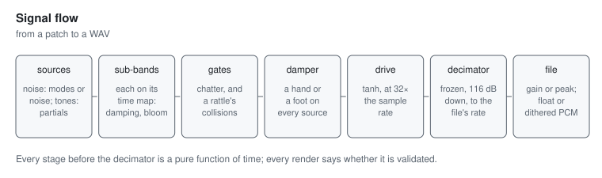
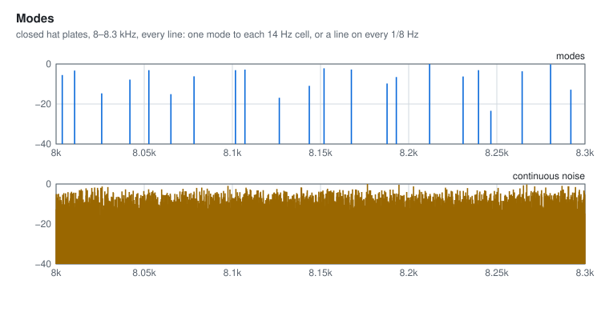
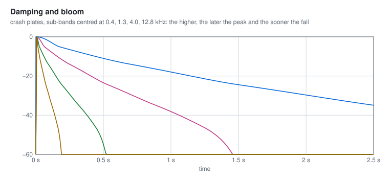
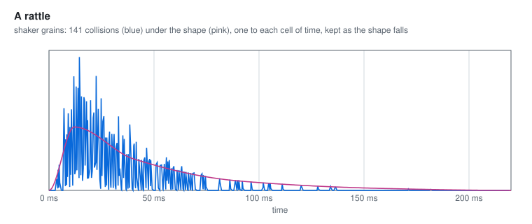
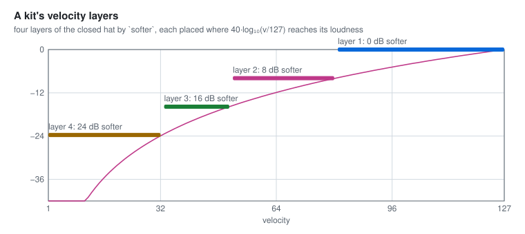

# Brightwork — Design and Implementation Plan

*Revision 1. Follows the Kick Synth (plan revision 2), which was implemented, validated and approved by ear, and the Snare/Clap Synth (plan revision 4), which was implemented and validated by measurement and awaits its listening approval. This is an independent codebase on its own branch: it carries over their designs and findings, not their code.*

The architecture has now held up twice. Every synthesis stage is a pure function of time, curves and noise are exact, one saturator feeds one frozen decimator, patches are strict and complete, and the validated domain is measured. This plan keeps all of it and adapts it to the longest, brightest and most intricate sounds in a kit, for professionals who program hi-hats and cymbals in a DAW or a sampler.

Three things are new. Each is forced by the physics of a cymbal rather than chosen:

- **A cymbal is made of modes, not noise.** A thin plate has a finite modal density: about one mode every 13–35 Hz for bronze cymbals of 10–20 inches (estimated). In the low and middle range the ear resolves a handful of them per auditory band, so a cymbal's tail is a chord of modes, not a hiss. Noise sources are therefore made of seeded modes at a chosen density, and continuous noise is their limit.
- **The spectrum moves.** High modes decay faster than low ones, and after a hard strike the high partials build up. One exponent each, `damping` and `bloom`, expresses both, and the result is computed exactly: each source is split into sub-bands whose shapes are the source's own shape read on mapped time.
- **Tails are long.** A crash rings for seconds. The snare's 1 s noise period would be heard repeating in it, so the spectral grid is 1/8 Hz and nothing repeats within the longest sound, 8 s. Tables are computed at twice the base rate and interpolated to the internal rate by a frozen filter.

Values marked *measured* come from three sources:

- the snare's implementation and its validation record;
- the snare's engine, which implements the validated-domain rule and the reference method, run on cymbal bands and attacks;
- prototypes of this plan's new parts: the interpolator, the sub-band layout, band-limited oscillator banks and the cost of long renders.

Values marked *estimated* are derived from those or from the physics, and this project's own grid and benchmark confirm or replace them.

What makes this a state-of-the-art instrument is not a bigger model:

- **Measured aliasing.** Every render states whether it lies where its aliasing is demonstrated below −100 dB, by how much, and how much more drive it would take to leave.
- **Exact reproducibility.** A render is exact at every sample rate and depends only on its patch: the cymbal, which is its seed, and the strike, which is its take.
- **Few controls, each physically motivated.** They cover the family: seeded modes at a chosen density, a decay and a build-up that depend on frequency, plates that chatter, a damper, and analog oscillator banks that are band-limited by construction.
- **Built for production.** It delivers kits of articulations with choke groups, velocity layers, round robins that keep the cymbal and vary the strike, and stereo from pairs of takes, in formats that samplers load directly. You audition in patterns and chokes, in context and against your own samples.

On the goal of never needing another cymbal or hi-hat sample: no plan can guarantee that. What a plan can do is make the claim testable for a declared family of sounds and show exactly where it fails. That test is the final gate (§8.5).

## What the snare taught us

| Finding, measured on the snare | Consequence here |
|---|---|
| **K = 32 was needed and enough.** At 16× the crack reference's 30 µs stick kept only 1.7 dB of drive headroom. At 32× every reference kept at least 16 dB, all 654 grid fixtures inside the validated domain passed (the worst at −113.9 dB), and 64× was not needed. | Cymbals are brighter. On the snare's engine a 6–16 kHz band leaves the domain about 4 dB earlier than the snare's 2–9 kHz wires, and a 10 µs rise under full-scale hat noise is marginal even at 32× (§3). K was measured again on this grid, and is 32 again. |
| **The rule's constant fell from the kick's 2 to 0.419 and was frozen at 0.5.** The domain barely depends on it, since near the edge the prediction moves 11–12 dB per dB of drive. | C starts at 0.5 and is refit on this grid (§5). |
| **The kink bound was never exceeded**, driven or not. It sits at least 3.8 dB above the measured error, a structural gap set by its band B = base/2. | The bound carries over, extended to sub-bands, chatter and the damper (§5). |
| **The drive headroom was never optimistic**, on 957 fixtures and 92,524 full renders. | Its method carries over unchanged (§5). |
| **All 145 unconverged references were driven corners**, and the rule put none of them inside. | The same convergence test applies. Long fixtures cost more at the reference rate, so most fixtures stay under 1 s and a separate family covers 8 s (§8.3). |
| **Take spreads stayed within 0.77 dB.** Short, narrow events varied most. | Hats are short but wide, and a dense source averages over many modes, while sparse modes vary more. The same criterion is measured (§7.1). |
| **The snap's 25.6 dB crest set every reference at −27 LUFS**, the loudest level at which every take peaks below −1 dBFS. | The references are matched the same way (§8.4). The analog hat set the level here, its 60 ms of square partials having the highest crest of the seven: −32.5 LUFS, with the analog hat itself at −33.1. |
| **Noise tables took about 25 ms each at 32×**, for 1 s at F, one transform each in threads, and cached. | An 8 s table at F would hold 12.3 million samples, 98 MB, for every sub-band, whatever the sound's length. Tables are computed at 2 × base and interpolated (§3). |
| **Carriers at knots, interpolated from the tables, were ten times less accurate than the plan estimated**: 1.6·10⁻⁶ of the RMS in value and 10⁻⁴ in slope. That is still far inside the kink bound's 1% margin. | The measured figures are quoted, and the margin is kept (§5). |
| **The report cost about 40 ms per render**, once the probes shared one window of the saturator's input. | The report grows with length only through the knee record, the peak probes and the loudness (§3). |
| **28 random fixtures were silent and tested nothing.** | The random family always sounds at least one source (§8.3). |
| **Three usability measurements had to be replaced.** A span and a crest proved fragile; the energy centroid time and the level after a fixed time did not. | The usability tasks start from those measurements (§8.4). |
| **A closed pipe left packs half-written** when the CLI printed before writing. | Every file is written before anything is printed (§9). |

## Changes from the snare

| Snare | Cymbal | Why |
|---|---|---|
| A modal body: up to four modes and one glide | No body. Tones: up to two banks of up to 16 partials at fixed frequencies, sines or band-limited squares | A cymbal has no head. A bell or a ping is a few strong modes, analog metal is a bank of square oscillators, and a cymbal's glide is small |
| Noise: 20,000 components 1 Hz apart, period 1 s | One spectral grid for everything: 160,000 bins 1/8 Hz apart, period 8 s | Listeners hear repeated noise at periods of 1–2 s and beyond, and a crash's tail lasts seconds |
| Noise tables at F | Tables at 2 × base, interpolated to F by a frozen filter | An 8 s table at F costs 98 MB and a 12.3-million-point transform for every sub-band |
| Continuous noise | Noise sources made of seeded modes at a mean spacing; continuous noise when the spacing is 0 | A cymbal's modes are countable, and its tail is a chord of them |
| The seed is the take | The seed is the cymbal: where its modes lie. The take is the strike: their amplitudes and phases | A cymbal struck again keeps its modes |
| Decay compression on the body's modes | Damping and bloom on every source, over sub-bands | The moving spectrum is what defines a cymbal |
| Rattle at the body's fundamental | Chatter at its own rate | Half-open plates slap at their own rate, and there is no head |
| — | A damper that multiplies every source | A hand or a closing hi-hat damps every mode at once |
| A noise layer's level applies after its band | Every source's level applies after its band | A band shapes a source; it never attenuates it |
| At most 1 s of noise and 2 s of body | At most 8 s | Crash and ride tails |
| `tune`, `stretch`, `bursts`, `softer` | `pitch`, `stretch`, `choke`, `softer` | Cymbals are resized and choked; claps are not in the family |
| Packs on one key | Kits: several keys, each with velocity layers and takes, and choke groups | A hi-hat is several articulations of one instrument |
| Mono | Mono, or two takes as a stereo pair | Cymbals are usually recorded and used in stereo |
| Audition on the backbeat | Also on subdivisions, in patterns and with chokes | Hats are judged in patterns |
| Six references | Thirteen | The family is wider, reaches the tops, and is voiced along the vision |

---

## 1. Scope

The instrument has one voice. Up to four noise sources and two tones are summed into one saturator, band-limited once, and rendered offline to a mono WAV, or to a stereo WAV made of two takes.

It is built for producers and sound designers who program hi-hats, cymbals and the tops of a groove in a DAW or a sampler: first the producers of house, tech house and trance, whose kick leads the mix and whose tops carry its groove, and from there along one axis, from the programmed machine to the played band. It renders one-shots, sets of round-robin takes, and kits: articulations on several keys, each with velocity layers, and choke groups that a sampler plays.

Its family is synthesized hi-hats and cymbals: closed, open, half-open and pedal hi-hats; crash, splash and china cymbals; rides and ride bells; and the analog metallic hats and cymbals of drum machines. With rattles (§2.12) it reaches the tops beside them: shakers, tambourines, maracas and cabasas. Thirteen reference patches define acceptance:

- **Closed:** tight, bright plates with a stick tick.
- **Open:** plates that ring and sizzle.
- **Pedal:** the plates closed by the foot; a short, darker chick.
- **Crash:** a bright wash that blooms after the strike and darkens as it decays.
- **Ride:** a defined ping over a sustained wash.
- **Bell:** a ride's bell; a few strong partials, long and clearly pitched.
- **Analog:** six square oscillators through a band; a drum machine's closed hat.
- **Shaker:** one stroke of a shaker: fine grains rattling against the shell, larger beads clicking over them.
- **Tambourine:** a hand on a headless tambourine: the jingles ring from the strike, then shiver as they rattle down.

Four more are voiced for the producers the plan serves first, and for the two ends of the axis from the programmed machine to the played band:

- **Off-beat:** trance's off-beat open hat: airy and brighter than the open hat, ringing about half a second, the plates slapping lightly.
- **Tight:** tech house's closed hat: shorter and a little darker than the closed reference.
- **Dead:** the played end's damped hat, as with a towel over the plates: dark, its highs gone at once.
- **Wash:** the shoegaze end's ride, washed with a soft mallet: the highs swell after the strike and ring for seconds.

These are starting patches. Their names never select hidden algorithms.

Six things are outside the model or the family:

- Gongs and tam-tams, whose pitch glides and whose tails outlast 8 s. Bells, cowbells and other tuned metal are also out of family: a tone can make them, but no reference covers them.
- Performance: rolls, swells, bowing, brushes, and the continuous pedal of an electronic hi-hat. One patch is one hit. Openness is a set of articulations, and dynamics are velocity layers (§2.11).
- Sounds defined by processing or storage: rooms and reverb, filtering after the fact, and the 6-bit samples of machines such as the TR-909, whose cymbals are recordings of acoustic cymbals played through low-resolution memory. Their acoustic source is in the family; their playback character is not.
- Rivet and sizzle cymbals, whose rivets buzz against the plate. A rattle on a cymbal's modes can approach them (§2.12), but no reference covers them.
- FM and wavetable metallics, whose spectra follow a moving modulation index or a table. Coherent sources can approach them.
- A real-time plugin. The renderer is a pure function of the patch; it takes about 0.2 s for a closed hat and under 2 s for an 8 s ride (estimated). A later frontend could render on every edit and play cached buffers from MIDI. That frontend is not part of this plan.

The priority order stays Correctness → Minimalism → Elegance.

## 2. Sound model

The whole instrument fits in three lines:

$$x(t)=\sum_{j}g_j\,D(t)\,G_j(t)\sum_{b=0}^{B_j}e_j\big(\tau_{jb}(t)\big)\,c_{jb}(t),\qquad y(t)=S_\alpha\big(x(t)\big),\qquad \mathrm{out}[m]=p\,g_{\mathrm{out}}\sum_{k=0}^{L-1}h[k]\,y\!\left(\tfrac{mK-k}{F}\right)$$

The symbols:

- j counts the sources, noise and tones alike, and g_j is a source's gain.
- c_jb is sub-band b of the source's carrier: a fixed spectrum of lines on the grid (§2.3), weighted by the sub-band's window.
- e_j is the source's shape, and τ_jb the sub-band's time map, which carries damping and bloom (§2.6).
- G_j is the source's gate: its chatter gate (§2.7) times its collisions R_j when it rattles (§2.12). D is the damper (§2.8).
- S_α, h, F, K, g_out and p are the snare's: the saturator, the frozen decimator of length L, the internal rate, the decimation factor, the output gain and the polarity.

Everything before the decimator is a pure function of time, with no state.



**Why a signal model.** Physical models of cymbals and hi-hats solve the nonlinear plate equations and reproduce the cascade itself (Bilbao; Ducceschi and Touzé; Sekiguchi and Samejima). They are the reference for what a cymbal does. But their sound depends on the grid they are solved on, they cost far more to run, and their controls are thickness, curvature and material rather than what a producer edits. This plan takes their findings as the laws its signal model obeys: a finite modal density, damping that rises with frequency, and a build-up after hard strikes. It then renders that model exactly.

### 2.1 Time

As in the snare: the trigger is at t = 0, knot times are milliseconds ≥ 0, and internal sample n lies at t_n = n/F, computed by division and never accumulated.

### 2.2 Curves

As in the snare, with two differences: there is no pitch curve, and there is one damper curve (§2.8). Every curve is a cubic Hermite curve through its knots, with PCHIP slopes: the weighted harmonic mean at interior knots and the shape-preserving three-point rule at the ends, with overrides applied first.

- **Amplitude shapes** start and end at 0 with zero end slopes, and peak at exactly 1.
- **The damper** has no knots, or starts at exactly 1 and ends at exactly 0, with zero end slopes, and never increases.

The monotonicity proof carries over, so amplitudes stay within [0, 1]. The snare's authoring guidance for transients holds too. A peak has zero slope, so a crack or a tick needs a shoulder knot within about 0.1 ms after its peak, and knots every 10 dB of a decay stay within 0.15 dB of an exponential (measured on the kick). Every knot is a kink (§5).

**Time maps.** A shape read at a piecewise-linear time map is again a Hermite curve. The rise is stretched by r from the shape's onset t₀, its first knot, and the decay compressed by s: knots up to the peak move to t₀ + r·(t_k − t₀) with slopes divided by r, and knots after it move to t₀ + r·(t_pk − t₀) + (t_k − t_pk)/s with slopes multiplied by s. Each segment is the original segment read at the mapped time, so:

- the onset stays where it was, and the peak is still exactly 1, now at t₀ + r·(t_pk − t₀);
- every segment stays monotone within [0, 1];
- the result is C¹, because the peak's slope is zero;
- jumps in the second and third derivatives scale by r⁻² and r⁻³ on the rise and by s² and s³ on the decay. At the peak, the stretched rise joins the compressed decay, and the kink bound takes both sides (§5).

This generalizes the snare's decay compression, which is the case r = 1. As there, it is chosen over powers of a shape, whose third derivative can be singular where the shape touches zero.

### 2.3 The spectral grid

Every source is a set of lines on one grid:

$$f_k=\tfrac{k}{8}\ \mathrm{Hz},\qquad k=1\ldots160{,}000\quad(\text{up to } 20\ \mathrm{kHz})$$

Every carrier is therefore periodic with period T = 8 s. Every shape ends by 8 s, so no part of a sound ever repeats within it.

**Why 8 s.** The snare's 1 s period is inaudible in a snare, whose noise ends within it. A cymbal's tail lasts seconds:

- listeners hear a frozen noise repeat with ease at periods up to 1 s, and with difficulty up to 2 s (Guttman and Julesz);
- trained listeners have tapped along to repetitions 10 s apart (Warren et al.).

A period at least as long as the longest sound removes the question. The 8 s covers crash and ride samples as they are used; 16 s is an open decision (§11).

**Resolution.** A partial sounds at the nearest multiple of 1/8 Hz, at most 1/16 Hz away: 1.1 cents at 100 Hz, 0.11 cents at 1 kHz. The report states the realized frequencies.

**Exact samples** come from one inverse real FFT per table, at the table rate R = 2 × base: 705,600 points at 88.2 kHz or 768,000 at 96 kHz, taking 22 ms and 6 MB (measured). The carrier at F is interpolated from the table (§3).

### 2.4 Noise sources

$$c_j(t)=\gamma_j\sum_{l}\lvert H_j(f_l)\rvert\,\rho_l\cos(2\pi f_lt+\theta_l),\qquad \gamma_j^2\sum_{l}\lvert H_j(f_l)\rvert^2=\tfrac12$$

The lines l depend on the spacing:

- **Spacing 0, continuous noise.** Every bin is a line. Its amplitude and phase come from the noise stream, keyed by the seed and the take.
- **Spacing s ≥ 1 Hz, modes.** The grid is divided into cells: cell i is the run of whole bins in (i·s, (i + 1)·s]. Each cell holds one mode, at the bin nearest to s·(i + u_i), kept within the cell; u_i is uniform on [0, 1) and drawn from the modes stream, which is keyed by the seed alone. A mode whose place lies above 20 kHz is left out. Its amplitude and phase come from the strike stream, keyed by the seed and the take. Each cell has at least 8 bins, so two modes never share one.

Amplitudes ρ are Rayleigh with mean square 2, and phases θ are uniform, made as in the snare: SHAKE-256 over a domain-separated key yields two 53-bit uniforms, and our own Box–Muller map turns them into ρ and θ. Each band |H_j| uses the snare's second-order Butterworth skirts, with half-power points at the band edges.

**Calibration.** γ_j is computed from the source's own lines, weighted by its band, so the mean square over takes is exactly ½, that of a unit sine, for every cymbal. Realizations are never renormalized, and a take's own level varies with its excitation.

**Why modes.** A thin plate's modal density is n(f) = √3·S/(h·c_L), independent of frequency (Cremer and Heckl). Here S is the area, h the thickness and c_L the plate's longitudinal wave speed, about 3,800 m/s in bronze. For typical weights (estimated):

| Cymbal | Mean mode spacing |
|---|---|
| 10-inch splash | 34 Hz |
| 14-inch hi-hat pair | 14 Hz (25 Hz top, 33 Hz bottom) |
| 16-inch crash | 18 Hz |
| 18-inch china | 13 Hz |
| 20-inch ride | 15 Hz |

The dome's curvature raises the lowest modes, not the density above them. An auditory filter is one ERB wide (Glasberg and Moore), so at 16 Hz spacing it holds about 5 modes at 500 Hz, 8 at 1 kHz, 28 at 4 kHz and 55 at 8 kHz. In the low and middle range the ear therefore hears a chord of modes, the hum of a cymbal's tail. Above a few kilohertz the modes are too dense per band to separate. Continuous noise is the limit of infinite density, and it suits the stick's tick.

**Coherence.** Sources that share a spacing share their modes and excitation, and noise sources share one noise. So:

- identical bands and spacings give bit-identical carriers;
- a crossfade between two such sources is a spectral morph of one cymbal;
- editing a band reweights the same lines instead of rerolling them;
- `pitch` scales every cell, and each mode keeps its place in its cell and its excitation: the same cymbal, resized (§4).

**The strike varies, the cymbal stays.** Struck hard, the plate vibrates in its weakly nonlinear or chaotic regime (Chaigne, Touzé and Thomas); struck softly, it still never meets the stick twice on the same spot. Either way, each strike distributes its energy among the modes differently. The modes themselves are the cymbal's geometry. Each take therefore draws every mode's amplitude and phase anew and keeps every mode's frequency. A different seed is a different cymbal of the same design.



**One mode per cell.** Positions within cells are uniform, so spacings range from nearly 0 to twice the mean, and no gap is wider than two cells.

**Short events vary most.** On the snare, snare-like hits varied by 0.05–0.2 dB between takes, and 12–30 ms snaps by 1.4–3.1 dB. A hat is short but wide: a closed hat over 6–16 kHz draws on some 700 modes at 14 Hz spacing, so its spread was estimated to be small. Measured, it is not: over takes 1–8 of seeds 1–4, the closed reference varies by 0.8–1.4 dB, the pedal by up to 1.9 dB and the analog hat by up to 1.5 dB. A short hit's loudness depends on the time–bandwidth product of its effective length, not on its number of modes: over its first ten milliseconds or so, 10 kHz of band gives about a hundred degrees of freedom, whether it is made of modes or of continuous noise (0.3–0.5 dB standard deviation either way, measured). Long sounds vary less: the open hat, crash and ride by 0.6–0.7 dB, the bell by 0.07 dB. Delivery keeps one gain per set, offers level matching, and the report flags these sets (§7.1).

### 2.5 Tones

$$c_j(t)=\gamma_j\sum_{i}a_i\sum_{n}\frac{\lvert H_j(nf_i)\rvert}{n}\,\sin\!\big(n\,(2\pi f_it+\varphi_i)\big),\qquad a_i=10^{\,\mathrm{level}_i/20}$$

- **Sine partials** have n = 1 only. **Square partials** sum the odd harmonics n = 1, 3, 5, … up to 20 kHz: the Fourier series of a square wave, exactly band-limited.
- Partial levels are a spectral shape whose loudest partial is exactly 0 dB, as the snare's mode levels were. γ_j sets the tone's mean square after its band to ½, as for noise, counting lines that coincide separately.
- Every harmonic lies on the grid, since each partial is realized on it. Lines that coincide add.

**Phase.**

- **`strike`:** every φ_i is 0, so every partial starts at zero displacement, as struck modes do. This is the snare body's convention, and the same in every take.
- **`free`:** each φ_i is drawn per take from the phase stream. Free-running oscillators, as in analog machines, have arbitrary phases at a trigger, so every hit differs slightly.

**Why partials.** A naive square oscillator sampled at F aliases into the audio band. For a 205.25 Hz square, measured exactly over one period, the in-band alias power is −50, −56 and −62 dB relative to its in-band harmonics at 16×, 32× and 64×. That falls 6 dB per doubling, so −100 dB would need an internal rate about 150 times higher than 32×. Built from its partials, a square is band-limited by construction, and its lines join the grid like any others.

**Analog metal.** The TR-808's hats and cymbal share six square oscillators between about 200 and 800 Hz, followed by filters, and the cymbal gives a brighter and a darker part separate envelopes (Werner, Abel and Smith; Reid). A tone with six square partials through a band is that source, and damping gives its bright part the shorter decay.

### 2.6 Damping and bloom



Two facts of cymbal physics:

- higher modes decay faster, since damping rises with frequency;
- after a hard strike, energy moves from the struck modes to higher ones, so the highs build up after the strike (Chaigne, Touzé and Thomas; Ducceschi and Touzé).

Each source has a reference frequency f_ref: the higher of its band's lower edge and its lowest partial. Content at f ≥ f_ref plays the shape's decay s(f) = (f/f_ref)^damping times faster, and its rise r(f) = (f/f_ref)^bloom times slower. Below f_ref both are 1, so the shape is exactly the decay and rise at the bottom of the source.

**Exactly, by sub-bands.**

- **Centres:** f_b = f_ref · 2^(b·w), for b = 0 up to the first centre at or above 20 kHz. The step w = 1/(2·max(damping, bloom)) octaves makes neighbouring sub-bands differ by at most √2 in both compression and stretch.
- **Windows:** cos² crossfades in log frequency between neighbouring centres, equal to 1 below the first centre and above the last. They form a partition of unity, so a source's sub-bands sum exactly to the source.
- **Envelopes:** sub-band b plays the shape at τ_b:

$$\tau_b(t)=\begin{cases}t_0+(t-t_0)/r_b & t\le t_0+r_b(t_{\mathrm{pk}}-t_0)\\ t_{\mathrm{pk}}+s_b\,\big(t-t_0-r_b(t_{\mathrm{pk}}-t_0)\big) & \text{after}\end{cases},\qquad s_b=(f_b/f_{\mathrm{ref}})^{\mathrm{damping}},\quad r_b=(f_b/f_{\mathrm{ref}})^{\mathrm{bloom}}$$

  Here t₀ is the shape's onset, its first knot, and t_pk its peak, its first knot at gain 1. Each envelope is the shape on a time map (§2.2): C¹, peaking at exactly 1, and ending at t₀ + r_b·(t_pk − t₀) + (t_end − t_pk)/s_b. Its mapped knots can lie far closer than the 10 µs that written knots allow; the kink bound covers them like any other (§5).

A line between two centres takes a mix of their envelopes. The mix follows a continuous power law closely. When a line should be 20, 40 or 60 dB down, the mix is at most 0.9, 2.4 or 4.5 dB louder and 0.6, 0.8 or 0.8 dB quieter (computed); halving the step to 2^(1/4) gives 0.4, 1.0 and 1.7 dB louder and 0.3, 0.5 and 0.7 dB quieter. A smooth law is itself an idealization, so whether the step must be finer is settled by listening (§11).

**Cost.** A source has 1 + ⌈2·max(damping, bloom)·log₂(20 kHz/f_ref)⌉ sub-bands: 3 for a closed hat (6 kHz, damping 0.5) and 14 for a crash (300 Hz, damping 1). When damping sets the step, higher sub-bands end sooner, and the total carrier time is at most about 3.4 times the shape's span. Bloom alone leaves every sub-band as long as the shape, so its cost grows with the number of sub-bands. With damping and bloom at 0 there is one table, exactly the unsplit source.

**Why sub-bands.** A time-varying filter has no exact form in this construction. The snare's answer, hand-authored layers, would need one shape per band from the user. Sub-bands keep one exact table each and derive every shape from a single one. They are the snare's decay compression for modes, applied to a spectrum.

### 2.7 Chatter

$$G_j(t)=1-d_j\,e_j(t)\,\frac{1-\cos 2\pi f_{c,j}t}{2}$$

This is the snare's rattle, at its own rate f_c. Half-open plates are driven by their low modes and slap once per cycle, and every slap re-excites the wash (the two plates' contact is modelled physically by Sekiguchi and Samejima). The gate follows the source's own shape, because plates that have stopped moving no longer touch.

The gate stays within [1 − d, 1] and is smooth, so it adds no kinks of its own; the jumps it inherits through e_j are accounted for in §5. A gate with a jittered rate is pre-registered in case the periodic one buzzes (§8.5).

### 2.8 Damper

D(t) is 1 before its first knot, the Hermite curve through its knots, and 0 after its last knot. With no knots it is 1 throughout.

The damper multiplies every source after its sub-bands, so a hand choke or a closing hi-hat damps every mode at the same moment. Putting the choke inside the shapes would be wrong: their decay compression would choke the high modes early. `choke` writes the damper (§4), and the damper ends the file (§3).

### 2.9 Drive

$$S_\alpha(x)=\frac{\tanh\alpha x}{\tanh\alpha}\ \ (\alpha>0),\qquad S_0(x)=x,\qquad \frac{\alpha}{\tanh\alpha}=10^{\,\mathrm{drive}/20}$$

This is unchanged from the snare:

- drive in dB is the saturator's small-signal gain, and 0 dB is exact bypass;
- the saturator is odd by construction, and S(1) = 1 exactly;
- α is solved by bracketed root finding.

On bright content the knee slew is larger. Measured on the snare's engine at 32× (seeds 1–3), the first change of validated-domain status comes at:

- 17.5–19.5 dB of noise level + drive for a 6–16 kHz band;
- 17.0–18.75 dB for 8–18 kHz;
- 21.75–22.5 dB for the snare's 2–9 kHz wires.

A band-limited square has fast edges and a Gibbs overshoot, so a driven square bank behaves like bright noise.

### 2.10 Output

As in the snare. The decimated signal is scaled by the output gain (gain mode), to a sample-peak target (peak mode) or to a true-peak target (true-peak mode), multiplied by the polarity, and converted to float32 once or quantized once to PCM (§7.2). Stereo is two takes, one per channel (§7.2).

### 2.11 Dynamics

A patch is one hit at the strength it will be played hardest. `brightwork softer PATCH DB [--contact P]` derives a softer hit of the same cymbal and prints it like any other patch. With v = 10^(−DB/20), it applies two of the snare's rules:

| Rule | Edit | Physics |
|---|---|---|
| Level | Every source level falls by DB, before the drive | Every source scales with the strike; entering the drive lower, a softer hit is also cleaner |
| Contact | Every rise lengthens by v^(−1/5), and later knots shift by the added time; every source's upper band edge scales by v^(1/5) | Hertz's contact law: a slower strike stays longer on the metal and excites less high frequency |

Nothing else changes. There is no glide rule, since there is no glide.

A harder strike also drives the plate further into its chaotic regime, and its spectrum further up (Chaigne, Touzé and Thomas; Touzé, Bilbao and Cadot). No rule models that yet; it is pre-registered as a cascade rule (§8.5). As in the snare, a rise is the run of increasing knots that ends at a local maximum, the rules are exact on the whole curve, 0 turns the contact rule off, and the command fails rather than clamping.

### 2.12 Rattles

$$R_j(t)=a\sum_i \beta_j(t-t_i),\qquad a=\frac{1}{\sqrt{m(\lambda)}},\qquad m(\lambda)=\lambda\!\int\!\beta^2+\lambda^2\Big[\Big(\int\!\beta\Big)^2-\int(\beta\star\beta)(\tau)\,\mathrm{tri}(\lambda\tau)\,d\tau\Big]$$

Shakers, tambourines, maracas and cabasas are struck by many small collisions rather than one strike: beads against a shell, jingles against each other and their frame. A source with `grains_hz` > 0 is multiplied by a stream of collisions R_j, as it is by its chatter gate, so what rings at each collision is the source itself: a band of noise for a shaker's shell, modes for jingles, partials for a head.



- **One collision** β rises to 1 in 0.1 ms and falls through a knot every 10 dB to −60 dB at `grain_ms`, then to 0: a Hermite curve like every shape, so the collision rings as the source would after a tap.
- **When.** Time from the trigger is cut into cells of 1/λ, λ = `grains_hz`, and each cell holds one candidate at a uniform place in it, drawn from the seed and the take (key `cymbal/grains/v1`), as each cell of a cymbal holds one mode (§2.4). The shape keeps a candidate with probability e_j(t_i): collisions crowd at the peak of a shake and thin out as it dies away, as beads collide less often as the energy they share falls. Sources with the same rate share their collisions, as a tambourine's jingles and head are struck by the same hand.
- **Why cells.** A Poisson stream clumps. Overlapping collisions add up, so a shake's energy goes as the square of how many fall near its peak, and with a Poisson count one shake of a dense shaker came out 3–5 dB louder than the next (measured over takes). One candidate per cell keeps the timing irregular and the count steady: about 1 dB over takes, as for the closed hat.
- **How strong.** Every collision has the same strength, as in Cook's PhISEM, where each collision adds the same energy and the noise it excites carries the randomness; here that noise is the source's own carrier. a normalizes R to a mean square of exactly 1 at the shape's peak, where m is the mean square of unit collisions one to a cell (pairs at lag τ have density λ²(1 − tri(λτ))). A rattle is as loud there as the source it gates, and as the rate grows it tends to that source. Below the peak fewer collisions are kept, so the energy falls faster than the shape, as a dying shake's does.
- **Limits.** At most 64 collisions ring at once at the shape's peak; past that a rattle sounds as the plain source. Collisions are part of the strike: `pitch`, `stretch` and `softer` leave the rate and the ring as written.

Every collision's knots are kinks of the source (§5). R is piecewise cubic, so it is rendered exactly by summing each run of 256 samples' cubic coefficients once, aligned to the start, and a sample never depends on the block.

## 3. Rendering policy

**Internal rate and families.** As in the snare: F = K × base, where base is 44.1 or 48 kHz. The 88.2 and 96 kHz exports reuse their family's F and filter with factor K/2, so a 96 kHz file is exactly the 48 kHz file with the in-between samples filled in.

**Bandwidth.** 20 kHz at every export rate, with the snare's decimator specifications. An extended band at the 2× rates stays pre-registered (§8.5). Cymbals are often repitched in samplers, but `pitch` resizes a cymbal exactly, which removes most of the need.

**Decimators.** The snare's design: a Kaiser prototype at 116 dB, converted to minimum phase by the full-length homomorphic method at 2²⁰ points and renormalized. Minimum phase keeps every transient free of pre-ringing. The measured designs:

| Family and rate | Taps | Length | 99% of energy within | Passband deviation | Stopband |
|---|---|---|---|---|---|
| 44.1 kHz, 32× | 5,183 | 3.67 ms | 0.85 ms | 3.7·10⁻⁵ dB | 115.6 dB |
| 48 kHz, 32× | 2,891 | 1.88 ms | 0.52 ms | 1.8·10⁻⁵ dB | 115.1 dB |

The 16× and 64× designs ship for the grid, as in the snare.

**Carriers.** The carrier of every sub-band is interpolated from its table at R = 2 × base up to F by a frozen interpolator:

- **Design.** A Kaiser-windowed sinc at 280 dB, cut off at R/2, flat to 20 kHz and stopped from R − 20 kHz, that is, from 76 kHz for the 48 kHz family and 68.2 kHz for 44.1. It is linear phase, since it reconstructs a steady carrier, where exactness needs zero phase. The shapes are applied after it, at F, so it never filters a transient and pre-ringing cannot arise.
- **Size.** 34 taps per phase at 96 kHz and 36 at 88.2 kHz.
- **Accuracy.** Against direct summation with exactly reduced integer phases, the error is at most 8·10⁻¹⁴ of the carrier's RMS (measured at 300–400 instants on three noises in the 48 kHz family and one in 44.1). Designed for 240 dB instead, it gives about 5·10⁻¹² with 28 and 30 taps.
- **Speed.** A sliding window of the table times the polyphase matrix is one matrix product per block: about 6 ns per internal sample, against 29 ns for a polyphase `upfirdn` (measured).
- **Bit-identity.** Blocks have a fixed size and are aligned to n = 0, the last block is computed at full size, and each product runs single-threaded, with parallelism across blocks. Every sample is therefore computed the same way at any render length and any split of the work; this was measured across partitions.
- **Data.** The interpolators ship with checksums, like the decimators.

Tables at F would be simpler, but an 8 s table at 1.536 MHz is 12.3 million samples and 98 MB, and a transform of that length would be needed for every sub-band, however short the sound.

**Timing contract.** As in the snare, where T_src is now the latest end among the sub-bands of the audible sources, those whose level is finite, and never later than the damper's last knot:

$$\mathrm{out}[m]=\sum_{k=0}^{L-1}h[k]\,y[mK-k],\quad y[n]=y(n/F)\ \text{for}\ 0\le n<N,\ \text{else } 0;\qquad N=\lfloor T_{\mathrm{src}}F\rfloor+1,\qquad N_{\mathrm{out}}=\Big\lfloor\tfrac{N+L-2}{K}\Big\rfloor+1$$

Nothing trims, fades, high-passes or removes DC. Every file starts at exactly zero, since every shape starts at 0, and ends in the filter's decayed tail. PCM dither leaves exact zeros alone, so this holds for PCM too.

**Evaluation.**

- The internal signal is computed in blocks of 2¹⁸ samples aligned to n = 0, each sub-band only over its span.
- Sub-bands accumulate in a fixed order, so a sum never depends on scheduling.
- Curves are evaluated per segment slice, not by per-sample lookup, which took half the kick's synthesis time.
- Tables are computed together, one transform each in threads, and cached up to 256 MB. A table depends on the seed, the take, the spectrum, the band and the sub-band layout. It never depends on shapes, levels, chatter, the damper or the drive, so the most common edits re-render without new tables.
- Decimation is matrix products too. Outputs run in fixed blocks aligned to m = 0, a block's inputs are laid out in rows of 256 samples, one product with the filter's polyphase matrix gives every row's partial sum for every output phase, and each output adds its rows' partial sums in a fixed order. Each product runs on one thread, and the last block is computed at full size. An output therefore never depends on the render's length or the split of the work, and inputs outside its window meet exact zeros, so it never depends on them. A 2× export runs as two interleaved streams of its family's decimation, so its even samples are the base rate's own. Parallel `upfirdn` chunks took 0.76 s of a 5 s crash at 88.2 kHz and put it over its budget; the products agree with `upfirdn` within rounding and take about a tenth of that (measured), so the single-stage filter stays.
- Seeded streams are cached per seed and take, since 160,000 bins take tens of milliseconds to draw.

**Choosing K.** Measured on the snare's engine and rule (C = 0.5), seeds 1–3. First, noise level + drive at the first change of validated-domain status:

| Band | 16× | 32× |
|---|---|---|
| 6–16 kHz | 11.5–13.5 dB | 17.5–19.5 dB |
| 8–18 kHz | 11.0–12.75 dB | 17.0–18.75 dB |
| 2–9 kHz (snare wires) | 15.5–16.5 dB | 21.75–22.5 dB |

Second, the validated-domain margin of a tick under full-scale noise, undriven: a rise of 10–50 µs to the peak, then a shoulder and a decay over 60 ms.

| Rise and band | 16× | 32× |
|---|---|---|
| 10 µs, 6–16 kHz | −18.3 to −8.4 dB | 0.2 to 10.0 dB |
| 10 µs, 8–18 kHz | −20.4 to −6.7 dB | −1.7 to 11.7 dB |
| 20 µs, 6–16 kHz | −10.3 to 2.6 dB | 7.9 to 20.8 dB |
| 20 µs, 8–18 kHz | −12.2 to 4.8 dB | 6.2 to 23.0 dB |
| 50 µs, 6–16 kHz | 9.5 to 18.9 dB | 27.6 to 37.3 dB |
| 50 µs, 8–18 kHz | 7.2 to 22.8 dB | 25.5 to 41.3 dB |
| 10 µs, 1–20 kHz | −16.5 to −11.8 dB | 2.0 to 6.8 dB |

The rule stays cautious: the 10 µs tick at 16×, predicted outside, measures −106.9 dB, and −126.7 dB at 32× (seed 1).

The measured cost with new tables, on a prototype of this policy that leaves out the report and evaluates shapes by lookup. Times are for the 48 kHz family, with 44.1 kHz at 32× in parentheses:

| Sound | Sources, sub-bands | 16× | 32× | 64× |
|---|---|---|---|---|
| Closed hat, 0.25 s | 2, 4 | 139 ms | 149 ms (177) | 193 ms |
| Open hat, 1.5 s | 2, 5 | 191 ms | 253 ms (315) | 388 ms |
| Crash, 5 s | 3, 20 | 594 ms | 906 ms (995) | 1,739 ms |
| Ride, 8 s | 3, 16 | 738 ms | 1,167 ms (1,428) | 2,173 ms |

**K = 32, frozen by the grid.** On the prototype it was the smallest rate that validated 20 µs ticks under full-scale hat noise, with 6–23 dB of margin, and about 18 dB of level + drive in a hat band, within budget; 16× validated rises from 50 µs and about 12 dB, and 64× roughly doubles the cost of long sounds. On the adversarial grid (§8.3), 16× fails the criterion below: the analog reference stays inside in only 7 of its 16 seeds and takes. At 32× every reference is inside with at least 10 dB of drive headroom over seeds 1–4 × takes 1–4, so 64× was not needed (docs/VALIDATION.md).

The final K follows the snare's criterion: the smallest candidate that meets the performance budget and for which every reference is inside the validated domain with at least 3 dB of drive headroom, for seeds 1–4 × takes 1–4. If a driven reference needs 64×, its budget is renegotiated. Antiderivative anti-aliasing stays out unless 64× fails too, because it would change what a sample means, and the reference method with it.

**Performance budget.** New tables, report included, at any export rate:

- A 0.25 s closed hat with two sources renders in ≤ 250 ms.
- A 1.5 s open hat in ≤ 500 ms.
- A 5 s crash with three sources in ≤ 1.5 s, and an 8 s ride in ≤ 2 s.
- A hi-hat kit of three articulations × four layers × eight takes, 96 files, in ≤ 30 s, in parallel processes.
- Memory stays within 500 MB above the interpreter baseline: an 8 s internal signal is 98 MB, a table 6 MB, and the table cache is capped.

The budget includes the report, which grows with length only through the knee record, the probes and the loudness. On the snare it took about a quarter of a short render; its fixed part weighs less in a long one.

## 4. Patch

The patch is the complete, readable description of the sound. Every field is required and the renderer holds no defaults, so a future default can never change an old patch. The one exception is the source arrays, `[[noise]]` and `[[tone]]`, which may be absent, meaning none. `brightwork init` writes complete patches. The values below are illustrative, not voiced.

```toml
instrument = "cymbal"
schema = 1
seed = 1                    # the cymbal: where its modes lie
take = 1                    # the strike: round robins use take, take + 1, …

[[noise]]                   # noise[1], the plates: modes about 14 Hz apart
level_db   = -2.0
band_hz    = [6000.0, 16000.0]
spacing_hz = 14.0           # mean distance between modes; 0 = continuous noise
damping    = 0.5            # content at f decays (f / 6 kHz)^0.5 times faster
bloom      = 0.0            # and rises (f / 6 kHz)^bloom times slower
chatter    = 0.0            # 0 … 1: gated at chatter_hz, as plates that slap
chatter_hz = 220.0
grains_hz  = 0.0            # collisions per second at the shape's peak, a rattle; 0 = none
grain_ms   = 10.0           # each collision rings down 60 dB in this time
amp = [                     # shape: 0 at both ends, highest point exactly 1
  { ms = 0.0,   gain = 0.0 },
  { ms = 0.3,   gain = 1.0 },
  { ms = 8.0,   gain = 0.45 },
  { ms = 30.0,  gain = 0.14 },
  { ms = 70.0,  gain = 0.04 },
  { ms = 120.0, gain = 0.0 },
]

[[noise]]                   # noise[2], the stick's tick
level_db   = -10.0
band_hz    = [3000.0, 18000.0]
spacing_hz = 0.0
damping    = 0.0
bloom      = 0.0
chatter    = 0.0
chatter_hz = 220.0
grains_hz  = 0.0
grain_ms   = 10.0
amp = [
  { ms = 0.0,  gain = 0.0 },
  { ms = 0.03, gain = 1.0 },
  { ms = 0.13, gain = 0.6 },  # a shoulder knot keeps the tick sharp
  { ms = 1.5,  gain = 0.1 },
  { ms = 5.0,  gain = 0.0 },
]

[damper]                    # multiplies every source: 1 until damped, then down to 0
amp = []                    # no knots: never damped

[drive]
db = 0.0                    # small-signal gain; 0 = bypass

[output]
sample_rate = 48000
format      = "float32"     # "float32" | "pcm24" | "pcm16"
mode        = "gain"        # "gain" | "peak" | "true-peak"
db          = -6.0          # gain in dB, or peak target in dBFS
polarity    = 1
```

A tone looks like this, here the analog reference's oscillators:

```toml
[[tone]]                    # tone[1]
level_db   = -3.0
wave       = "square"       # "sine" | "square"
phase      = "free"         # "strike": every partial starts at zero | "free": set by the take
partials   = [              # loudest exactly 0 dB; sounds at the nearest 1/8 Hz
  { hz = 205.3, level_db = 0.0 }, { hz = 304.4, level_db = 0.0 }, { hz = 369.6, level_db = 0.0 },
  { hz = 522.7, level_db = 0.0 }, { hz = 540.0, level_db = 0.0 }, { hz = 800.0, level_db = 0.0 },
]
band_hz    = [7000.0, 16000.0]
damping    = 0.3            # f_ref: the higher of the band's lower edge and the lowest partial
bloom      = 0.0
chatter    = 0.0
chatter_hz = 220.0
grains_hz  = 0.0
grain_ms   = 10.0
amp = [ … ]
```

The parser rejects everything the snare's parser rejects:

- unknown or missing fields;
- wrong types (integers are accepted for floats, booleans never);
- non-finite numbers, except `level_db = -inf` on a source, which means exact silence;
- knot times that repeat, decrease, or are closer than 10 µs, compared on the decimal values as written;
- amplitude shapes that do not start and end at 0, or whose highest point is not exactly 1;
- anything outside the valid domain, and unsupported schema versions.

It also rejects:

- a missing or different `instrument`, and a patch with no source;
- more than four noise sources or two tones;
- a damper whose knots do not start at exactly 1 and end at exactly 0, or that increases anywhere;
- partials that do not strictly increase, or whose loudest level is not exactly 0 dB;
- a `wave` or `phase` outside its values;
- a sub-band that would end after 8 s, and damping or bloom whose compression or stretch at 20 kHz would exceed 1000. That keeps a source within 21 sub-bands.

It never clamps or repairs a patch. Its messages name fields by path, and paths count from 1 everywhere, in the report and the commands too: `noise[1].amp[3].ms`, `tone[1].partials[2].hz`.

A two-source hat has 22 numeric fields and three curves, one of them the empty damper, against the snare's 26 fields and five curves. §8.4 tests that common edits stay short.

**Editing commands** rewrite points visibly and never add a parameter. Each prints a complete, canonical patch, so only canonical comments are kept. Sources and knots are numbered from 1, in patch order.

- `brightwork pitch PATCH SEMITONES|NOTE` multiplies every frequency in the patch by one ratio: band edges, spacings, partials and chatter rates. Each mode keeps its place in its cell and its excitation, so the same cymbal is resized. Given a note such as D5, the ratio puts the lowest partial of `tone[1]` on it, and the command fails if there is no tone. Times are unchanged, unlike a sampler's repitch. The command fails, rather than clamping, when anything would leave the valid domain.
- `brightwork stretch PATCH CURVE... FACTOR [--after MS]` rescales knot times after the peaks, as in the snare; on the damper, after `--after`. `all` names every shape and the damper.
- `brightwork choke PATCH MS [--release MS]` replaces the damper: gain 1 at MS, knots every 10 dB evenly spaced over the release down to −60 dB, and 0 one step later. The release defaults to 40 ms, as in kits. It is the choked cymbal, grabbed by a hand, and the open hat closed by the foot.
- `brightwork softer PATCH DB [--contact P]` prints the same cymbal struck DB softer (§2.11).

## 5. Domains

There are three separate promises, as in the snare:

- **Valid domain.** What the parser accepts. The renderer promises defined, finite output with bounded time and memory.
- **Validated domain.** Where the numerical criteria of §8 are demonstrated.
- **Voiced regions.** The recorded neighbourhoods of the references, where musical usefulness is promised.

"Excellent everywhere" is not claimed. The hard limits are:

| Quantity | Valid range |
|---|---|
| sources | 0–4 noise sources and 0–2 tones, at least one source in all |
| `band_hz` | 20 ≤ low < high ≤ 20,000 |
| `spacing_hz` | 0, or 1–200 |
| partials | 1–16 per tone, strictly increasing, 20 Hz – 20 kHz; levels −60 – 0 dB, with the loudest exactly 0 |
| `wave` / `phase` | `"sine"` or `"square"` / `"strike"` or `"free"` |
| `damping`, `bloom` | 0 – 3, with (20 kHz / f_ref)^damping and (20 kHz / f_ref)^bloom ≤ 1000 |
| `chatter` / `chatter_hz` | 0 – 1 / 10 – 4,000 |
| `grains_hz` / `grain_ms` | 0 – 4,000 / 1 – 1,000, with grains_hz · grain_ms / 1000 ≤ 64 collisions ringing at once |
| source `level_db` | −inf, or −90 – +24 |
| drive | 0 – 48 dB |
| knots per curve | amplitude 3 – 32; damper none, or 2 – 32 |
| knot spacing | ≥ 10 µs |
| shapes, every sub-band and the damper | end by 8 s |
| output | 44.1, 48, 88.2 or 96 kHz; float32, pcm24 or pcm16; gain −60 – +24 dB; peak target −60 – 0 dBFS |
| `seed` / `take` | integers, 0 to 2⁶³ − 1 / 1 to 2³¹ |

**The validated-domain rule** keeps the form measured on the kick and the snare, where P is the output peak at unity gain:

$$\text{predicted}=C\,e^{-\pi^2/q_{\mathrm{knee}}}\,P+B_{\mathrm{kink}}\;\le\;10^{-5}\,P\qquad(\text{or }10^{-7}\text{ when }P<10^{-2})$$

- **q_knee** is the knee slew: the largest step of αx between internal samples that crosses zero or touches |αx| ≤ 1.
- **B_kink** is the first-principles bound on the kinks' aliasing:

  $$B_{\mathrm{kink}}=\sum_{\text{knots}}\;\sum_{n=2,3}\frac{4\,\zeta(n+1)\,B\,\lvert J_n\rvert}{(2\pi F)^{n+1}},\qquad B=\tfrac{\text{base}}{2}$$

  Each J_n is a jump in the n-th derivative of y at a knot, computed exactly from the carriers and their slopes there, and from the saturator's local slope S′ and curvature S″. It is extended in four places:
  1. **Sub-bands.** Each sub-band's knots are mapped by its time map. Rise jumps scale by r_b⁻² and r_b⁻³, decay jumps by s_b² and s_b³, and at the peak the stretched rise joins the compressed decay. Each jump multiplies that sub-band's own carrier.
  2. **Gates.** A chattering source also jumps wherever its shape does, through its chatter gate, and a rattling one at every knot of every collision (§2.12), each jump times the rest of the gate.
  3. **The damper.** Every knot of the damper is a kink of every source it multiplies.
  4. **Carriers at knots.** Values and slopes come from the table through the interpolator's own windowed sinc, evaluated as a continuous function at the knot's exact time: accurate to 10⁻¹³ of the carrier's RMS in value and 10⁻¹² of its RMS slope (measured). The bound is still inflated by 1%, as on the snare, whose cubic interpolation was accurate only to 1.6·10⁻⁶ in value and 10⁻⁴ in slope.

  The interpolator's own error, below 10⁻¹³ of each carrier's RMS, is 160 dB under the criterion and needs no term. §8.1 tests it.
- **C** started at the snare's frozen 0.5 and was refit on this grid as the smallest value that covers every converged fixture with at least 6 dB of margin: 0.356 at 32×, frozen as 0.36. The same form would need 0.85 at 16×, where 4 kHz chatter under drive sets it, so C belongs to the K it was fitted at.
- **If the grid finds a mechanism the rule misses**, the rule gains a term before anything is frozen.
- **The rule is evaluated per render**, and therefore per take and per channel.

**Drive headroom** is how much the drive can change before the validated-domain status does; it is negative outside. The method is the snare's, unchanged. One render records:

- the knee slew at every α, exactly, from the small frontier of crossing steps and their reaches;
- the kink bound at every α, exactly, from the jumps at every knot;
- a lower bound on the output peak for every α, from probes at the render's loudest outputs, just after the crest, and just after the steepest crossing.

The rule is not monotone in drive, so the search visits every 0.5 dB and both sides of every α at which the knee slew drops, then refines the first change of status. On the snare's grid it was never optimistic.

Once measured, the domain is also published as a rule of thumb. The prototype's figures at 32× are about 18 dB of noise level + drive for a hat band and 22 dB for 2–9 kHz, with ticks from 20 µs under full-scale bright noise; the grid gives the real figures.

`brightwork verify` runs the reference comparison on any single patch or set of takes, so settings outside the declared domain can still be checked one by one.

## 6. Repeatability

**Contract.** The same patch, renderer version, frozen decimator and frozen interpolator reproduce the same sound. On one machine and environment the output is bit-identical. Across machines and library versions, including the platform's matrix library, it agrees within floating-point rounding, so cross-platform tests use tolerances, not hashes.

**Stability.** Within a schema version, a new release never changes the sound of an existing patch beyond floating-point rounding, and the golden renders enforce this (§10). A change that would alter old patches becomes a new schema version, and older schemas keep rendering as they did.

**Randomness.** Every random value is a pure function of the patch, through SHAKE-256 over a domain-separated key and our own Box–Muller map, never a library generator:

| Stream | Key | Gives |
|---|---|---|
| modes | `cymbal/modes/v1`, seed | each cell's mode position |
| strike | `cymbal/strike/v1`, seed, take | each mode's amplitude and phase |
| noise | `cymbal/noise/v1`, seed, take | each bin's amplitude and phase |
| phase | `cymbal/phase/v1`, seed, take | the phases of free partials |
| dither | `cymbal/dither/v1`, seed, take | PCM dither |

Each stream is indexed by cell, bin or partial, so its integer stage is platform-independent and prefix-stable.

**Takes.** A patch's `take` is its strike. Round robins render take, take + 1, and so on, and never change the seed, so every take is the same cymbal. In a kit, take j of every file uses its patch's take + j − 1, and a stereo kit pairs them. A take differs from its patch only in `take`, and its file records it.

**Invariants under test:**

- Repeating a render changes nothing.
- Every take of a patch has exactly the same mode frequencies; only the seed moves them.
- Editing a band reweights the same lines, and identical bands and spacings give bit-identical carriers.
- `pitch` by a ratio moves every mode's place s·(i + u_i) by exactly that ratio and keeps its excitation; every mode sounds within one bin of its place.
- Damping and bloom at 0 give one table per source, bit-identical to the unsplit source. With every sub-band envelope forced equal, the sub-bands sum to the unsplit source within rounding.
- Tables never depend on shapes, levels, chatter, the damper, the drive or the output.
- Output gain and polarity never touch synthesis.
- Longer renders never change earlier samples, and the interpolation is bit-identical across block partitions.
- The 48 kHz export equals every second sample of the 96 kHz export.
- `softer` by 0 dB changes nothing, and `softer` by a then by b equals `softer` by a + b, up to the decimal rounding of the values it writes.
- A stereo file's channels equal the mono renders of its two takes.
- A kit re-renders bit-identically.
- Every exported WAV records the patch text, renderer version, decimator and interpolator checksums and dependency versions.

## 7. Delivery

### 7.1 Levels and sets

As in the snare:

- gain mode applies the output gain;
- peak mode scales to a sample-peak target of at most 0 dBFS, true-peak mode to a true-peak target of at most 0 dBTP within the format's ceiling, and silence stays silence;
- when a gain-mode render exceeds full scale, `render` refuses to write it and `audition` keeps playing the last valid buffer. Both state the peak and the reduction needed, and `--allow-over` writes a float file anyway;
- nothing is ever clipped, and the final buffer is checked for non-finite values.

**A set shares one gain.** The takes of a render, and every file of a kit, are scaled together, so the natural balance between takes and between articulations survives. In peak mode that gain brings the loudest file of the set to the target.

**Level matching**, with `--level-match`, instead scales each take to the loudness of its layer's first take. The report flags any set whose loudness spread exceeds 1 dB. A stereo file is matched as one. Each file records its take gain, so it stays reproducible.

### 7.2 Files

Output is WAV from our own RIFF writer:

- **float32** by default;
- **PCM** at 24 or 16 bits for hardware samplers, with the plain PCM format tag and triangular (TPDF) dither of ±1 LSB from the seeded generator. Exact zeros stay zero, and a PCM render must peak at least 2 LSB below full scale, as in the snare;
- **mono**, or with `--stereo`, **stereo**: consecutive takes as the left and right channels, so `--takes N --stereo` writes N files from 2N takes. Two takes are the same cymbal with independent strikes, so the pair is wide and fully decorrelated in its random parts, while anything the takes share, such as struck partials, is centred. The DAW narrows it with its stereo width. The mono sum is two takes of one cymbal.

A file contains:

- `fmt` and `data` chunks, and a `fact` chunk for float;
- a `smpl` chunk with the root note of `tone[1]`'s lowest partial, when that tone sounds; unpitched patches have none;
- a private `cymb` chunk with the patch text and provenance: the seed, the take or takes, the take and set gains, the renderer version, and the decimator and interpolator checksums.

`brightwork extract` recovers the exact patch; from a stereo file, the first take's.

### 7.3 Kits

`brightwork pack KEY=PATCH[,PATCH…]… --out DIR [--takes N] [--stereo] [--level-match] [--choke KEY:KEY,…]… [--release MS]` renders a multisampled kit:



- Each `KEY=` group is one articulation on one key. Its patches are velocity layers, loudest first, and each layer gets N takes.
- All patches share their output settings. Within a key, measured loudness must fall from each layer to the next.
- Files are named `<key>_<stem>_v<top velocity>_rr<take>.wav`, such as `42_closed_v127_rr1.wav`, so they also map by hand in samplers that do not read SFZ.
- `<DIR>/<DIR>.sfz`, named after the directory, maps them:
  - velocity ranges follow the snare's square-law curve, 40·log₁₀(v/127) dB, per key, from each layer's loudness relative to that key's loudest;
  - one `<group>` per key and layer carries its range and a curve point at every velocity in it (`amp_velcurve_N`);
  - takes cycle in sequence (`seq_length`, `seq_position`), every sample plays through (`loop_mode=one_shot`), and nothing transposes (`pitch_keytrack=0`).
- **Chokes.** `--choke 46:42,44` gives keys 42 and 44 one group number and turns key 46 off whenever a region of that group plays (`group`, `off_by`). The choked regions fade over the release instead of cutting (`off_mode=normal` with `ampeg_release`), since a closing hi-hat damps the ring in milliseconds, not instantly. The release defaults to 40 ms, an open decision (§11). A key cannot be in two choke groups, and the command refuses rules that would need it.
- The kit report lists each key's layers with loudness, velocity range, take spread and domain status, and its chokes.

The General MIDI keys are the natural map: 42 closed hi-hat, 44 pedal, 46 open, 49 and 57 crash, 51 and 59 ride, 53 ride bell, 52 china, 55 splash.

### 7.4 Report

After each render the report shows:

- per source: its kind, f_ref, number of sub-bands and, for noise, how many of its modes lie within the band's edges and their realized mean spacing; for tones, the realized partials in Hz and, for sines, as note ± cents;
- source and exported duration, sample rate, format, seed and take, and channels;
- sample peak in dBFS, the true peak in dBTP, read exactly from the decimator's output at every internal sample with a parabola through each crest, and the loudness: the largest K-weighted momentary loudness (ITU-R BS.1770, 400 ms) over every window position, counting windows that run past the end of the file, in LUFS, with channels summed as BS.1770 sums them;
- validated-domain status and margin, the dominant cause with the knot that contributes most, named by its path, and the drive headroom; outside, the drive to lower to;
- for sets, the loudness and peak spread of the takes;
- render time.

### 7.5 Audition

As in the snare:

- it plays the exact float buffer that `render` would write; PCM formats add only their quantization;
- each edit starts a render tagged with an increasing generation number, and stale renders are dropped;
- an invalid edit leaves the last valid buffer playing;
- a new buffer takes over at the next hit boundary;
- without a tempo, hits repeat every rendered length plus 0.5 s;
- the stream opens at the patch's sample rate and never resamples.

For cymbals:

- **`--bpm` with `--every NOTE`** places hits on a grid, from `1/32` to `4/1`. Hats run on `1/8` or `1/16`, a ride on `1/4`, and a crash on `4/1`, once every four bars. Overlapping tails sum.
- **`--pattern`** lists, per step, which patch plays, numbered in command order, with 0 for a rest. For example, `1,1,2,1` is three closed hits and an open one. Without a pattern, patches cycle hit by hit.
- **`--choke A:B,…`** makes patch A choked by the others, fading over `--release` ms, as the kit asks a sampler to. A hi-hat pattern is heard as it will play.
- **`--with FILE`** loops a bed under the hits, as in the snare: it must be at the patch's sample rate and within 1 ms of a whole number of bars, and it restarts on the tempo grid so it never drifts.
- **`--against FILE`** alternates the render with a sample, hit by hit, matched in loudness and rematched on every re-render. With `--blind`, each pair plays in random order, revealed when audition stops. With `--stereo`, renders play as take pairs and a stereo sample in stereo; otherwise a stereo sample plays as its mid channel.
- **Clipping.** Audition warns when the matched sample, or the hits over the bed, would clip the device.
- **`--takes N`** cycles takes, and a long render starts playing as soon as it is ready while the next renders behind it. In peak mode the set's gain depends on every take, so the set plays once it is complete.

### 7.6 Commands

```
brightwork init closed > closed.toml
brightwork audition closed.toml open.toml --watch --bpm 120 --every 1/8 --pattern 1,1,2,1 --choke 2:1 --with groove.wav
brightwork audition crash.toml --watch --bpm 120 --every 4/1 --with groove.wav --stereo
brightwork audition closed.toml --watch --against favourite.wav --blind --takes 8
brightwork render crash.toml --out crash.wav [--takes 8] [--stereo] [--level-match]
brightwork verify crash.toml [--takes 8]
brightwork extract crash.wav > crash.toml
brightwork pitch crash.toml +2
brightwork pitch bell.toml D5
brightwork stretch crash.toml all 0.7
brightwork choke crash.toml 450 --release 60 > crash-choked.toml
brightwork softer closed.toml 12 > closed-12.toml
brightwork pack 42=closed.toml,closed-8.toml,closed-16.toml 44=pedal.toml 46=open.toml,open-12.toml --choke 46:42,44 --takes 8 --out hats/
```

A typical session goes like this:

1. Start from the nearest reference.
2. Voice it in a pattern, over the track's loop.
3. Match it against the sample it should replace.
4. Derive articulations with `choke` and `stretch`, and softer layers with `softer`.
5. Pack the kit with takes and chokes for the sampler.

## 8. Validation

### 8.1 Numerical criteria

| Area | Method | Pass |
|---|---|---|
| Curves | As the snare, plus time maps | 10⁻¹² relative; mapped shapes keep their peak at exactly 1 and their segments monotone, and their jumps scale by r⁻², r⁻³, s² and s³; the damper never increases |
| Tables | Line spectra against direct summation at common instants | ≤ 10⁻¹²; period exactly 8 s |
| Interpolator | Frozen coefficients; against direct summation with integer-reduced phases, both families, at F and at the reference rates | ≤ 10⁻¹³ of the carrier's RMS; bit-identical across block partitions, render lengths and thread counts |
| Noise | As the snare, per take | 200-take mean square 0.5 ± 0.5%; band spectra within statistical bounds; identical bands bit-identical; two bands of one noise correlate as their skirts overlap, and noise and modes not at all, within statistical bounds |
| Modes | Positions, excitation, calibration | One mode per cell, positions uniform within cells (KS over 2,000 seeds) and identical in every take; amplitudes Rayleigh and phases uniform across takes; mean square ½ over takes within statistical bounds; every mode within one bin of its place s·(i + u_i), which `pitch` scales exactly |
| Tones | Spectra and phases | Squares: every odd harmonic up to 20 kHz at 1/n, and nothing else; realized frequencies within 1/16 Hz; strike: every partial at zero phase at t = 0, in every take; free: phases uniform across takes |
| Damping and bloom | Windows; exponential shapes | Windows sum to 1 within 10⁻¹⁵; at 0 and 0 one table, bit-identical to the unsplit source; each sub-band centre's fitted decay rate is s_b times the shape's within 0.1%, and its peak lies at r_b·t_pk; the mix stays within the computed excess of §2.6 |
| Chatter | Flat shapes; demodulated envelope | Modulation at f_c with depth d within 1%; none when d = 0 or the shape is 0 |
| Damper | Products | Multiplies every source exactly; the file ends at its last knot |
| Drive | Identities | As the snare |
| Dynamics | `softer` on every reference, over ladders of 0–36 dB | Levels fall by exactly DB; rises lengthen by v^(−1/5) and upper band edges scale by v^(1/5); the curves are exact to 10⁻¹²; `softer` composes |
| Decimators | Frozen coefficients | As the snare, for every shipped K |
| Kink bound | Every undriven grid fixture | Never exceeded by the measured error |
| Rendering accuracy | §8.2 over the §8.3 grid | E_max and E_rel ≤ −100 dB for every fixture inside the validated domain, for every seed and take tested |
| Drive headroom | The report's value against full renders at the same candidate drives, on every grid fixture; dense 0.05 dB scans on a subset | Never optimistic beyond the brute force's resolution; no change of status between the candidates |
| Loudness | EBU Tech 3341 test signals at every export rate, mono and stereo; the K-weighting against BS.1770's 48 kHz table | Within 0.1 LU; coefficients to 10⁻¹⁴, and the other rates within 0.03 dB of its response |
| Export | Independent readers | Float and PCM, mono and stereo, read back exactly; each take carries its own patch and gains; a stereo file's channels equal its takes' mono renders; dither as the snare |
| Kits | The SFZ mapping, parsed back | Every key, velocity 1–127 and take maps to exactly one file; chokes as declared; the level follows the square law across layer boundaries within one velocity step; a kit re-renders bit-identically |
| Takes | Seeds 1–4 × takes 1–8 of each reference | One gain per set; loudness spread ≤ 1 dB, with level matching where the report flags it |
| Performance | Named machine, with CPU model and library versions recorded | The budget of §3; render latency reported separately from the wait for the next hit |

### 8.2 Reference method

The method is the snare's:

1. Render the same patch at a reference rate.
2. Remove everything above F/2 with a zero-phase FFT mask: flat up to 0.4F, then a raised cosine down to zero at 0.5F.
3. Keep every M-th sample.
4. Pass the result through the same frozen decimator.

The mask is applied in segments with guard bands. There is no time shifting and no gain matching, and the output gain is fixed at unity. Filter leakage is bounded and reported separately, and near-silent fixtures use the absolute bound of 10⁻⁷.

Reference rates are set by absolute rate: 128 × base, checked at 256 × base, with a 512 × base check on a subset. A reference counts only if the pair agrees 20 dB below the threshold.

The reference's carriers come from the same tables, through interpolators of the same design at its own rates. Their exactness is established separately (§8.1), so the reference tests the rendering policy: the saturator's aliasing, the kinks and the decimator. Long fixtures run in segments, and the grid keeps within about 2 GB per worker.

### 8.3 Adversarial grid

The validated domain comes from combined corners, not from moving one knob at a time:

| Family | Covers |
|---|---|
| noise | bands (hat 6–16 kHz and 8–18 kHz, crash 300 Hz – 18 kHz, dark 500 Hz – 5 kHz, the top 1 kHz, the narrowest) × spacing 0, 1, 16 and 200 Hz × level × drive 0–48 dB |
| damping and bloom | 0–3 each × f_ref of 20 Hz, 300 Hz and 6 kHz × shapes up to 8 s |
| chatter | depth 0.25–1 × rate 10–4,000 Hz × drive |
| ticks | 10–50 µs rises under full-scale bright noise and dense modes |
| tones | square banks at the analog frequencies and eight times higher × bands × drive; sine partials up to 20 kHz, struck, with fast rises |
| chokes | dampers from `choke`, with releases of 1–100 ms, over ringing sources |
| layers | four coherent sources at +24 dB; crossfades between spacings and bands |
| dynamics | `softer` ladders of 0–36 dB from every reference |
| seeds and takes | one fixture per family across seeds 1–4 × takes 1–4 |
| rates | 44.1, 88.2 and 96 kHz exports |
| random | at least 200 fixtures over the valid domain, each sounding at least one source |
| longest | 8 s rides and crashes with three sources, at 96 kHz |

The grid runs at 16× and 32×, and at 64× if §3's criterion calls for it. It produces the final K, the rule's constant and the frozen decimators, and it checks the drive-headroom estimate on every fixture. Its results are committed, and a test re-checks the frozen rule against them.

### 8.4 Listening and usability

The references become recorded acceptance material:

- approved patches, matched in loudness within 1 dB and peaking below −1 dBFS;
- measured useful neighbourhoods in band, spacing, damping, bloom, chatter, tail length and drive;
- renders both dry and in context, in patterns over a groove, since hats and cymbals are judged in the mix;
- blind, level-matched comparisons, with the matching method recorded.

**Voicing holds across takes, cymbals and strengths.**

- A reference is approved only if takes 1–8 sound like it, for seeds 1–4. One lucky realization does not count.
- From each reference, a kit of four layers, 0 to 24 dB softer, sounds like one instrument played four ways, in a pattern with accents.
- A 16th-note hi-hat at 120 bpm with eight takes has no machine-gun effect, heard next to the same pattern with one take.
- A closed–open pattern with chokes sounds like one hi-hat played, and a stereo crash from a take pair sounds like one cymbal in stereo, with a mono sum that still sounds like the cymbal.

Usability is measured as tasks that start from a reference:

- **From the closed hat:** tighten it, loosen it, darken it, brighten it, add stick, and make a ghost note.
- **From the open hat:** shorten it, half-open it, close it on a beat, and darken it.
- **From the pedal:** shorten it and darken it.
- **From the crash:** lengthen it, darken its tail, make it bloom more, choke it, make a splash (brighter and shorter), and make a china (darker, shorter and rougher, with more envelope modulation between 20 and 300 Hz).
- **From the ride:** add ping, add wash, and darken it.
- **From the bell:** retune it and shorten it.
- **From the analog hat:** open it, turn it into its cymbal, retune it, and darken it.

Each task should take at most three field edits or one command, and move a measurement in the expected direction. The snare's lessons apply: measurements use windows that preserve the onset, and they check direction rather than arbitrary magnitudes. A task that fails gets an editing command that visibly rewrites the points, never a second parameter competing with them.

### 8.5 The sample-replacement benchmark

This is where "no more cymbal, hi-hat or shaker samples" becomes a measurement.

1. Collect the 20–30 hi-hat, cymbal and top samples you actually use that fall inside the family, with their articulations and velocity layers where they have them.
2. For each one, voice a patch within a fixed time limit, using `audition --against`.
3. Compare the two blind and level-matched, in context with a groove, over several takes. Compare hats in patterns with their chokes, and, where the source has layers, compare kits in a groove with dynamics.

The claim holds for the fraction that passes. Each failure is sorted as a missing control, a voicing-skill issue, or out of family.

Impulsive sizzle with a density control, for rivets and loose hats, was pre-registered here; rattles (§2.12), added when the family widened to the tops, now provide it. Eight additions are pre-registered and may be added only if they fix recorded failures:

- chatter at a jittered rate, if the periodic gate buzzes;
- a cascade rule in `softer`, if softer hits need to bloom less and reach less high than contact alone gives;
- take variation that keeps part of each mode's amplitude, if takes of one cymbal sound like different cymbals;
- seeded scatter of modal decay times, if tails sound too even: real modes do not all follow one smooth law, and a few seeded decay classes per sub-band would keep the construction exact;
- pedal position (MIDI CC4) regions in kits, for electronic hi-hats;
- an extended band at 88.2 and 96 kHz, if repitched samples sound dull;
- ring modulation and pulse width for tones, for drum-machine metallics beyond square banks;
- a post-drive low-pass for the fizz of heavy drive.

Anything else needs its own evidence.

## 9. Implementation shape

**An independent codebase, on its own branch.** Nothing is imported from the kick or the snare. What carries over is the design and the measured findings. Their validated algorithms are re-implemented from this plan and re-verified by this project's own tests: curves, seeded streams, decimator design, the domain rule and drive headroom, the reference method, the RIFF writer and the audition scheduler.

**Dependencies.**

- Python 3.11+ (for `tomllib`).
- Runtime: NumPy, whose matrix product runs the interpolation and the decimation, with `threadpoolctl` to keep each product on one thread; SciPy for the reference's `upfirdn`, a bracketed root finder, FFTs and the K-weighting filters; optional `sounddevice` for audition.
- Standard library for TOML, argument parsing and SHAKE-256.
- Development only: SciPy's filter design.
- Tests: adaptive quadrature and an independent WAV reader such as `soundfile`.

It installs with pip as one package with a `cymbal` command, and its tests run on Linux, macOS and Windows. The CLI writes every file before it prints anything, so a closed pipe never leaves a kit half-written.

**Modules.**

| Module | Responsibility |
|---|---|
| `patch.py` | Schema, parsing, validation, canonical TOML; `pitch`, `stretch`, `choke` and `softer`; note helpers |
| `curve.py` | Hermite curves, slopes, derivatives, knot jumps, time maps |
| `spectrum.py` | The grid; seeded modes, noise and partials; bands and calibration; sub-band layout and windows |
| `carrier.py` | Tables at 2 × base (cached), the frozen interpolators, carriers at F and at knots |
| `voice.py` | Sources, sub-band envelopes, chatter, the damper, drive, slew statistics, the kink bound |
| `render.py` | Rates, frozen decimators, decimation by matrix products, output stage, domain rule and drive headroom, report, takes and stereo pairs |
| `loudness.py` | K-weighting at every export rate, momentary loudness for mono and stereo |
| `pack.py` | Kits: keys, layers, takes, chokes, set gains and the SFZ mapping |
| `reference.py` | The reference renderer and comparison behind `verify` |
| `wav.py` | RIFF writing and reading, float and PCM, mono and stereo |
| `audition.py` | Tempo, subdivisions and patterns, chokes, beds, A/B and blind order, watching, takes, stereo, playback |
| `cli.py` | Commands |
| `data/` | Frozen decimators and interpolators with checksums, the thirteen references |
| `tools/` | `design_decimator.py`, `design_interpolator.py`, `grid.py`, `headroom.py`, `references.py`, `neighbourhoods.py`, `bench.py`, `golden.py` |
| `tests/` | The test suite, including the grid-evidence test |
| `docs/` | `GUIDE.md` for users: the workflow, every control, recipes, kits and chokes, reading the report; `VALIDATION.md` and `BENCHMARK.md` for the evidence |

The central call is `render(patch) → (audio, report)`. There is no synthesis graph, plugin system or drum framework.

## 10. Milestones

| Milestone | Delivers | Exit criterion |
|---|---|---|
| 1. Complete path | Curves with time maps, the grid and its streams, noise and modes, tones, sub-bands, chatter, the damper, drive, the frozen interpolators, provisional 32× decimators, the WAV writer (float, PCM, stereo), `render`, `pitch`, `stretch`, `choke`, `softer` | All §8.1 tests except rendering accuracy, drive headroom and kits pass; a hi-hat and a crash import into a DAW |
| 2. Measure and freeze | Reference renderer, metrics, adversarial grid at 16× and 32× (64× if needed), the drive-headroom estimate | K, the rule's constant and the decimators frozen; the estimate checked on every fixture; golden renders begin |
| 3. Audition and delivery | Watching, playback, tempo, subdivisions and patterns, chokes, beds, A/B, takes, stereo, loudness, set gains, kits | Plays the exact render buffer; stale renders dropped; swaps at hit boundaries; patterns and chokes play as the kit will; the bed never drifts from the hits; a kit loads in two SFZ players with the right keys, velocities, takes and chokes |
| 4. Voicing | Seven references across takes, cymbals and strengths, neighbourhoods, usability tasks, the user guide | Acceptance material recorded; controls that did not earn their place removed. Spacing, damping, bloom, chatter, the damper, square tones and stereo pairs must each earn theirs. |
| 5. Benchmark | Sample-replacement benchmark | Pass rate and failure categories documented; domains published |

**Regression contract.** From milestone 1, the invariants are those of the continuous-time model and of the rewrites: curves and time maps, the grid and its streams, modes, tones, sub-bands, chatter, the damper, the drive identities and `softer`'s rules. Sample-identical golden files begin only at milestone 2, when the rendering policy is frozen.

## 11. Open decisions

Six decisions remain, each with its settling method:

| Decision | Settled by |
|---|---|
| The sub-band step: √2, or 2^(1/4) if tails sound stepped | Listening to the references' tails, then the budget |
| Whether spacing, bloom, chatter, the damper and stereo pairs earn their place | Voicing and the usability tasks |
| Voiced ranges of spacing, damping, bloom, chatter and drive | The references |
| `softer`'s default exponent, and whether contact should darken square tones | Voicing kits from the references |
| The period and maximum length, 8 s, or 16 s for long rides | Use, and the cost of doubling every table |
| The default choke release | Voicing hi-hat patterns in two SFZ players |

Everything else above is specified.

---

## References

- F. N. Fritsch and R. E. Carlson (1980). Monotone piecewise cubic interpolation. *SIAM Journal on Numerical Analysis*.
- F. N. Fritsch and J. Butland (1984). A method for constructing local monotone piecewise cubic interpolants. *SIAM Journal on Scientific and Statistical Computing*.
- N. H. Fletcher and T. D. Rossing (1998). *The Physics of Musical Instruments*, 2nd edition. Springer. Plates, cymbals and gongs.
- T. D. Rossing (2000). *Science of Percussion Instruments*. World Scientific.
- L. Cremer, M. Heckl and B. A. T. Petersson (2005). *Structure-Borne Sound*, 3rd edition. Springer. The modal density of plates.
- A. Chaigne, C. Touzé and O. Thomas (2005). Nonlinear vibrations and chaos in gongs and cymbals. *Acoustical Science and Technology* 26(5), 403–409.
- G. Düring, C. Josserand and S. Rica (2006). Weak turbulence for a vibrating plate: can one hear a Kolmogorov spectrum? *Physical Review Letters* 97, 025503.
- A. Boudaoud, O. Cadot, B. Odille and C. Touzé (2008). Observation of wave turbulence in vibrating plates. *Physical Review Letters* 100, 234504.
- S. Bilbao (2010). Percussion synthesis based on models of nonlinear shell vibration. *IEEE Transactions on Audio, Speech, and Language Processing* 18(4), 872–880.
- C. Touzé, S. Bilbao and O. Cadot (2012). Transition scenario to turbulence in thin vibrating plates. *Journal of Sound and Vibration* 331(2), 412–433.
- M. Ducceschi and C. Touzé (2015). Modal approach for nonlinear vibrations of damped impacted plates: application to sound synthesis of gongs and cymbals. *Journal of Sound and Vibration* 344, 313–331.
- S. Sekiguchi and T. Samejima (2023). Physical modeling and sound synthesis of the hi-hat. *Acoustical Science and Technology* 44(5), 352–359.
- P. R. Cook (1997). Physically informed sonic modeling (PhISM): synthesis of percussive sounds. *Computer Music Journal* 21(3), 38–49. The stochastic event model of shakers.
- K. J. Werner, J. S. Abel and J. O. Smith (2014). The TR-808 cymbal: a physically-informed, circuit-bendable, digital model. *Proceedings of the International Computer Music Conference and Sound and Music Computing Conference*, Athens.
- G. Reid (2002). Synth Secrets: practical cymbal synthesis. *Sound On Sound*.
- K. L. Johnson (1985). *Contact Mechanics*. Cambridge University Press. Hertzian impact.
- N. Guttman and B. Julesz (1963). Lower limits of auditory periodicity analysis. *Journal of the Acoustical Society of America* 35(4), 610.
- R. M. Warren, J. A. Bashford, J. M. Cooley and B. S. Brubaker (2001). Detection of acoustic repetition for very long stochastic patterns. *Perception & Psychophysics* 63(1), 175–182.
- B. R. Glasberg and B. C. J. Moore (1990). Derivation of auditory filter shapes from notched-noise data. *Hearing Research* 47, 103–138.
- S. P. Lipshitz, R. A. Wannamaker and J. Vanderkooy (1992). Quantization and dither: a theoretical survey. *Journal of the Audio Engineering Society* 40(5).
- NIST FIPS 202 (2015). SHA-3 Standard: Permutation-Based Hash and Extendable-Output Functions (defines SHAKE-256).
- ITU-R BS.1770. Algorithms to measure audio programme loudness and true-peak audio level.
- EBU Tech 3341. Loudness metering: "EBU mode" metering to supplement loudness normalisation.
- The SFZ format specification, sfzformat.com: `group`, `off_by`, `off_mode`, `seq_length`, `amp_velcurve_N`.
- The Kick Synth plan, revision 2, and the Snare/Clap Synth plan, revision 4, with their validation records, `docs/VALIDATION.md` in their branches.
