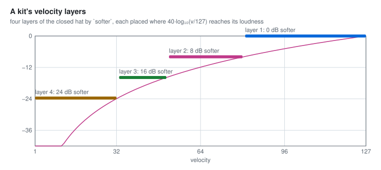

# User guide

This guide is for producers and sound designers who program hi-hats, cymbals
and tops such as shakers and tambourines. It covers the workflow, recipes for
common edits, kits with chokes, and how to read what a render reports. Every
field is in the [patch reference](patch.md), and how the instrument works, and
the evidence for it, in [the design](design.md) and
[the validation record](validation.md).

## The workflow

1. **Start from the nearest preset.** `brightwork init closed > closed.toml`.
   There are twenty-eight, from `closed` to `splash` (below).
2. **Voice it in a pattern, over your loop.**
   `brightwork audition closed.toml open.toml --watch --bpm 120 --every 1/8 --pattern 1,1,2,1 --choke 2:1 --with groove.wav`
   plays three closed hits and an open one per half bar, the open hat choked
   by the next closed hit, over your groove, and re-renders whenever you save
   a file. Edits take over at the next hit.
3. **Match it against the sample it should replace.**
   `brightwork audition closed.toml --watch --against favourite.wav --blind --takes 8`
   alternates your render with the sample, matched in loudness, in a random
   order that audition reveals when you stop it.
4. **Derive articulations and layers.** `brightwork choke open.toml 250 > half.toml`
   closes the open hat on a beat; `brightwork stretch closed.toml all 0.7` tightens
   it; `brightwork softer closed.toml 8 > closed-8.toml` gives a softer layer.
5. **Pack the kit for the sampler.**
   `brightwork pack 42=closed.toml,closed-8.toml 44=pedal.toml 46=open.toml --choke 46:42,44 --takes 8 --out hats/`.

Every file is exact and reproducible: `brightwork extract` gives back the exact
patch of any exported file, take included. It never prints text holding
control characters, which no patch does and a terminal would act on.

## The presets

[The gallery](presets.md) has every preset's sound, level over time,
spectrum and drive headroom.

| Preset | What it is | Try |
|---|---|---|
| `closed` | A closed hi-hat: modes 14 Hz apart over 6–16 kHz and a stick tick, 120 ms | `stretch`, the plates' band, the tick's level |
| `open` | The open hat: the same plates ringing for 1.3 s, slapping a little (chatter) | `choke`, chatter, the damper |
| `pedal` | The foot chick: plates closing, with a darker chick in 0.9–6 kHz, 70 ms | `stretch`, the bands |
| `crash` | A crash: modes 18 Hz apart from 400 Hz, a tail that darkens and highs that bloom after the strike, 4.5 s | damping, bloom, `choke`, the band |
| `ride` | A ride: a modal wash, a stick ping and a tick, 6 s | the ping's and the wash's levels |
| `bell` | A ride bell: struck sine partials over modes, 3.5 s | `pitch` to a note, `stretch` |
| `analog` | A closed hat of six square oscillators through a band, 60 ms | `pitch`, the band, `stretch` |
| `shaker` | One stroke: fine grains rattling 3 kHz a second over the shell's 3–12 kHz, beads clicking 300 a second over them, 220 ms | `grains_hz`, `grain_ms`, the shape for a slower or harder stroke |
| `tambourine` | A headless tambourine: jingles (modes 110 Hz apart over 2.5–12 kHz) ringing from the strike, then shivering as they rattle down, and the hand's tap, 450 ms | the shiver's rate and level, `choke` |
| `offbeat` | An open hat: plates over 8–18 kHz, brighter and shorter than `open` (about half a second), slapping lightly | `stretch` for the tempo, `choke` on the next 16th |
| `tight` | A closed hat: plates over 5.5–14 kHz, 65 ms, shorter and darker than `closed` | `stretch`, the plates' band |
| `dead` | A damped hat, a towel over the plates: dark (2.5–10 kHz) with damping 2, its highs gone at once, 140 ms | damping, to take the towel off |
| `wash` | A ride washed with a soft mallet: a 15 ms rise, highs that swell after it (bloom 0.6), 7 s | bloom, the band, `choke` |
| `house-open` | An open hat: darker and longer than `offbeat`, sizzling as its plates slap, about half a second | `choke` on the next 16th, chatter |
| `house-ride` | A ride: a bright ping over a short wash, 1.2 s | the ping's level, the wash's band |
| `house-tamb` | A short tambourine stroke: jingles ringing, a short shiver, 220 ms | the shiver's `stretch` and rate |
| `shaker-16` | A short shaker stroke for sixteenths, 110 ms | `stretch`, the grains' rate |
| `top` | A closed hat whose plates rattle, 200 ms | the rattle's level and rate |
| `trance-crash` | A long, bright crash, its highs blooming, 6 s | bloom, `stretch`, `choke` |
| `trance-ride` | A ride: bright wash and ping, 3.5 s | the bands, the ping's level |
| `analog-open` | The six squares of `analog`, open: 450 ms | `pitch`, `stretch`, the band |
| `analog-cymbal` | The six squares of `analog` as a cymbal, through a wider band, 1.3 s | `pitch`, `stretch`, damping |
| `machine-closed` | A cymbal's closed hat stored in 6 bits at 32 kHz, played back through an 11 kHz low-pass, the damper as its decay | `storage.bits`, the damper |
| `machine-open` | The same storage on an open hat, its decay the damper | the damper's `stretch`, `storage.rate_hz` |
| `half-open` | A half-open hat: its plates slapping at 150 Hz as they touch, 500 ms | chatter, `choke` |
| `sizzle` | A ride with rivets buzzing against the plate through its wash, 6 s | the rivets' level and rate |
| `china` | A china: trashy and quick, its plates slapping, 2.4 s | the band, chatter, `choke` |
| `splash` | A splash: small, bright, modes 34 Hz apart, 900 ms | `stretch`, the band |

They are matched in loudness (−32.5 LUFS; the analog hat −33.1) and peak
below −1 dBFS, so you can compare them fairly, and they share one output
setting (−6 dB gain), so any of them combine into one kit. Short sounds read
low on a 400 ms loudness window; raise `output.db` as you need.

Without drive, the controls of each preset's main source stay inside the
validated domain, over seeds 1–4 × takes 1–4, wherever the patch accepts them
across what [the validation record](validation.md#neighbourhoods) scans: the whole range of spacing, damping, bloom
and chatter, the band edges over octaves, and tails from a quarter to four
times as long. The one exception is the analog hat's damping above 2.5. Under
drive, the report's drive headroom says how far a take can go.

## Every control

Every field, its range and what it does are in the [patch reference](patch.md). Paths count from 1: `noise[2].amp[3]` is the third knot of the second noise source.

## Editing commands

Each prints a complete patch; redirect it to a file. They rewrite points and
never add parameters, so you can always keep editing the result by hand. They
fail, and say why, rather than clamp.

- **`brightwork pitch PATCH SEMITONES|NOTE`** multiplies every frequency by one
  ratio: band edges, spacings, partials and chatter rates. Each mode keeps its
  place in its cell and its excitation, so it is the same cymbal, resized.
  Times are unchanged, unlike a sampler's repitch. A note, such as D5, puts
  `tone[1]`'s lowest partial on it. A band edge at 20 kHz cannot go up, nor one
  at 20 Hz down, so leave room where you will pitch.
- **`brightwork stretch PATCH CURVE... FACTOR [--after MS]`** rescales knot times
  after each shape's peak, or after `--after`; on the damper, from 0 ms. `all`
  names every shape and the damper, so `brightwork stretch crash.toml all 0.7`
  shortens a whole cymbal.
- **`brightwork choke PATCH MS [--release MS]`** replaces the damper: gain 1 at
  MS, knots every 10 dB over the release down to −60 dB, and 0 one step later.
  The release defaults to 40 ms, as in kits.
- **`brightwork softer PATCH DB [--contact P]`** gives the same cymbal struck DB
  softer, by two rules from the physics of a strike:
  - every source level falls by DB, before the drive, so a softer hit is also
    cleaner;
  - every rise lengthens by v^(−contact) and every source's upper band edge
    scales by v^contact, with v = 10^(−DB/20) (default 0.2: Hertz's contact
    law, a slower strike stays longer on the metal and excites less high end).

  An exponent of 0 turns the contact rule off. `softer` by a then b equals
  `softer` by a + b up to the decimals it writes.

## Recipes

These start from a preset and take at most three field edits or one
command; the test suite checks that each moves the sound the right way.

| To | Edit |
|---|---|
| Tighten or loosen a closed hat | `brightwork stretch closed.toml all 0.6` (or 1.6) |
| Darken or brighten a hat | lower or raise the plates' `band_hz`, and the tick's upper edge |
| Add stick | raise the tick source's `level_db` by 6 dB: it reaches lower than the plates |
| A ghost note | `brightwork softer closed.toml 18` |
| Shorten an open hat | `brightwork stretch open.toml all 0.6` |
| Half-open it | raise `noise[1].chatter` to 0.6, and give it a damper that falls from 1 at 0 ms to 0 at 700 ms |
| Close it on a beat | `brightwork choke open.toml 250` |
| Lengthen or choke a crash | `brightwork stretch crash.toml all 1.5`; `brightwork choke crash.toml 450` |
| Darken a crash's tail | raise `noise[1].damping` |
| More bloom | raise `noise[1].bloom` |
| A splash | raise the crash's band (`noise[1].band_hz` from 1.2 kHz) and add a damper from 1 at 200 ms to 0 at 1.2 s |
| A china | a lower band (`[400, 9000]`), `chatter` 0.7 at its 220 Hz, and a damper from 1 at 150 ms to 0 at 1.5 s |
| Add ping or wash to a ride | raise the ping source (`noise[2]`) or the wash (`noise[1]`) by 6 dB |
| Retune a bell | `brightwork pitch bell.toml D5` |
| Open the analog hat | `brightwork stretch analog.toml all 8` |
| The analog cymbal | `tone[1].band_hz` to `[3500, 18000]` and the shape's last two knots to 300 and 1200 ms |
| Retune the analog hat | `brightwork pitch analog.toml +3` |

A darker band alone can lengthen a cymbal's measured decay, because what
remains is its slow low end; the damper shortens the whole ring at once.

## Reading the report

```
sources  noise[1] 714 modes in 6000–16000 Hz, mean spacing 14.00 Hz; 3 sub-bands from 6000 Hz
         noise[2] continuous noise, 3000–18000 Hz; one band
length   120.0 ms source, 121.9 ms exported (5851 samples at 48000 Hz, float32, mono), seed 1, take 1
peak     -7.90 dBFS sample, -7.42 dBTP true
loudness -32.8 LUFS, the largest 400 ms momentary loudness (BS.1770)
domain   inside the validated domain: predicted aliasing -141 dB, margin 40.6 dB
         mostly kinks, 52% at noise[2].amp[2] (0.03 ms); drive headroom +25.6 dB
render   178 ms
```

- **sources**: each source's kind, its band, and the sub-bands it plays from
  f_ref. For modes, how many lie within the band's edges and their mean
  spacing; for tones, the partials as they sound, and for sines the lowest as
  a note.
- **length**: the source length (the latest end among the audible sources'
  sub-bands, never after the damper's last knot) and the exported length,
  which includes the decimator's decaying tail. Every file starts at exactly
  zero and ends in that tail, so a sampler needs no fades.
- **peak**: the sample peak and the true peak, the highest point between the samples as a converter plays them, measured exactly. Bright hats peak up to 1.5 dB above their samples.
- **loudness**: the largest K-weighted 400 ms momentary loudness over every
  window position (ITU-R BS.1770), in LUFS, channels summed. Short sounds read
  low, because the window spreads their energy over 400 ms.
- **domain**: the renderer's own prediction of its aliasing error, relative
  to the peak. Inside means at most −100 dB: the adversarial grid has
  demonstrated that every render it calls inside measures below −100 dB
  ([validation](validation.md)). Outside, the render is still defined and exact, but
  unvalidated; `brightwork verify` measures its actual error against a reference
  render.
- **The line under it** says what dominates the prediction:
  - *mostly kinks, 52% at noise[2].amp[2] (0.03 ms)*: a fast segment around
    that knot under a loud, bright source. Lengthen the rise around it, or
    lower that source.
  - *mostly saturation*: the drive on a loud, bright source. Lower the drive,
    the level, or the source's upper band edge.

  The **drive headroom** is how much more drive the take stands before its
  status changes. Outside, it is negative and the line says what to lower
  `drive.db` to. It is exact or cautious, never optimistic.
- **files** (with `--takes` or `--stereo`): the set gain, the loudness and
  peak spread, and each file's levels and each take's domain status. Each
  take, and so each channel of a pair, is judged on its own render.

## Audition

`brightwork audition PATCH... [--watch] [--bpm BPM] [--every NOTE] [--pattern N,…] [--choke A:B,…] [--release MS] [--with BED] [--against SAMPLE] [--blind] [--takes N] [--stereo]`

- It plays exactly the buffer `render` writes; PCM formats add only their
  quantization. It opens the device at the patch's sample rate or says it
  cannot. On Windows it plays through WASAPI, in exclusive mode when the
  shared mixer runs at another rate. On macOS it asks Core Audio to switch the
  device to the patch's rate, or fails. On Linux, a sound server such as
  PipeWire or PulseAudio may still resample to its own rate; set it to the
  patch's rate to hear the exact samples.
- If the device ever runs out of samples, for example while a long render
  keeps the computer busy, it says so, with a count.
- `--watch` re-renders on every save. Each edit is a numbered generation;
  stale renders are dropped, an invalid edit keeps the last valid buffer
  playing, and a new buffer takes over at the next hit of its patch.
- Without a tempo, hits repeat every rendered length plus 0.5 s. With `--bpm`
  they land on a grid of `--every` note values, from `1/32` to `4/1` (default
  `1/4`): hats on `1/8` or `1/16`, a ride on `1/4`, a crash on `4/1`, once
  every four bars. Tails overlap and sum.
- `--pattern 1,1,2,0` names the patch of each step, numbered in command order,
  0 for a rest; without a pattern, patches take turns hit by hit. Each patch's
  takes cycle over its own hits.
- `--choke 2:1` makes patch 2 choked by patch 1: a hit of patch 1 fades every
  patch-2 hit still sounding over `--release` ms (default 40), with the curve
  `brightwork choke` writes, as a kit asks its sampler to.
- `--with BED` loops a bed under the hits. It must be at the patch's rate and
  within 1 ms of a whole number of bars; it restarts on the tempo grid, so it
  never drifts. A stereo bed opens a stereo stream with mono hits in the
  centre.
- `--against SAMPLE` alternates the render with a sample, hit by hit, the
  sample matched to the render's loudness and rematched on every re-render.
  With `--blind` each pair plays in random order, revealed when you stop.
- `--takes N` cycles takes; the first plays as soon as it is ready while the
  others render behind it. `--stereo` plays take pairs, and a stereo sample in
  stereo; otherwise a stereo sample plays as its mid channel.
- It warns when the matched sample, or the hits over the bed, would clip the
  device.

## Kits



`brightwork pack KEY=PATCH[,PATCH…]… --out DIR [--takes N] [--stereo] [--level-match] [--choke KEY:KEY,…]… [--release MS]`
renders a multisampled kit. Each `KEY=` group is one articulation on one key;
its patches are velocity layers, loudest first, each with N takes (file j of a
layer plays its patch's take + j − 1, or with `--stereo` a pair).

- The patches must share their output settings, and within a key their
  loudness must fall from each layer to the next. `softer` makes such ladders.
- Every file of the kit shares one gain, so layers and articulations keep
  their natural balance.
- Files are named `<key>_<stem>_v<top velocity>_rr<take>.wav`, such as
  `42_closed_v127_rr1.wav`, so they also map by hand in samplers that do not
  read SFZ. A patch or folder whose name a sampler would read as part of the
  map, one holding `<`, `>`, `=`, `$`, a backslash, a comment's start, a
  control character or a line break, or beginning or ending with a space, is
  refused: rename it.
- `<DIR>/<DIR>.sfz` maps them. Velocity follows a square law,
  40·log₁₀(v/127) dB, per key: a layer's velocities run up to its own, where
  the law reaches its loudness relative to the key's loudest, and its group
  carries a curve point at every velocity below it, so the level follows the
  law across layer boundaries and no velocity plays a take louder than it was
  rendered. Takes cycle in sequence,
  every sample plays through, and nothing transposes.
- **Chokes.** `--choke 46:42,44` puts keys 42 and 44 in one group and turns
  key 46 off whenever either plays, fading over the release rather than
  cutting (`off_mode=normal`, `ampeg_release`), since a closing hat damps the
  ring in milliseconds. A key can belong to one choke group only; rules that
  would need two are refused. Players' release curves differ in detail.
- The kit report lists each key's layers with loudness, velocity range, take
  spread and domain status, and its chokes.
- Every file must pass two gates: its true peak at or below 0 dBTP, with no
  sample over the format's ceiling, and its first and last samples below
  −90 dBFS, so no sampler clicks where the file starts or stops. If one
  fails, nothing is written, every failure is listed, and the report says how
  far to lower `output.db` in every patch when the level is what fails.

The General MIDI keys are the natural map: 42 closed hi-hat, 44 pedal, 46
open, 49 and 57 crash, 51 and 59 ride, 53 ride bell, 52 china, 55 splash. Kits
have been checked in sfizz and liquidsfz ([validation](validation.md#two-sfz-players)).

### In a DAW

- **One file.** Every WAV works on its own: drop it on a drum pad or a
  sampler. A patch with a tone carries its root key in a `smpl` chunk, so
  samplers map it to its note; noise alone has no pitch, and no root key.
  Hats choke each other only if the pads do: put the closed, pedal and open
  hats in one choke group, as Ableton Live's Drum Rack calls it, or the same
  cut group in FL Studio.
- **A kit.** The SFZ map that `pack` writes plays the whole kit as one
  instrument, velocity layers, round robins and chokes included, in any SFZ
  player loaded on an instrument track, such as the free sfizz or
  Sforzando, both of which run as plugins in FL Studio, Ableton Live and
  Logic Pro. The map names its samples by file name, so keep it in its
  folder beside them, as `pack` writes it. The levels follow the square law
  across layers from the map itself, so a pattern's velocities play as
  written.
- **Keys.** The map uses General MIDI's numbers, so drum patterns and pad
  controllers find the hats where they expect them. Brightwork names notes as
  scientific pitch does, with middle C, key 60, as C4: key 42, the closed
  hat, is F#2. DAWs that call middle C C3, such as Ableton Live, Cubase and
  Logic Pro, call it F#1.

### With Ballast and Halyard

The presets sit at −32.5 LUFS so they compare fairly with each other,
which leaves them some 24 dB under Ballast's kicks, which peak at −1 dBTP.
For a working balance, set the kick's `output.db` to −10 and raise each
preset's `output.db` by the amount below: in eight bars of 4/4 with the kick
on every beat, a hat, shaker, tambourine or ride on the offbeats then reads
10 dB under the kick by loudness, a crash, splash or china struck once in two
bars 6 dB under, Halyard's snares and claps, raised as its guide says, 5 dB
under, and no file peaks above −1 dBFS. Each was measured against the Ballast
preset in the table, at 124 bpm for `house`, 126 for `tech-house` and 138 for
`trance`, by `tools/balance.py`, which a test holds to this table; it is a
starting balance, and your ears and the track decide the rest.

| Preset | Against Ballast's | Played | Raise `output.db` by | Note |
|---|---|---|---|---|
| `closed` | `house` | offbeats, 10 dB under | +5.6 dB | |
| `open` | `house` | offbeats, 10 dB under | +5.4 dB | |
| `pedal` | `house` | offbeats, 10 dB under | +4.9 dB | |
| `crash` | `house` | once per two bars, 6 dB under | +9.3 dB | |
| `ride` | `house` | offbeats, 10 dB under | +5.2 dB | |
| `bell` | `house` | offbeats, 10 dB under | +3.6 dB | |
| `analog` | `house` | offbeats, 10 dB under | +5.3 dB | 0.7 dB short, held at −1 dBFS by its peak |
| `shaker` | `house` | offbeats, 10 dB under | +5.3 dB | |
| `tambourine` | `house` | offbeats, 10 dB under | +5.2 dB | |
| `offbeat` | `trance` | offbeats, 10 dB under | +4.0 dB | |
| `tight` | `tech-house` | offbeats, 10 dB under | +4.8 dB | |
| `dead` | `house` | offbeats, 10 dB under | +5.7 dB | |
| `wash` | `house` | offbeats, 10 dB under | +5.0 dB | |
| `house-open` | `house` | offbeats, 10 dB under | +5.4 dB | |
| `house-ride` | `house` | offbeats, 10 dB under | +5.2 dB | |
| `house-tamb` | `house` | offbeats, 10 dB under | +4.9 dB | |
| `shaker-16` | `tech-house` | offbeats, 10 dB under | +4.7 dB | |
| `top` | `tech-house` | offbeats, 10 dB under | +4.4 dB | |
| `trance-crash` | `trance` | once per two bars, 6 dB under | +7.9 dB | |
| `trance-ride` | `trance` | offbeats, 10 dB under | +3.8 dB | |
| `analog-open` | `house` | offbeats, 10 dB under | +5.4 dB | |
| `analog-cymbal` | `house` | once per two bars, 6 dB under | +9.3 dB | |
| `machine-closed` | `house` | offbeats, 10 dB under | +5.4 dB | |
| `machine-open` | `house` | offbeats, 10 dB under | +5.3 dB | |
| `half-open` | `house` | offbeats, 10 dB under | +5.4 dB | |
| `sizzle` | `house` | offbeats, 10 dB under | +5.3 dB | |
| `china` | `house` | once per two bars, 6 dB under | +8.5 dB | 0.8 dB short, held at −1 dBFS by its peak |
| `splash` | `house` | once per two bars, 6 dB under | +9.1 dB | |

## Exit status

| Status | Meaning |
|---|---|
| 0 | done |
| 1 | refused or failed: a render over the format's ceiling, a kit that fails its gates, or an audition that cannot play |
| 2 | bad input: an invalid patch, a file that cannot be read or written, or bad arguments |
| 130 | interrupted with Ctrl+C |

## Python API

The modules are importable for scripting renders and kits:

```python
from brightwork_synth import cli, pack, patch, render

hat = patch.loads(cli.preset_text("closed"))  # or patch.load("hat.toml"); raises patch.PatchError
hat = patch.pitch(hat, "-2")  # every editing command is a function that returns a new patch
audio, report = render.render_takes(hat, 4)  # four takes sharing one gain, float32 arrays
print(report)
if not report.over:
    for a, f in zip(audio, report.files, strict=True):
        render.export(f"hat_rr{f.number}.wav", a, hat, report, f)  # with the patch and its provenance
```

`render.render(p)` renders one take. A kit is built, checked, then written:

```python
from brightwork_synth import cli, pack, patch

closed = patch.loads(cli.preset_text("closed"))
soft = patch.softer(closed, 8)
opened = patch.loads(cli.preset_text("open"))
groups = [(42, [("closed", closed), ("closed-8", soft)]), (46, [("open", opened)])]
kit = pack.build(groups, pack.Options(takes=4, chokes=((46, (42,)),)), stem="hats")  # raises pack.PackError
print("\n".join(kit.lines("hats")))
if problems := pack.gates(kit):  # a sample over the ceiling, a true peak over 0 dBTP, or an edge that clicks
    print("\n".join(problems))
else:
    pack.write(kit, "hats")  # the WAVs and hats/hats.sfz
```

## Outside the family

- Gongs and tam-tams, whose pitch glides and whose tails outlast 8 s; bells,
  cowbells and other tuned metal (a tone can make them, but no preset
  covers them).
- Performance: rolls, swells, bowing, brushes and the continuous pedal of an
  electronic hi-hat. One patch is one hit; openness is a set of articulations
  and dynamics are velocity layers.
- Sounds defined by processing: rooms and reverb, and filtering after the
  fact. Storage at a low rate and bit depth is in the family: see Storage.
- FM or wavetable metallics, though coherent sources can approach them.
