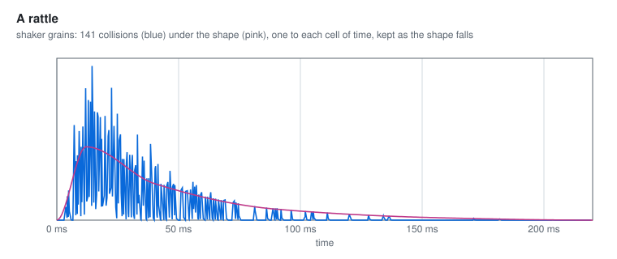

# Patch reference

A patch is a complete TOML description of one hit. Every field is required and the renderer holds no defaults, so a future default can never change an old patch; the one exception is the source arrays, `[[noise]]` and `[[tone]]`, which may be absent, meaning none. The parser refuses anything outside the valid domain and never clamps or repairs. `brightwork init PRESET` writes a complete one to start from; the [user guide](guide.md) shows how to work with it and [the design](design.md) how each part sounds.

## A patch

```toml
instrument = "cymbal"
schema = 1
seed = 1                    # the cymbal: where its modes lie
take = 1                    # the strike: round robins use take, take + 1, …

[[noise]]                   # noise[1], the plates: modes about 14 Hz apart
level_db   = -2.0
band_hz    = [6000.0, 16000.0]
spacing_hz = 14.0           # mean distance between modes; 0 = continuous noise
damping    = 0.5            # content at f decays (f / 6 kHz)^0.5 times faster
bloom      = 0.0            # and rises (f / 6 kHz)^bloom times slower
chatter    = 0.0            # 0 … 1: gated at chatter_hz, as plates that slap
chatter_hz = 220.0
grains_hz  = 0.0            # collisions per second at the shape's peak, a rattle; 0 = none
grain_ms   = 10.0           # each collision rings down 60 dB in this time
amp = [                     # shape: 0 at both ends, highest point exactly 1
  { ms = 0.0,   gain = 0.0 },
  { ms = 0.3,   gain = 1.0 },
  { ms = 8.0,   gain = 0.45 },
  { ms = 30.0,  gain = 0.14 },
  { ms = 70.0,  gain = 0.04 },
  { ms = 120.0, gain = 0.0 },
]

[[noise]]                   # noise[2], the stick's tick
level_db   = -10.0
band_hz    = [3000.0, 18000.0]
spacing_hz = 0.0
damping    = 0.0
bloom      = 0.0
chatter    = 0.0
chatter_hz = 220.0
grains_hz  = 0.0
grain_ms   = 10.0
amp = [
  { ms = 0.0,  gain = 0.0 },
  { ms = 0.03, gain = 1.0 },
  { ms = 0.13, gain = 0.6 },  # a shoulder knot keeps the tick sharp
  { ms = 1.5,  gain = 0.1 },
  { ms = 5.0,  gain = 0.0 },
]

[storage]                   # low-resolution memory: the sources stored, then played back
bits      = 0               # 0 = off; else 2 … 16, quantized against the sound's peak
rate_hz   = 32000.0         # stored at this rate, as near as the internal rate allows
filter_hz = 16000.0         # played back through a low-pass, −3 dB here

[damper]                    # multiplies every source: 1 until damped, then down to 0
amp = []                    # no knots: never damped

[drive]
db = 0.0                    # small-signal gain; 0 = bypass

[output]
sample_rate = 48000
format      = "float32"     # "float32" | "pcm24" | "pcm16"
mode        = "gain"        # "gain" | "peak" | "true-peak"
db          = -6.0          # gain in dB, or peak target in dBFS
polarity    = 1
```

A tone looks like this, here the analog preset's oscillators:

```toml
[[tone]]                    # tone[1]
level_db   = -3.0
wave       = "square"       # "sine" | "square"
phase      = "free"         # "strike": every partial starts at zero | "free": set by the take
partials   = [              # loudest exactly 0 dB; sounds at the nearest 1/8 Hz
  { hz = 205.3, level_db = 0.0 }, { hz = 304.4, level_db = 0.0 }, { hz = 369.6, level_db = 0.0 },
  { hz = 522.7, level_db = 0.0 }, { hz = 540.0, level_db = 0.0 }, { hz = 800.0, level_db = 0.0 },
]
band_hz    = [7000.0, 16000.0]
damping    = 0.3            # f_ref: the higher of the band's lower edge and the lowest partial
bloom      = 0.0
chatter    = 0.0
chatter_hz = 220.0
grains_hz  = 0.0
grain_ms   = 10.0
amp = [ … ]
```

## Every field

A patch is complete: every field is required, and the renderer has no
defaults. The one exception is the source arrays, `[[noise]]` and `[[tone]]`,
which may be absent. Paths below are the ones the parser and the report use.
They count from 1: `noise[2].amp[3]` is the third knot of the second noise
source.

### Times and curves

Knot times are milliseconds from the hit, at least 10 µs apart, and every
sound ends by 8 s. Every curve is a smooth monotone cubic through its knots
(PCHIP): it never overshoots between knots.

- **Amplitude shapes** (`noise[N].amp`, `tone[N].amp`) start and end at gain
  0, and their highest point is exactly 1: the peak, where the decay starts.
  Levels are set separately, in dB.
- **Knots every 10 dB** of a decay reproduce an exponential tail closely. The
  first segment after a peak starts flat, because the peak has zero slope; for
  a sharp tick, put a **shoulder knot** about 0.1 ms after the peak, as the
  presets do.
- **Every knot is a kink.** Very fast segments under loud, bright sources
  alias. The report tells you when a knot matters and which one.

### Noise sources

Up to four `[[noise]]` tables.

| Field | Range | What it does |
|---|---|---|
| `level_db` | −inf, −90 – +24 | The source's level. `-inf` silences it exactly; a silent source never lengthens the file. |
| `band_hz` | 20 ≤ low < high ≤ 20,000 | Second-order skirts, half power at the edges. Editing the band reweights the same lines; it never rerolls them. |
| `spacing_hz` | 0, or 1 – 200 | 0 is continuous noise: every line of the 1/8 Hz grid sounds, as for a stick's tick. From 1 Hz up, the source is **modes**: one per `spacing_hz` cell, at a place within its cell that the seed decides. |
| `damping` | 0 – 3 | Content at f decays (f / f_ref)^damping times faster than the shape says; f_ref is the band's lower edge. |
| `bloom` | 0 – 3 | Content at f rises (f / f_ref)^bloom times slower: the highs build up after the strike. |
| `chatter` | 0 – 1 | Gates the source at `chatter_hz` while its shape sounds, as plates that slap: 0 is off, 1 full depth. |
| `chatter_hz` | 10 – 4,000 | The gate's rate. |
| `amp` | 3 – 32 knots | The source's shape. |

**Modes.** A real cymbal's modes are about evenly dense in frequency, at its
own spacing: about 34 Hz for a 10-inch splash, 14 Hz for a 14-inch hi-hat
pair, 18 Hz for a 16-inch crash, 13 Hz for an 18-inch china and 15 Hz for a
20-inch ride. Wider spacings sound more like a chord of partials, the hum of a
cymbal's tail; denser ones like noise.

**Coherence.** Sources that share a spacing share their modes and their
excitation, and continuous-noise sources share one noise. Identical bands and
spacings give identical carriers; two identical sources at equal level sum to
+6 dB; a crossfade between two sources is a spectral morph of one cymbal.

### Tones

Up to two `[[tone]]` tables: partials that you place.

| Field | Range | What it does |
|---|---|---|
| `level_db` | −inf, −90 – +24 | The tone's level. |
| `wave` | `sine`, `square` | A square sums its odd harmonics up to 20 kHz at 1/n, band-limited by construction. |
| `phase` | `strike`, `free` | `strike`: every partial starts at zero, the same in every take, as struck modes do. `free`: phases drawn per take, as free-running oscillators. |
| `partials` | 1 – 16 | `{ hz, level_db }`, increasing by at least 1/8 Hz, 20 Hz – 20 kHz; the loudest exactly 0 dB. Each sounds at the nearest 1/8 Hz, which the report shows. |
| `band_hz`, `damping`, `bloom`, `chatter`, `chatter_hz`, `amp` | as for noise | f_ref is the higher of the band's lower edge and the lowest partial. |

`tone[1]`'s lowest partial is also the root note written into the file, so
samplers map a pitched cymbal by key.

### Damping and bloom

Higher modes of a cymbal decay faster, and after a hard strike energy moves
from the struck modes up into higher ones, so the highs build up. `damping`
and `bloom` say how much, per source, from its f_ref up. Below f_ref both are
1: the shape is exactly the decay and rise at the bottom of the source.

The renderer splits each source into sub-bands half an octave apart at
damping or bloom 1 (finer at higher values), each playing the shape on its own
time map, and crossfades them in frequency; the report gives their number.
Between two sub-band centres the decay follows the power law within about
1 dB at 20 dB down. Damping or bloom must not compress or stretch the content
at 20 kHz more than 1000 times relative to f_ref: from 20 Hz that allows 1,
from 300 Hz 1.6, from 6 kHz any value up to 3.

### Chatter

The gate is 1 − chatter · shape · (1 − cos 2π·chatter_hz·t)/2, so it follows
the source's own shape and is gone where the shape is. 100–300 Hz is plates
slapping (an open or half-open hat); at 4 kHz it becomes a roughness. It
sounds through drive and the damper like the rest of the source.

### Rattle



`grains_hz` above 0 turns a source into a rattle: it sounds only at a stream
of collisions, as a shaker's beads or a tambourine's jingles, and what rings
at each one is the source itself, its band, modes or partials.

- `grains_hz` is how many collisions a second at the shape's peak, from
  0.125, one in the longest sound, to 4,000. They thin out with the shape, so
  a shake that dies away clicks ever more sparsely.
- `grain_ms` is how long each one rings, down 60 dB: a few milliseconds for
  beads on a shell, tens of milliseconds for jingles.
- The shape is the gesture: one shake, a push and a pull, or a tambourine's
  hit and shiver. The collisions change with every take, as every shake does.
- Sources with the same `grains_hz` share their collisions, so a
  tambourine's jingles (modes) and head (a sine tone) are struck together.
- At the shape's peak a rattle is as loud as the source would be, at any
  rate; below it, fewer collisions make it fall away faster than the shape.
  At most 64 collisions may ring at once; past that it sounds as the plain
  source.

| Starting point | Source | `grains_hz` | `grain_ms` |
|---|---|---|---|
| Shaker | noise, 3–9 kHz, spacing 0, damping 0 | 500–1000 | 3–8 |
| Maraca | noise, 2–7 kHz | 200–400 | 3–5 |
| Cabasa | noise, 4–16 kHz | 1500–3000 | 1–2 |
| Tambourine jingles | modes, 2.5–12 kHz, spacing 100–150 Hz | 100–300 | 50–120 |
| Sizzle on a cymbal | a second source on the cymbal's modes | 200–400 | 10–30 |

### Storage

`[storage]` stores the whole sound at a low rate and bit depth, on purpose:
`bits` above 0 turns it on.

- `bits`, 2 to 16, is how fine each stored value is, against the sound's own
  peak: 6 bits is about 36 dB of range, so a fading cymbal
  turns grainy as its tail sinks into the steps.
- `rate_hz`, 4 to 96 kHz, is how often the sound is stored, at the nearest
  rate the internal rate allows, which the report names. Below about 40 kHz
  the hold's images reach into hearing, and what lies above half the rate
  folds down.
- `filter_hz`, 1 to 20 kHz, is the playback low-pass, −3 dB there, gentle as
  an analog one: lower is darker.
- The damper then fades the playback, grain and all, as the machine's decay
  knob did: `brightwork stretch PATCH damper.amp 1.5` opens it.

The sources are synthesized as always and stored as they sound, so any
patch, a ride or a shaker as well as a hat, can be stored.

Played back, a stored sound comes a little after its sources, as a real
machine's does: by half a stored period and the filter's delay, 0.11 ms for
`machine-closed` and at most about 1.2 ms (4 kHz through a 1 kHz filter).
The report says how much; against other drums, place the file that much
early.

### Damper

`damper.amp` multiplies every source: 1 until damped, then down to 0 at its
last knot, where the sound ends. Empty (`amp = []`) means never damped. It is
a hand on a crash, a foot closing a hat, or with a slow fall from 0 ms a
cymbal pressed into a shorter ring. `brightwork choke` writes one for you.

### Drive

`drive.db`, 0 – 48 dB, is the small-signal gain of a tanh saturator on the sum
of all sources. 0 dB is exact bypass. On bright sources what matters is
**source level + drive**: a source at −6 dB with 24 dB of drive saturates like
one at 0 dB with 18 dB.

### Output

| Field | Values | What it does |
|---|---|---|
| `sample_rate` | 44100, 48000, 88200, 96000, 176400, 192000 | The file's rate. The 96 and 192 kHz files are exactly the 48 kHz one with samples filled in. |
| `format` | `float32`, `pcm24`, `pcm16` | PCM uses the plain PCM tag that hardware samplers read, with seeded triangular dither that leaves exact zeros alone. |
| `mode` | `gain`, `peak`, `true-peak` | Apply `db` as a gain, or scale so the sample peak is at `db` dBFS, or the true peak, between the samples, at `db` dBTP. A set or a kit shares one gain, set by its loudest file. |
| `db` | gain −60 – +24; peak and true peak −60 – 0 | See `mode`. |
| `polarity` | 1, −1 | Inverts the output. |

A gain-mode render over full scale is refused, with the reduction it needs;
`--allow-over` writes it anyway as a float file. Nothing is ever clipped. A
PCM render must peak 2 LSB below full scale so the dither never clips.

### Seed and take

`seed` is the cymbal: where its modes lie. A different seed is a different
cymbal of the same design. `take` is the strike: each take draws every mode's
amplitude and phase anew and keeps every mode's frequency, so takes are the
same cymbal struck again. `brightwork render … --takes 8` writes takes take,
take + 1, … as `closed_rr1.wav` … `closed_rr8.wav`; struck tones are the same
in every take.

The takes of a set share one gain, so their natural balance survives. Short
hits vary most: a closed hat's takes spread by up to 1.4 dB in loudness, since
over its first ten milliseconds its band holds only about a hundred degrees of
freedom, whatever its number of modes. The report flags any set that spreads
over 1 dB; `--level-match` then scales each file to the first.

**Stereo.** `--stereo` writes consecutive takes as left and right, so
`--takes 4 --stereo` writes four stereo files from eight takes. The pair is
one cymbal struck twice: wide and fully decorrelated in its random parts
(L/R correlation −0.03 on the crash), with anything the takes share, such as
struck partials, in the centre, and a mono sum that is still the cymbal.

## Validation

The parser refuses, listing every problem with its path:

- unknown or missing fields;
- wrong types (integers are accepted for floats, booleans never);
- non-finite numbers, except `level_db = -inf` on a source, which means exact silence;
- knot times that repeat, decrease, or are closer than 10 µs, compared on the decimal values as written;
- amplitude shapes that do not start and end at 0, or whose highest point is not exactly 1;
- a missing or different `instrument`, a patch with no source, and unsupported schema versions;
- more than four noise sources or two tones;
- a damper whose knots do not start at exactly 1 and end at exactly 0, or that increases anywhere;
- partials that do not strictly increase, or whose loudest level is not exactly 0 dB;
- a `wave` or `phase` outside its values;
- a sub-band that would end after 8 s, and damping or bloom whose compression or stretch at 20 kHz would exceed 1000, which keeps a source within 21 sub-bands;
- anything outside the valid domain:

| Quantity | Valid range |
|---|---|
| sources | 0–4 noise sources and 0–2 tones, at least one source in all |
| `band_hz` | 20 ≤ low < high ≤ 20,000 |
| `spacing_hz` | 0, or 1–200 |
| partials | 1–16 per tone, strictly increasing, 20 Hz – 20 kHz; levels −60 – 0 dB, with the loudest exactly 0 |
| `wave` / `phase` | `"sine"` or `"square"` / `"strike"` or `"free"` |
| `damping`, `bloom` | 0 – 3, with (20 kHz / f_ref)^damping and (20 kHz / f_ref)^bloom ≤ 1000 |
| `chatter` / `chatter_hz` | 0 – 1 / 10 – 4,000 |
| storage `bits` / `rate_hz` / `filter_hz` | 0 or 2 – 16 / 4 – 96 kHz / 1 – 20 kHz |
| `grains_hz` / `grain_ms` | 0, or 0.125 – 4,000 / 1 – 1,000, with grains_hz · grain_ms / 1000 ≤ 64 collisions ringing at once |
| source `level_db` | −inf, or −90 – +24 |
| drive | 0 – 48 dB |
| knots per curve | amplitude 3 – 32; damper none, or 2 – 32 |
| knot spacing | ≥ 10 µs |
| shapes, every sub-band and the damper | end by 8 s |
| output | 44.1, 48, 88.2, 96, 176.4 or 192 kHz; float32, pcm24 or pcm16; gain −60 – +24 dB; sample or true peak target −60 – 0 dBFS |
| `seed` / `take` | integers, 0 to 2⁶³ − 1 / 1 to 2³¹ |

## Canonical form

The editing commands print a complete, canonical patch: every field, in a fixed order, with the standard comments. Comments of your own are not kept. Paths count from 1 in parser messages, the report and the commands alike: `noise[1].amp[3].ms`, `tone[1].partials[2].hz`.
