# The references

<!-- Written by docs/build.py from the shipped references; edit those, then run it. -->

Every reference is a complete starting patch: `brightwork init NAME > NAME.toml`. They are matched in
loudness and share one output setting, so any of them combine into one kit. Each sound below is the
reference as it ships, seed 1, take 1, as `brightwork render` writes it. [GUIDE.md](GUIDE.md) says what to
try on each.

| Reference | Length to −40 dB | Centroid | Loudness | Peak | Drive headroom |
|---|---|---|---|---|---|
| [closed](#closed) | 89 ms | 11.3 kHz | −32.8 LUFS | −7.9 dBFS | 25.7 dB |
| [open](#open) | 795 ms | 10.1 kHz | −32.6 LUFS | −15.2 dBFS | 34.3 dB |
| [pedal](#pedal) | 43 ms | 7.0 kHz | −32.1 LUFS | −7.9 dBFS | 28.2 dB |
| [crash](#crash) | 1587 ms | 5.4 kHz | −32.5 LUFS | −11.9 dBFS | 32.2 dB |
| [ride](#ride) | 2890 ms | 5.4 kHz | −32.5 LUFS | −14.3 dBFS | 35.4 dB |
| [bell](#bell) | 2973 ms | 1.1 kHz | −32.5 LUFS | −19.8 dBFS | any |
| [analog](#analog) | 49 ms | 7.5 kHz | −33.3 LUFS | −6.3 dBFS | 14.7 dB |
| [shaker](#shaker) | 106 ms | 7.8 kHz | −32.6 LUFS | −10.3 dBFS | 29.8 dB |
| [tambourine](#tambourine) | 220 ms | 7.5 kHz | −32.4 LUFS | −13.1 dBFS | 33.5 dB |
| [offbeat](#offbeat) | 440 ms | 12.3 kHz | −32.5 LUFS | −13.1 dBFS | 30.9 dB |
| [tight](#tight) | 47 ms | 10.4 kHz | −33.1 LUFS | −6.4 dBFS | 24.3 dB |
| [dead](#dead) | 86 ms | 4.4 kHz | −33.0 LUFS | −8.3 dBFS | 28.5 dB |
| [wash](#wash) | 4127 ms | 4.5 kHz | −32.6 LUFS | −19.4 dBFS | 41.7 dB |
| [house-open](#house-open) | 566 ms | 9.3 kHz | −32.6 LUFS | −12.3 dBFS | 33.5 dB |
| [house-ride](#house-ride) | 1338 ms | 5.7 kHz | −32.5 LUFS | −13.0 dBFS | 34.4 dB |
| [house-tamb](#house-tamb) | 80 ms | 7.8 kHz | −32.1 LUFS | −10.4 dBFS | 29.8 dB |
| [shaker-16](#shaker-16) | 58 ms | 8.8 kHz | −32.9 LUFS | −7.7 dBFS | 27.1 dB |
| [top](#top) | 144 ms | 10.6 kHz | −32.7 LUFS | −9.7 dBFS | 28.8 dB |
| [trance-crash](#trance-crash) | 2222 ms | 6.3 kHz | −32.4 LUFS | −15.7 dBFS | 35.5 dB |
| [trance-ride](#trance-ride) | 2213 ms | 6.7 kHz | −32.5 LUFS | −16.1 dBFS | 35.6 dB |
| [analog-open](#analog-open) | 396 ms | 7.7 kHz | −32.6 LUFS | −13.8 dBFS | 25.3 dB |
| [analog-cymbal](#analog-cymbal) | 1089 ms | 5.4 kHz | −32.6 LUFS | −16.6 dBFS | 25.5 dB |
| [machine-closed](#machine-closed) | 64 ms | 8.5 kHz | −32.6 LUFS | −11.3 dBFS | 30.0 dB |
| [machine-open](#machine-open) | 388 ms | 8.2 kHz | −32.5 LUFS | −16.4 dBFS | 34.3 dB |
| [half-open](#half-open) | 386 ms | 8.7 kHz | −32.6 LUFS | −12.6 dBFS | 31.8 dB |
| [sizzle](#sizzle) | 3156 ms | 7.7 kHz | −32.8 LUFS | −16.0 dBFS | 35.8 dB |
| [china](#china) | 1143 ms | 4.4 kHz | −32.6 LUFS | −9.5 dBFS | 31.1 dB |
| [splash](#splash) | 590 ms | 7.1 kHz | −32.4 LUFS | −12.1 dBFS | 32.0 dB |

## closed

A closed hi-hat: plates of modes 14 Hz apart over 6–16 kHz, and a stick tick.

[Listen: closed.wav](audio/closed.wav)

## open

The open hat: the same plates ringing for 1.3 s, slapping a little.

[Listen: open.wav](audio/open.wav)

## pedal

The foot's chick: plates closing, with a darker chick below them.

[Listen: pedal.wav](audio/pedal.wav)

## crash

A crash: a bright wash that blooms after the strike and darkens as it decays.

[Listen: crash.wav](audio/crash.wav)

## ride

A ride: a defined ping over a sustained wash.

[Listen: ride.wav](audio/ride.wav)

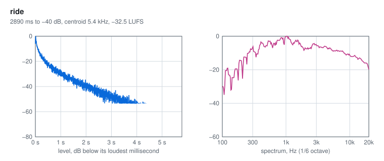

## bell

A ride's bell: a few strong partials, long and clearly pitched.

[Listen: bell.wav](audio/bell.wav)

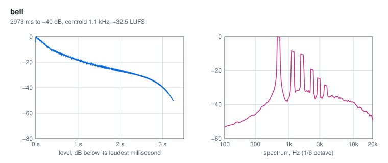

## analog

The drum machine's closed hat: six square oscillators through a band.

[Listen: analog.wav](audio/analog.wav)

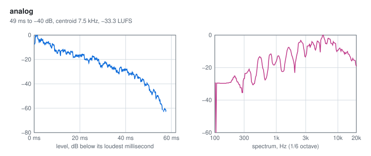

## shaker

One stroke of a shaker: fine grains rattling against the shell, larger beads clicking over them.

[Listen: shaker.wav](audio/shaker.wav)

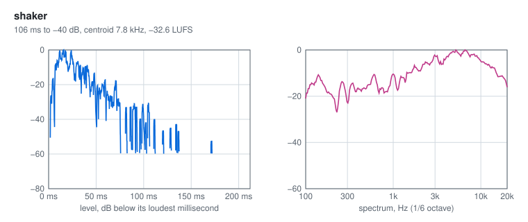

## tambourine

A headless tambourine: jingles ringing from the strike, then shivering as they rattle down.

[Listen: tambourine.wav](audio/tambourine.wav)

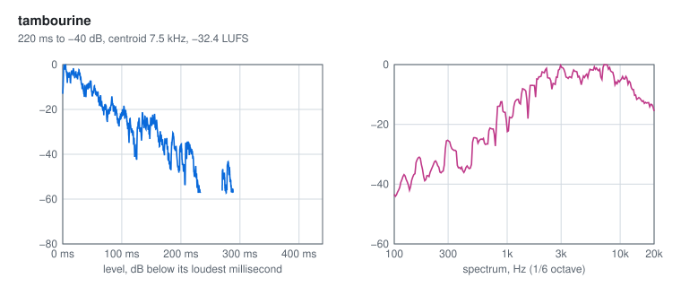

## offbeat

Trance's off-beat open hat: brighter and shorter than the open hat, slapping lightly.

[Listen: offbeat.wav](audio/offbeat.wav)

## tight

Tech house's closed hat: shorter and a little darker than the closed hat.

[Listen: tight.wav](audio/tight.wav)

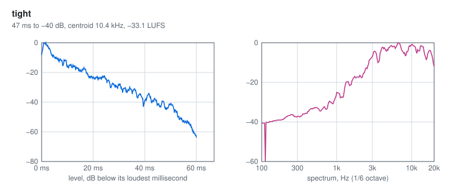

## dead

A damped hat, as with a towel over the plates: dark, its highs gone at once.

[Listen: dead.wav](audio/dead.wav)

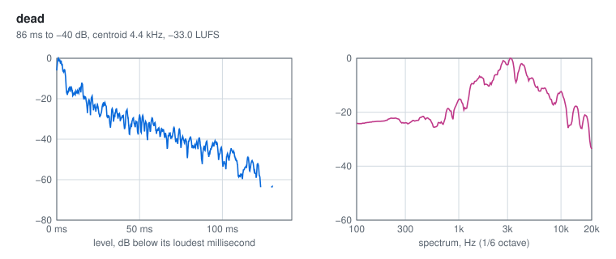

## wash

A ride washed with a soft mallet: its highs swell after the strike and ring for seconds.

[Listen: wash.wav](audio/wash.wav)

## house-open

House's off-beat open hat: darker and longer than trance's, sizzling as its plates slap.

[Listen: house-open.wav](audio/house-open.wav)

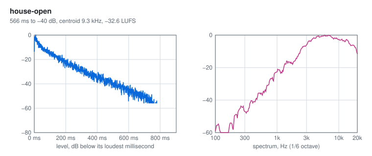

## house-ride

House's ride: a bright ping over a short wash.

[Listen: house-ride.wav](audio/house-ride.wav)

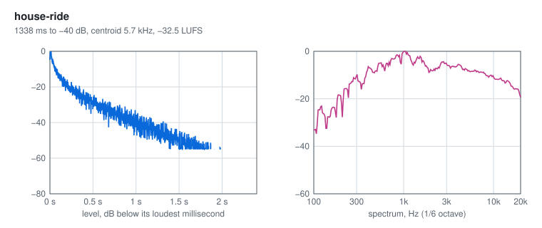

## house-tamb

A crisp tambourine stroke for the off-beat: jingles ringing, then a short shiver.

[Listen: house-tamb.wav](audio/house-tamb.wav)

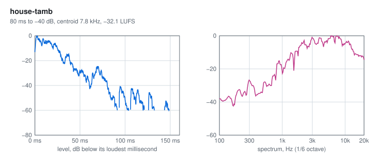

## shaker-16

A short shaker stroke for sixteenths.

[Listen: shaker-16.wav](audio/shaker-16.wav)

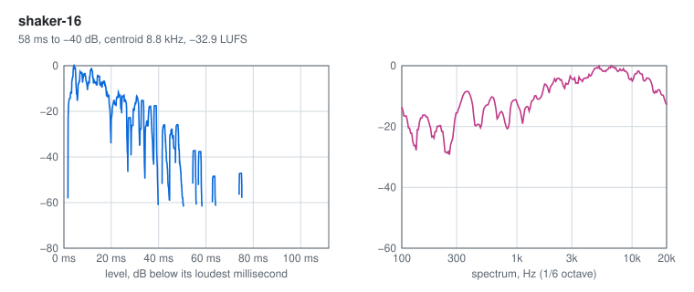

## top

Tech house's top: a closed hat whose plates rattle.

[Listen: top.wav](audio/top.wav)

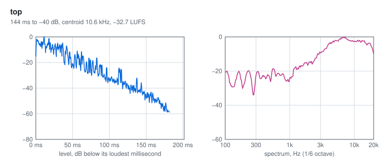

## trance-crash

The crash on the drop: long and bright, its highs blooming after the strike.

[Listen: trance-crash.wav](audio/trance-crash.wav)

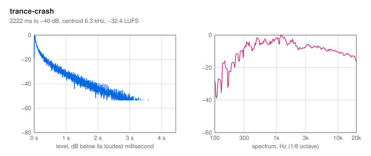

## trance-ride

A driving ride: bright wash, bright ping.

[Listen: trance-ride.wav](audio/trance-ride.wav)

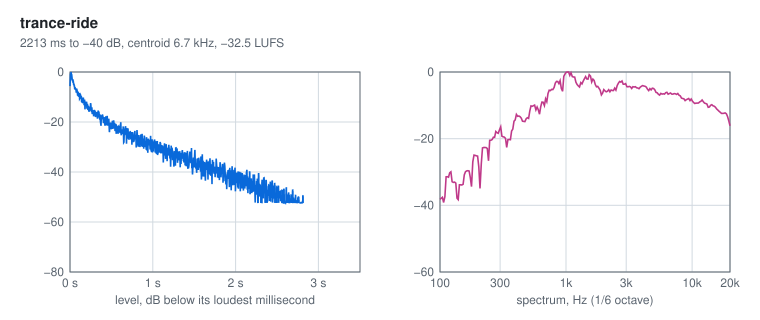

## analog-open

The drum machine's analog squares, open.

[Listen: analog-open.wav](audio/analog-open.wav)

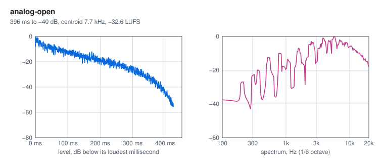

## analog-cymbal

The analog squares as their cymbal, through a wider band.

[Listen: analog-cymbal.wav](audio/analog-cymbal.wav)

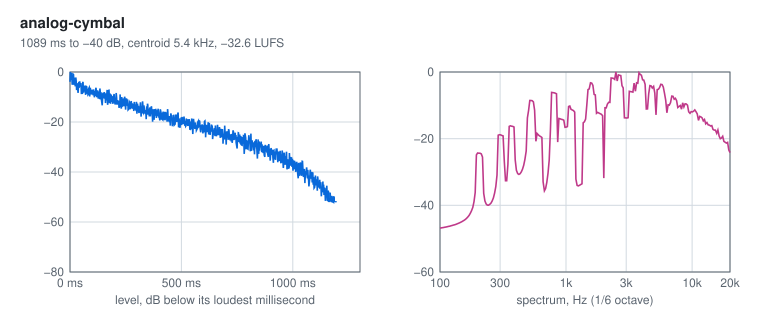

## machine-closed

A closed hat stored as a drum machine stored it: 6 bits at 32 kHz, its decay the damper.

[Listen: machine-closed.wav](audio/machine-closed.wav)

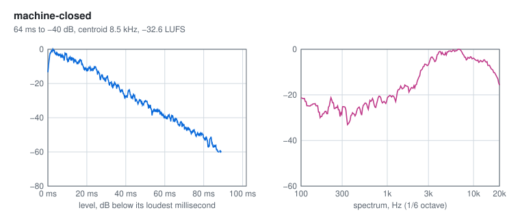

## machine-open

The same machine's open hat: 6 bits at 32 kHz, a fading tail turning grainy.

[Listen: machine-open.wav](audio/machine-open.wav)

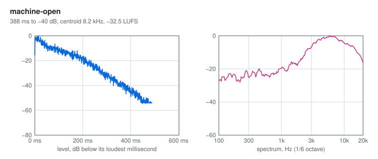

## half-open

A half-open hat: its plates slapping as they touch.

[Listen: half-open.wav](audio/half-open.wav)

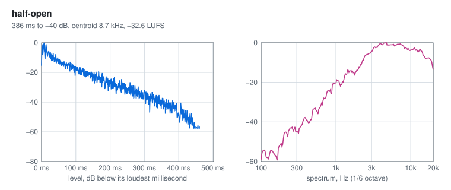

## sizzle

A ride with rivets buzzing against the plate through its wash.

[Listen: sizzle.wav](audio/sizzle.wav)

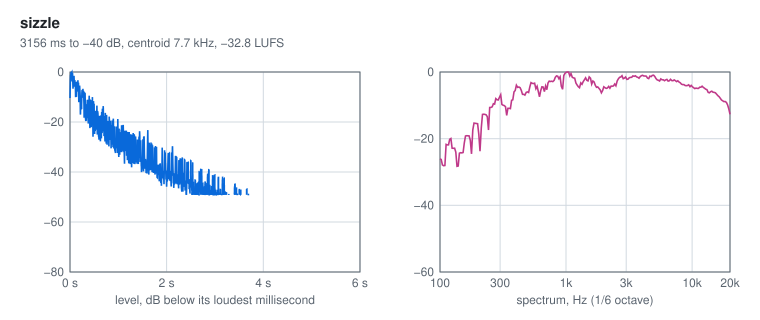

## china

A china: trashy and quick, its plates slapping.

[Listen: china.wav](audio/china.wav)

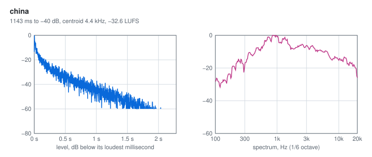

## splash

A splash: small and bright.

[Listen: splash.wav](audio/splash.wav)

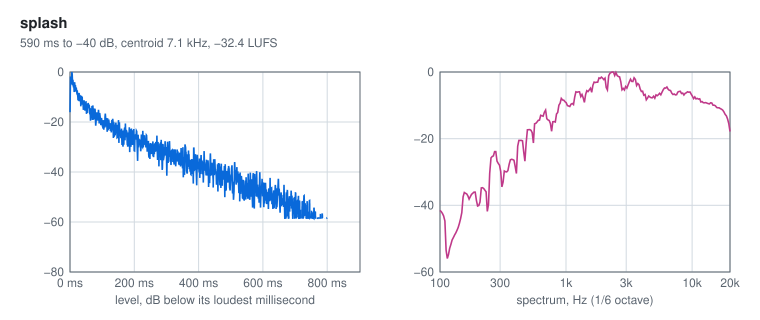
