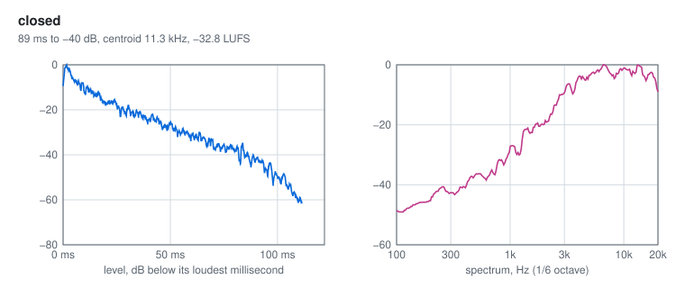
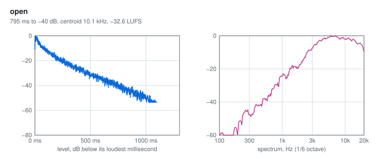
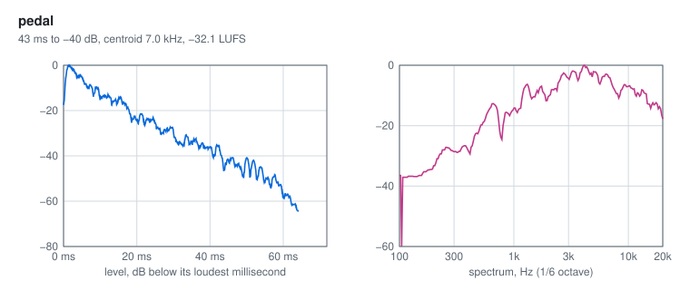
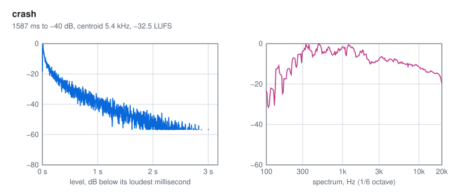
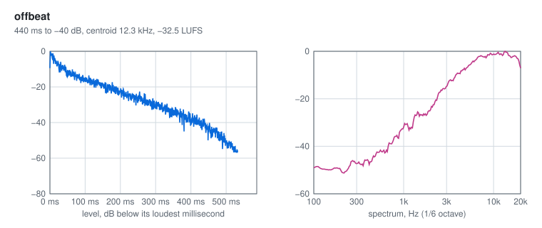
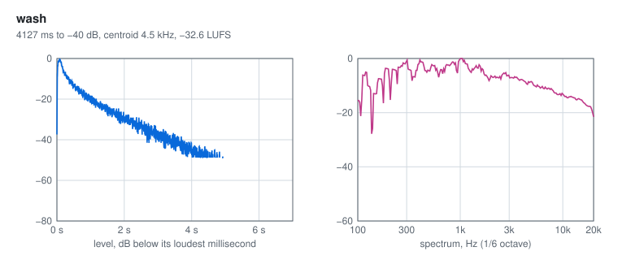

# The references

<!-- Written by docs/build.py from the shipped references; edit those, then run it. -->

Every reference is a complete starting patch: `brightwork init NAME > NAME.toml`. They are matched in
loudness and share one output setting, so any of them combine into one kit. Each sound below is the
reference as it ships, seed 1, take 1, as `brightwork render` writes it. [GUIDE.md](GUIDE.md) says what to
try on each.

| Reference | Length to −40 dB | Centroid | Loudness | Peak | Drive headroom |
|---|---|---|---|---|---|
| [closed](#closed) | 89 ms | 11.3 kHz | −32.8 LUFS | −7.9 dBFS | 26.3 dB |
| [open](#open) | 795 ms | 10.1 kHz | −32.6 LUFS | −15.2 dBFS | 34.9 dB |
| [pedal](#pedal) | 43 ms | 7.0 kHz | −32.1 LUFS | −7.9 dBFS | 28.8 dB |
| [crash](#crash) | 1587 ms | 5.4 kHz | −32.5 LUFS | −11.9 dBFS | 32.8 dB |
| [ride](#ride) | 2890 ms | 5.4 kHz | −32.5 LUFS | −14.3 dBFS | 36.0 dB |
| [bell](#bell) | 2973 ms | 1.1 kHz | −32.5 LUFS | −19.8 dBFS | any |
| [analog](#analog) | 49 ms | 7.5 kHz | −33.3 LUFS | −6.3 dBFS | 14.7 dB |
| [shaker](#shaker) | 106 ms | 7.8 kHz | −32.6 LUFS | −10.3 dBFS | 30.3 dB |
| [tambourine](#tambourine) | 220 ms | 7.5 kHz | −32.4 LUFS | −13.1 dBFS | 34.1 dB |
| [offbeat](#offbeat) | 440 ms | 12.3 kHz | −32.5 LUFS | −13.1 dBFS | 31.5 dB |
| [tight](#tight) | 47 ms | 10.4 kHz | −33.1 LUFS | −6.4 dBFS | 24.9 dB |
| [dead](#dead) | 86 ms | 4.4 kHz | −33.0 LUFS | −8.3 dBFS | 29.1 dB |
| [wash](#wash) | 4127 ms | 4.5 kHz | −32.6 LUFS | −19.4 dBFS | 42.3 dB |

## closed

A closed hi-hat: plates of modes 14 Hz apart over 6–16 kHz, and a stick tick.

[Listen: closed.wav](audio/closed.wav)

## open

The open hat: the same plates ringing for 1.3 s, slapping a little.

[Listen: open.wav](audio/open.wav)

## pedal

The foot's chick: plates closing, with a darker chick below them.

[Listen: pedal.wav](audio/pedal.wav)

## crash

A crash: a bright wash that blooms after the strike and darkens as it decays.

[Listen: crash.wav](audio/crash.wav)

## ride

A ride: a defined ping over a sustained wash.

[Listen: ride.wav](audio/ride.wav)

## bell

A ride's bell: a few strong partials, long and clearly pitched.

[Listen: bell.wav](audio/bell.wav)

## analog

The drum machine's closed hat: six square oscillators through a band.

[Listen: analog.wav](audio/analog.wav)

## shaker

One stroke of a shaker: fine grains rattling against the shell, larger beads clicking over them.

[Listen: shaker.wav](audio/shaker.wav)

## tambourine

A headless tambourine: jingles ringing from the strike, then shivering as they rattle down.

[Listen: tambourine.wav](audio/tambourine.wav)

## offbeat

Trance's off-beat open hat: brighter and shorter than the open hat, slapping lightly.

[Listen: offbeat.wav](audio/offbeat.wav)

## tight

Tech house's closed hat: shorter and a little darker than the closed hat.

[Listen: tight.wav](audio/tight.wav)

## dead

A damped hat, as with a towel over the plates: dark, its highs gone at once.

[Listen: dead.wav](audio/dead.wav)

## wash

A ride washed with a soft mallet: its highs swell after the strike and ring for seconds.

[Listen: wash.wav](audio/wash.wav)

